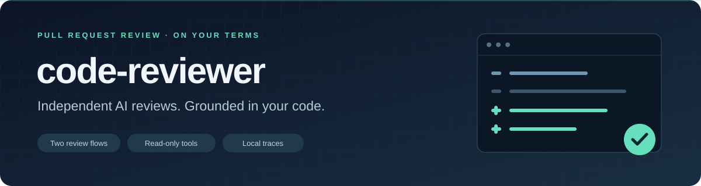
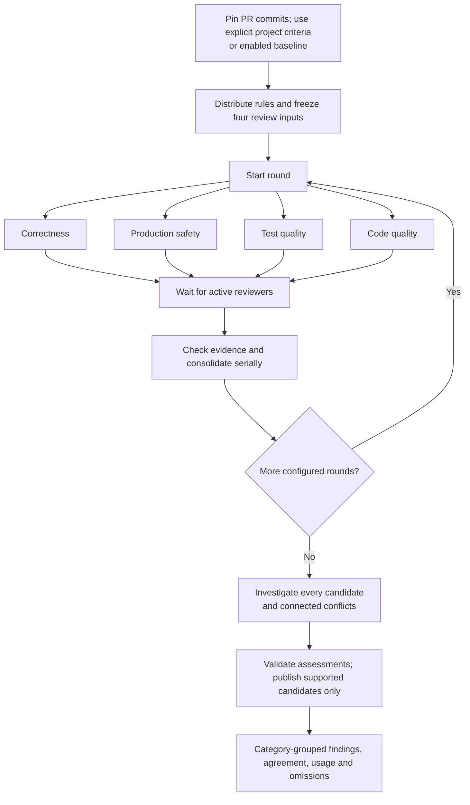

<p align="center">
  
</p>

# code-reviewer

[](pyproject.toml)
[](docs/llm.md)
[](docs/sandbox-architecture.md)
[](docs/tracing.md)

**One pull request. Four independent review perspectives.**

code-reviewer examines changes through the lenses of **correctness, production safety, test quality and code quality**. Each reviewer starts with its own focus and criteria, without seeing earlier findings. The harness checks repository evidence, consolidates duplicates and asks an independent Verifier to investigate every unique candidate before publication.

Choose Claude or OpenAI at runtime. Reviews run inside one jailed Firecracker VM by default; trusted use can explicitly select direct-host execution. Reports and metadata-only traces stay local unless you opt to post a PR summary. Review inputs—including PR text, diffs and files read during investigation—are sent to your selected model provider.

[Quick start](#quick-start) · [Review flow](#review-flow) · [Scope and limitations](#scope-and-limitations) · [Documentation](#documentation) · [Contributing](CONTRIBUTING.md)

## Review flow



A persona is a reviewer with one inspection focus. One pass runs each of the four perspectives once; criteria, consolidation and verification can make additional model calls. The default is **three passes per persona**, with up to four concurrent reviewers. `--passes N` sets rounds; `--parallel N` sets concurrency from 1 to 4. Each persona has its own budget. Exhausting one persona's pool does not stop the others. Agreement records repeated sightings, not proof of correctness; verification filters publication without changing original candidates, votes or severity.

Default criteria are assigned statically. Project rules come from the pinned base commit and are routed to every relevant persona. Reviewers and the Verifier have Read/Grep/Glob only: they cannot run tests, builds or arbitrary commands. Binary contents are omitted and reported. See [criteria](docs/persona-criteria.md) and [review contracts](docs/prompts.md).

## Quick start

### Install

Use Python 3.13 and install from a source checkout. For direct-host reviews, install Git and GitHub CLI (`gh`) and authenticate GitHub CLI for the repositories you want to review. Claude access also requires the Claude Code CLI. ChatGPT sign-in uses `/usr/bin/openssl`; the VM deployment supports compatible Apple Silicon Macs. See [access requirements](docs/llm.md) and [VM prerequisites](docs/sandbox-check.md#prerequisites).

```bash
git clone https://github.com/sskelkar/code-reviewer.git
cd code-reviewer
python3.13 -m venv .venv
source .venv/bin/activate
python -m pip install -e '.[tracing]'
reviewer --help
```

Keep the source checkout: role prompts and criteria load from `src/code_reviewer/review/`. The core uses the standard library; the tracing extra installs the optional Langfuse SDK. In each new terminal, run commands from this checkout. The examples activate `.venv` and invoke `reviewer` on one line; `&&` prevents execution if activation fails. See [running from another directory or through Python](docs/usage.md#running-from-a-new-terminal).

### Configure execution and authentication

VM execution requires a compatible Apple Silicon Mac, a dedicated mountless Lima Linux worker with nested virtualization and pinned Firecracker artifacts. Follow [VM setup](docs/sandbox-check.md#persistent-first-time-setup) and [operator configuration](docs/usage.md#vm-review-configuration). VM acquisition supports public github.com PRs; private in-VM source authentication is unsupported.

For a trusted repository, `--no-sandbox` explicitly runs acquisition and review on the host using your Git/GitHub access, without VM setup. Run `gh auth login` if GitHub CLI is not already authenticated. The reviewer can use an existing clone or acquire the PR itself. A VM failure never falls back to the host.

Choose [provider and authentication](docs/llm.md). Claude host subscription reviews can reuse the normal Claude Code SSO login:

```bash
claude  # complete your usual sign-in
source .venv/bin/activate && reviewer review OWNER/REPO#123 --no-sandbox --provider claude --auth subscription --model sonnet --passes 1
```

For an eligible ChatGPT subscription, sign into the selected execution identity. OpenAI defaults to `gpt-6-luna`; check account availability with `auth models`, or override it with `--model MODEL_ID`:

```bash
source .venv/bin/activate && reviewer auth login
source .venv/bin/activate && reviewer auth models
source .venv/bin/activate && reviewer review OWNER/REPO#123 --provider openai --auth subscription --passes 1
```

Add `--no-sandbox` to both authentication and review commands for host execution. API-key access is a separate billing choice; [LLM access](docs/llm.md#selecting-access) lists the credential variables and required OpenAI token rates. Credentials belong in the invoking environment or protected sign-in store, never Git or TOML. CLI overrides apply to one command; save your provider, authentication, model and execution choices in the external [operator configuration](docs/usage.md#configuration) to reuse them.

### Run and inspect

```bash
# After configuring your selected provider, authentication and execution location:
# Offline configuration only: no target, credential or model access.
source .venv/bin/activate && reviewer review OWNER/REPO#123 --preflight

# One review per perspective, at most two reviewers concurrently.
source .venv/bin/activate && reviewer review OWNER/REPO#123 --passes 1 --parallel 2
```

The CLI shows timed progress and verification-pending candidate counts, then prints the final summary and report path. Nothing is posted unless `--post` is supplied. Findings appear under **Correctness → Production safety → Test quality → Code quality**, sorted by severity within each section. Multi-category findings appear once and retain all labels.

`summary.md` and `report.md` show supported findings; `stats.json` records usage. Private `findings.json` contains the supported-only automation view and the full candidate audit, with pinned commits. VM runs export these four bounded files; host runs also retain prompts and per-call artifacts. See [report interpretation](docs/usage.md#reading-the-report).

Operator settings live outside Git, normally `~/.code-reviewer/review.toml`. Start from [example settings](review.example.toml), then use [configuration](docs/usage.md#configuration) for path/permission requirements. Add explicit [project review instructions](docs/usage.md#preparing-your-project-optional-recommended) through README/AGENTS review sections, dedicated review documents or review skills; these replace the baseline when present and are separate from operator settings.

## View review traces

Local Langfuse tracing is enabled by default. Complete [local setup](docs/tracing.md), then export the local project keys in your terminal:

```bash
. "$HOME/.code-reviewer/langfuse/local.env"
export LANGFUSE_PUBLIC_KEY LANGFUSE_SECRET_KEY
```

After a review, open its printed **Trace:** link or browse [local review traces](http://localhost:4000/project/reviewer/traces). Sign in with the local account described in the [tracing guide](docs/tracing.md#start-local-langfuse). The run's `stats.json` also records `tracing.url` and `tracing.trace_id`.

Traces contain stage/model/tool timing, retries and token/cache usage, excluding source, prompts and findings text. VM traces arrive after cleanup. Export failures do not fail reviews; local metadata remains available. Set `tracing = false` to opt out. See [missing traces](docs/tracing.md#missing-traces).

## Scope and limitations

- The public interface is a one-shot GitHub pull-request review command. Supported VM deployment uses a dedicated Lima worker on a compatible Apple Silicon Mac; in-VM acquisition accepts public github.com PRs. Private repositories use explicit host execution and the operator's GitHub access.
- Reviews inspect source, contracts and tests through read-only tools. They do not run target tests, builds or application code, measure query performance, or modify the PR.
- Final findings require a supported assessment. Model judgment can still be wrong; zero supported findings is not proof of correctness. Incomplete verification is reported explicitly. [Verification](docs/verification.md) explains the evidence and publication rules.
- Budgets and timeouts bound work, but provider usage can exceed an allowance before the harness observes it. The VM boundary controls access; it cannot revoke a copied credential or establish finding correctness.

Preflight checks configuration without fetching a target, inspecting runtime artifacts or reading credentials. Use the separate no-key [deployment check](docs/sandbox-check.md#command) to check VM boundaries and cleanup. Implemented paths and live qualification evidence are distinguished in [the roadmap](docs/proposal.md#qualification-evidence).

## Documentation

| Guide | Purpose |
|---|---|
| [Usage](docs/usage.md) | Commands, settings, reports and troubleshooting |
| [Architecture](docs/architecture.md) | Module ownership and review orchestration |
| [Code walkthrough](docs/project-explainer.md) | Method call chains, provider requests and VM handoffs |
| [Criteria](docs/persona-criteria.md) | Focus and default rules for each perspective |
| [Verification](docs/verification.md) | Structured evidence, supported-only publication and automation output |
| [Prompt contracts](docs/prompts.md) | Role inputs, outputs and deterministic validation |
| [LLM access](docs/llm.md) | Providers, authentication and usage accounting |
| [VM architecture](docs/sandbox-architecture.md) | Isolation, networking, transfers and cleanup |
| [VM deployment](docs/sandbox-check.md) | Setup, no-key checks and recovery |
| [Security contract](docs/security-contract.md) | Scope, guarantees and limitations |
| [Tracing](docs/tracing.md) | Local Langfuse setup and trace interpretation |
| [Development](docs/development.md) | Tests and implementation guidance |
| [Roadmap](docs/proposal.md) | Outstanding qualification and quality work |

Focused contributions are welcome; [CONTRIBUTING.md](CONTRIBUTING.md) explains bug reports, development setup, tests and pull requests.
