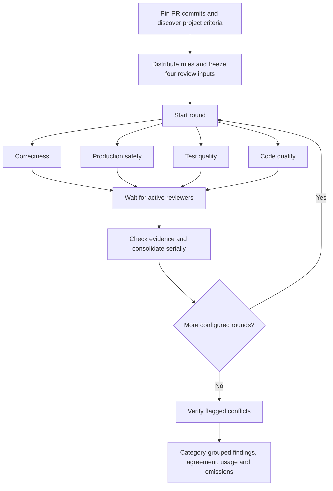

<p align="center">
  
</p>

# code-reviewer

[](pyproject.toml)
[](docs/llm.md)
[](docs/sandbox-architecture.md)
[](docs/tracing.md)

**One pull request. Four independent review perspectives.**

code-reviewer examines changes through the lenses of **correctness, production safety, test quality and code quality**. Each reviewer starts with its own focus and criteria, without seeing earlier findings. The harness checks repository evidence, consolidates duplicates and asks a Verifier to investigate flagged conflicts.

Choose Claude or OpenAI at runtime. Reviews run inside one jailed Firecracker VM by default; trusted use can explicitly select direct-host execution. Reports and metadata-only traces stay local unless you opt to post a PR summary.

[Quick start](#quick-start) · [Review flow](#review-flow) · [Documentation](#documentation) · [Contributing](CONTRIBUTING.md)

## Review flow



The default is **three passes per persona**, with up to four concurrent reviewers. `--passes N` sets rounds; `--parallel N` sets concurrency from 1 to 4. Each persona has its own budget. Exhausting one persona's pool does not stop the others. Agreement records repeated sightings, not proof of correctness; verification annotates conflicts without changing votes or severity.

Default criteria are assigned statically. Project rules come from the pinned base commit and are routed to every relevant persona. Reviewers and the Verifier have Read/Grep/Glob only: they cannot run tests, builds or arbitrary commands. Binary contents are omitted and reported. See [criteria](docs/persona-criteria.md) and [review contracts](docs/prompts.md).

## Quick start

### Install

Use Python 3.13. Host acquisition needs Git and GitHub CLI. ChatGPT sign-in uses `/usr/bin/openssl`.

```bash
git clone https://github.com/sskelkar/code-reviewer.git
cd code-reviewer
python3.13 -m venv .venv
source .venv/bin/activate
python -m pip install -e '.[tracing]'
reviewer --help
```

Keep the source checkout: role prompts and criteria load from `src/code_reviewer/review/`. The core uses the standard library; the tracing extra installs the optional Langfuse SDK.

### Configure execution and authentication

VM execution requires a compatible Apple Silicon Mac, a dedicated mountless Lima Linux worker with nested virtualization and pinned Firecracker artifacts. Follow [VM setup](docs/sandbox-check.md#persistent-first-time-setup) and [operator configuration](docs/usage.md#vm-review-configuration). VM acquisition supports public github.com PRs; private in-VM source authentication is unsupported.

For a trusted repository, `--no-sandbox` explicitly runs acquisition and review on the host using your Git/GitHub access. A VM failure never falls back to the host.

Choose [provider and authentication](docs/llm.md). Claude host subscription reviews can reuse the normal Claude Code SSO login:

```bash
claude  # complete your usual sign-in
reviewer review OWNER/REPO#123 --no-sandbox --provider claude --auth subscription --model sonnet --passes 1
```

For an eligible ChatGPT subscription, sign into the selected execution identity and choose a model from the account catalog:

```bash
reviewer auth login
reviewer auth models
reviewer review OWNER/REPO#123 --provider openai --auth subscription --model MODEL_ID --passes 1
```

Add `--no-sandbox` to both authentication and review commands for host execution. API-key access is a separate billing choice. Credentials belong in the invoking environment or protected sign-in store, never Git or TOML.

### Run and inspect

```bash
# Offline configuration only: no target, credential or model access.
reviewer review OWNER/REPO#123 --preflight

# One review per perspective, at most two reviewers concurrently.
reviewer review OWNER/REPO#123 --passes 1 --parallel 2
```

The CLI shows timed progress and provisional findings, then prints the final summary and report path. Nothing is posted unless `--post` is supplied. Findings appear under **Correctness → Production safety → Test quality → Code quality**, sorted by severity within each section. Multi-category findings appear once and retain all labels.

`summary.md`, `report.md` and `stats.json` contain the review and usage. VM runs export only these bounded files; host runs also retain prompts and per-call artifacts. See [report interpretation](docs/usage.md#reading-the-report).

Operator settings live outside Git, normally `~/.code-reviewer/review.toml`. See [example settings](review.example.toml) and [configuration](docs/usage.md#configuration). Preflight validates configuration, not deployment or account eligibility. Qualification evidence lives in [the roadmap](docs/proposal.md#qualification-evidence).

## View review traces

Local Langfuse tracing is enabled by default. Complete [local setup](docs/tracing.md), then export the local project keys in your terminal:

```bash
. "$HOME/.code-reviewer/langfuse/local.env"
export LANGFUSE_PUBLIC_KEY LANGFUSE_SECRET_KEY
```

After a review, open its printed **Trace:** link or browse [local review traces](http://localhost:4000/project/reviewer/traces). Sign in with the local account described in the [tracing guide](docs/tracing.md#start-local-langfuse). The run's `stats.json` also records `tracing.url` and `tracing.trace_id`.

Traces contain stage/model/tool timing, retries and token/cache usage, excluding source, prompts and findings text. VM traces arrive after cleanup. Export failures do not fail reviews; local metadata remains available. Set `tracing = false` to opt out. See [missing traces](docs/tracing.md#missing-traces).

## Documentation

| Guide | Purpose |
|---|---|
| [Usage](docs/usage.md) | Commands, settings, reports and troubleshooting |
| [Architecture](docs/architecture.md) | Module ownership and review orchestration |
| [Code walkthrough](docs/project-explainer.md) | Method call chains, provider requests and VM handoffs |
| [Criteria](docs/persona-criteria.md) | Focus and default rules for each perspective |
| [Prompt contracts](docs/prompts.md) | Role inputs, outputs and deterministic validation |
| [LLM access](docs/llm.md) | Providers, authentication and usage accounting |
| [VM architecture](docs/sandbox-architecture.md) | Isolation, networking, transfers and cleanup |
| [VM deployment](docs/sandbox-check.md) | Setup, no-key checks and recovery |
| [Security contract](docs/security-contract.md) | Scope, guarantees and limitations |
| [Tracing](docs/tracing.md) | Local Langfuse setup and trace interpretation |
| [Development](docs/development.md) | Tests and implementation guidance |
| [Roadmap](docs/proposal.md) | Outstanding qualification and quality work |

Focused contributions are welcome; start with [CONTRIBUTING.md](CONTRIBUTING.md). The supported frontend is the one-shot CLI. The retained REPL under `parked/` is outside the public command interface.
