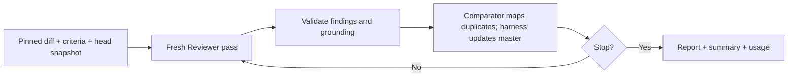
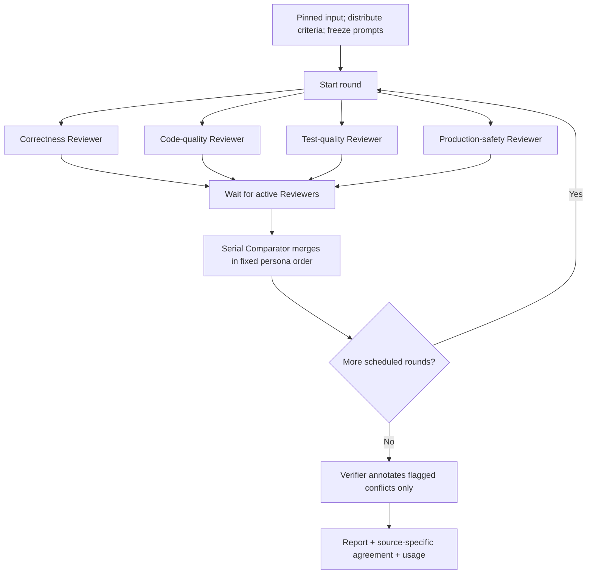

# code-reviewer

A one-shot pull request reviewer. It runs independent model passes, merges supported findings and reports how often each issue was found. Claude and OpenAI are runtime-selected adapters over the same review core.

**Current status:** both review strategies and VM/host dispatch are implemented. Offline tests and real no-key VM checks pass. Authenticated VM model calls, native tool behavior and live posting still need integration testing; review quality is judged manually. The REPL and comparator replay are parked, with code/tests retained.

[Quick start](#quick-start) · [Review flows](#review-flows) · [Results](#reading-the-results) · [Configuration](#configuration) · [Documentation](#documentation)

## Quick start

Python 3.9+ and an editable installation:

```bash
git clone https://github.com/sskelkar/code-reviewer.git
cd code-reviewer
python3 -m venv .venv
source .venv/bin/activate
python -m pip install --upgrade pip
pip install -e .
reviewer --help
```

Keep the source checkout and virtual environment: prompts/criteria load from the checkout. Runtime code uses the standard library plus `tomli` below Python 3.11.

Provider, strategy and execution location are independent:

```bash
reviewer review OWNER/REPO#123 --preflight
reviewer review OWNER/REPO#123 --passes 1
reviewer review OWNER/REPO#123 --mode agent-personas --passes 1
reviewer review OWNER/REPO#123 --provider openai --model MODEL_ID --passes 1
```

**VM is the default.** Configure the [dedicated Mac/Lima worker and credentials](docs/usage.md#vm-review-configuration) first. It fetches a public github.com PR inside one jailed Firecracker VM, pins the commits, runs the selected review strategy and returns private reports after cleanup/shutdown. Private source authentication is not implemented in VM mode. Missing setup refuses; it never falls back to the host.

For trusted direct-host execution, select it explicitly:

```bash
reviewer review OWNER/REPO#123 --no-sandbox --passes 1
reviewer review OWNER/REPO#123 --no-sandbox --dry-run
```

Host mode uses the operator's Git/GitHub CLI access and selected adapter credentials, plus a separate exported checkout. It avoids VM startup and supports repositories accessible to that GitHub account. It does not provide VM filesystem/kernel/network isolation.

`--preflight` and `doctor` only check configuration, with no target, credential, artifact or worker activity. `runtime_checked: false` prevents confusing configuration readiness with deployment verification. Bare `reviewer` shows help; it does not launch the parked REPL.

For the prepared VM deployment, `reviewer sandbox check --artifacts DIR --lima-home DIR --instance NAME` runs simulated reviews and real no-key boundary checks. It never calls a model. See [prerequisites, cleanup and recovery](docs/sandbox-check.md).

## Review flows

Both strategies pin base/head/merge-base once per run, review the merge-base-to-head diff and read a separate head snapshot. Project criteria come from the pinned base commit. Every Reviewer session is fresh and blind to earlier findings. **Models propose; Python validates evidence/replies, applies merges, accounts usage and writes reports.** The agent does not run project tests, builds or scripts.

### Single-agent



Default: 3–6 attempts; after at least three successful passes, two consecutive passes with no new findings can stop the loop. `--passes N` sets the maximum and lowers the minimum when needed. Budgets, failures and cancellation can stop earlier. Agreement is the share of completed passes that found an issue; one completed pass is unrated.

### Agent-personas



Default: three passes per persona, twelve scheduled slots. `--passes N` sets rounds; there is no quiet-pass stopping. `--parallel N` limits concurrent Reviewers to 1–4 (default 4). Failed or budget-exhausted personas can leave slots incomplete while others continue.

Defaults have static persona assignments; project rules are distributed once, with coverage checks and visible fallback. The Comparator merges duplicates, categorizes findings and flags possible conflicts. The targeted Verifier only annotates those groups: it never suppresses findings or changes severity/votes. Agreement stays per discovering persona, without a pooled confidence score.

Budget pools scale with the total cap: criteria 10%, Comparator 10%, Verifier 13⅓%, remainder equally among personas. Pools do not borrow. See [rounding, unknown costs and limits](docs/usage.md#persona-budget-pools).

## Reading the results

The terminal prints a shareable summary and report path. `summary.md`, `report.md` and `stats.json` contain findings, evidence, criteria, agreement and estimated usage. **Agreement does not establish correctness**; inspect findings yourself.

VM runs retain those three bounded files locally in a private directory; internal prompts/raw replies remain ephemeral. Host runs also retain detailed inputs, per-pass replies and mappings. See [report/storage details](docs/usage.md#reading-the-report).

Nothing is posted unless you supply `--post`. Posting uses the operator's host GitHub CLI after the review and creates or updates this tool's summary comment. Inline comments are not implemented.

## Configuration

Use `~/.code-reviewer/review.toml` or `reviewer --config /absolute/path/review.toml ...`. Configuration must be outside Git working trees; current-directory `review.toml` is ignored. The loader validates ownership, permissions, size and file type. Repository rules cannot select executables, credentials or execution location.

The [example TOML](review.example.toml) and [usage reference](docs/usage.md#configuration) describe all settings. OpenAI currently needs one explicit model ID across roles and positive operator token prices; its key comes from `OPENAI_API_KEY`. Native VM authentication explicitly selects API-key or OAuth credentials. Credentials never belong in TOML or command arguments.

## Scope and safety

The VM adds pinned runtime artifacts, jailer/systemd resource/deadline controls, non-root/no-new-privileges, read-only admitted input, external acquisition/inference networking and private bounded transfers. A compromised guest can falsify findings/accounting and expose its runtime credential. VM destruction does not revoke credentials; estimated budgets are not hard provider spending caps.

Current VM restrictions: compatible prepared Mac/Lima deployment, public github.com acquisition, 60–1800-second job deadline. `--local-path`, `--keep-checkout`, `--dry-run` and operator-file criteria manifests are host-only. Read the [execution contract](docs/security-contract.md) for the actual boundary.

## Development and roadmap

```bash
python3 -m unittest discover -s tests -t .
PYTHONPATH=src /usr/bin/python3 -m unittest discover -s tests -t .
```

Tests use synthetic repositories, fake executables and simulated model replies. They make no real model calls and do not boot VMs. Run the oldest and newest available supported Python before finishing a change.

Next: an authorized real PR review through the VM, then manual review-quality comparisons. REPL/replay restoration and other optional extensions are later work in the [proposal checklist](docs/proposal.md#checklist). No automated eval framework, per-persona VMs or distributed orchestration is maintained.

## Documentation

| Guide | Purpose |
|---|---|
| [Usage](docs/usage.md) | Commands, configuration, reports, storage and troubleshooting |
| [Architecture](docs/architecture.md) | Modules and actual review-flow diagrams |
| [VM architecture](docs/sandbox-architecture.md) | Launcher, worker, guest, credentials, networking and cleanup |
| [VM checks](docs/sandbox-check.md) | Prepared-worker prerequisites, no-key checks and recovery |
| [Execution contract](docs/security-contract.md) | Scope, enforced boundaries and limitations |
| [VM checklist](docs/sandbox-todo.md) | Completed checks and remaining live verification |
| [Proposal](docs/proposal.md) | Design decisions, experiment evidence and optional later work |
| [Development](docs/development.md) | Tests, debugging and contribution guidance |
| [Python walkthrough](docs/project-explainer.md) | Code explanations for Java developers |
| [Prompt contracts](prompts/README.md) | Canonical assets and harness validation |
