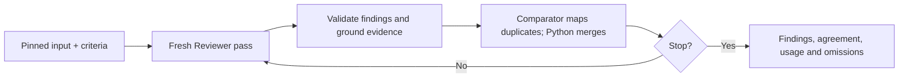
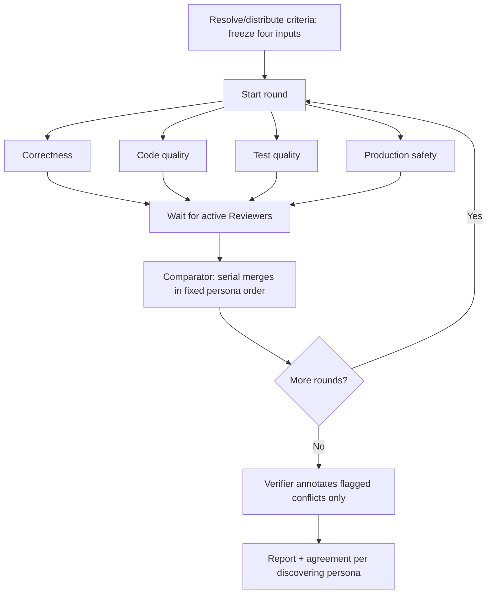

# code-reviewer

A one-shot Python CLI for independent, repeated pull-request reviews. Python validates evidence and model replies, merges duplicate findings and produces private reports. Claude and OpenAI adapters use the same review algorithms.

**Status:** both strategies, host/VM dispatch and a provider-neutral LLM interface are implemented. Claude API-key/subscription access and OpenAI API-key access are wired and tested with simulated providers. Successful live VM inference remains unverified. ChatGPT subscription login is the next implementation milestone; it is not a working flag today.

## Quick start

Python 3.9+, Git/GitHub CLI for host acquisition, and an editable installation:

```bash
git clone https://github.com/sskelkar/code-reviewer.git
cd code-reviewer
python3 -m venv .venv
source .venv/bin/activate
python -m pip install --upgrade pip
pip install -e .
reviewer --help
```

Keep the checkout: prompts and criteria load from it. Runtime dependencies are the standard library and `tomli` below Python 3.11.

Provider, authentication, strategy and execution location are independent:

```bash
reviewer review OWNER/REPO#123 --provider claude --auth subscription --preflight
reviewer review OWNER/REPO#123 --provider claude --auth subscription --passes 1
reviewer review OWNER/REPO#123 --provider claude --auth subscription --mode agent-personas --passes 1
reviewer review OWNER/REPO#123 --provider openai --auth api-key --model MODEL_ID --passes 1
```

Configure [credentials and adapter support](docs/llm.md) and the [persistent VM installation](docs/sandbox-check.md#persistent-first-time-setup) first. API keys use separate API billing; a ChatGPT subscription does not fund an API key. Claude subscription access uses a dedicated `CLAUDE_CODE_OAUTH_TOKEN` created through the supported enterprise/native flow. Tokens belong in the invoking environment, never TOML, arguments or Git.

**VM is the default.** One jailed Firecracker VM fetches a public github.com PR, pins commits, runs the selected strategy and returns bounded reports after cleanup. A mountless Lima worker supplies Linux/KVM on compatible Apple Silicon Macs. Private in-VM source authentication is unsupported. Failures never fall back to the host.

For trusted direct-host execution:

```bash
reviewer review OWNER/REPO#123 --no-sandbox --provider claude --auth subscription --passes 1
reviewer review OWNER/REPO#123 --no-sandbox --dry-run
```

Host mode uses the operator's Git/GitHub access and a separate exported checkout, without VM startup or VM isolation. Preflight and `doctor` inspect configuration only: no target, credentials, artifact or worker activity. Bare `reviewer` prints help.

## Review flows

Both flows use a pinned merge-base diff, criteria from the pinned base tip and a separate head snapshot. Reviewers are blind to earlier findings. Models have Read/Grep/Glob only; they never run tests, builds or arbitrary commands. Binary contents are omitted, with metadata and warnings in reports.

### Single-agent



Default: 3–6 attempts. After three successful passes, two consecutive passes without new findings can stop the loop. `--passes N` sets the maximum and lowers the minimum when necessary. Budget, failure and cancellation limits may stop earlier. One successful pass is unrated; repeated agreement is not proof of correctness.

### Agent-personas



Default: three passes per persona; `--passes N` sets rounds, without quiet-pass stopping. `--parallel N` limits concurrent Reviewers to 1–4. Exhaustion of one persona's budget does not stop the others. The Comparator merges duplicates, categorizes and flags conflicts. Verification does not suppress findings or change severity/votes.

Allocation pools scale with the total cap: criteria 10%, Comparator 10%, Verifier 13⅓%, remainder equally among personas; no borrowing. Dollar values are estimated allowances, not hard provider caps or subscription balances. Token/pass/time/concurrency limits remain relevant with subscription access.

## Results and configuration

The CLI prints a shareable summary and report path. `summary.md`, `report.md` and `stats.json` contain findings, criteria, agreement, omissions, usage and safe HTTP diagnostics. VM runs export only these three bounded private files; host runs also retain inputs and per-call artifacts. Nothing is posted unless `--post` is supplied.

Use `~/.code-reviewer/review.toml` or `reviewer --config /absolute/path/review.toml …`. Configuration must be outside Git working trees and pass ownership/permission/type/size checks; current-directory `review.toml` is ignored. See [example settings](review.example.toml), [usage](docs/usage.md) and [LLM selection](docs/llm.md).

The VM enforces read-only admitted code, non-root/no-new-privileges, jailer/systemd limits, external egress policy and private transfers. It cannot prove model findings, prevent exposure of a copied runtime token, or enforce provider billing. See the [execution contract](docs/security-contract.md).

## Development and next work

```bash
python3 -m unittest discover -s tests -t .
PYTHONPATH=src /usr/bin/python3 -m unittest discover -s tests -t .
```

Tests use synthetic Git repositories, fake executables and simulated providers; no real credentials, networking or VM boots. Check actual deployment separately with `reviewer sandbox check`; it performs no inference. Run the oldest and newest available supported Python before finishing changes.

Next: implement reviewer-owned ChatGPT consent/streaming, then qualify subscription-backed inference through the VM and compare review quality manually. REPL/replay remain in `parked/`, disconnected from the CLI. No eval framework, distributed scheduler or per-persona VMs are maintained.

## Documentation

| Guide | Purpose |
|---|---|
| [Usage](docs/usage.md) | Commands, settings, reports, limits and troubleshooting |
| [LLM interface](docs/llm.md) | Contract, adapter/authentication matrix, credentials and remaining subscription work |
| [Architecture](docs/architecture.md) | Ownership and review-flow diagrams |
| [VM architecture](docs/sandbox-architecture.md) | Launcher, worker, guest, networking and cleanup |
| [VM deployment](docs/sandbox-check.md) | Persistent setup, no-key checks and recovery |
| [Execution contract](docs/security-contract.md) | Scope and actual guarantees |
| [Plan](docs/proposal.md) | Checklist, decisions, evidence and optional later work |
| [VM checklist](docs/sandbox-todo.md) | Deployment evidence and unverified live behavior |
| [Development](docs/development.md) | Tests and debugging |
| [Python walkthrough](docs/project-explainer.md) | Reading this code as a Java developer |
| [Prompt contracts](prompts/README.md) | Canonical assets and harness validation |
