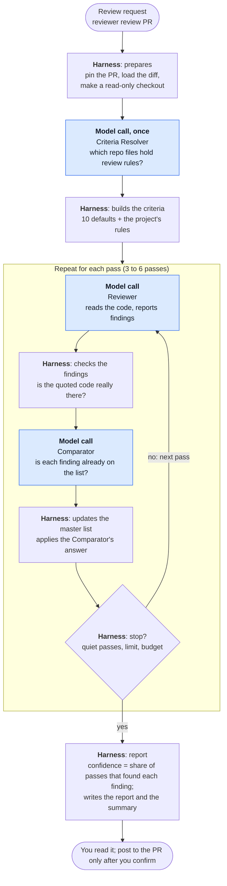
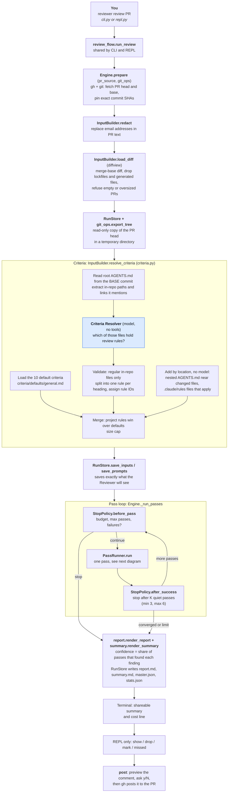
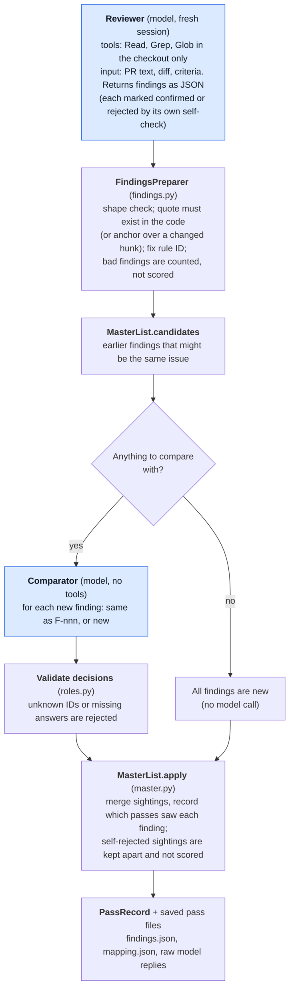

# code-reviewer

A multi-pass pull request review agent. It runs several **independent** review passes over a GitHub pull request with Claude Code in headless mode, merges the results, and scores each finding by how many passes found it. The output is a Markdown report with findings, token usage and cost. If you choose, it posts a summary comment on the PR after you confirm.

**Where to start**

| I want to... | Go to |
|---|---|
| Review a pull request with this tool | [Part 1: Using the agent](#part-1-using-the-agent) |
| Change or extend this tool | [Part 2: Contributing](#part-2-contributing) |
| Understand the code (written for Java developers new to Python) | [docs/project-explainer.md](docs/project-explainer.md) |
| Understand why it is designed this way | [proposal.md](docs/proposal.md) (short) or [proposal-full.md](docs/proposal-full.md) (detailed) |

Status: v0. The code is covered by automated tests that use a fake Claude. `reviewer doctor --live` has been run against the real Claude Code CLI (Haiku): the flags work with an enterprise login, the planted `CLAUDE.md` and project hook are ignored, a file outside the working directory could be neither read nor searched (Claude Code itself denied the attempts), and the JSON reply has the shape the parser expects. Multi-pass reviews of a real GitHub PR (fetching, criteria discovery, review, summary and report) have been run. **Posting a comment** to a PR has not been exercised yet. Section [Your first run](#your-first-run) is the way to try it.

---

# Part 1: Using the agent

## What it does

For a pull request you point it at:

1. It pins the PR to exact commits and reads the diff, the PR title, description and commit messages.
2. It loads review criteria: generic defaults plus the reviewed project's own criteria, if the project describes them in its `AGENTS.md`.
3. It runs several review passes. Each pass is a fresh Claude session that has never seen the other passes, and each is asked to review the **whole change thoroughly**: go through every changed block and every claim the change makes (every documented response, field, example or default, every changed branch), verify it against the actual code, and report **every** issue it can support, not just the most important one. A pass can read the code in a read-only checkout, but it cannot run commands or change anything.
4. It verifies each finding's evidence mechanically (the quoted code must exist), merges duplicates across passes, and scores confidence as the share of passes that found a finding.
5. It stops when extra passes stop finding anything new, or at a pass or budget limit, then prints a shareable review summary and saves a detailed report next to it.

Findings are advisory. Treat the confidence score as a hint, not a verdict, and use `mark` (below) to record which findings were right so you can judge how much to trust the tool.

## Prerequisites

| Need | Details |
|---|---|
| Python | 3.9 or newer. On 3.9 and 3.10 the package `tomli` is also needed; `pip install` pulls it in. |
| git | Any recent version. |
| GitHub CLI `gh` | Logged in (`gh auth login`) with read access to the repositories you review. To post comments, your account must be allowed to comment on the PR. For a company-hosted GitHub, log in to that host with `gh` too. |
| Claude Code `claude` | Installed and logged in (run `claude` once interactively). The agent calls `claude -p` with your login. |
| Permission | Your company must allow sending the reviewed code to Claude through that login (see [Privacy and safety](#privacy-and-safety)). |

## Install

```bash
git clone https://github.com/sskelkar/code-reviewer.git
cd code-reviewer
python3 -m venv .venv
source .venv/bin/activate
python -m pip install --upgrade pip      # needed on Python 3.9, whose bundled pip cannot do an editable install from pyproject.toml
pip install -e .
reviewer --help
```

Install it **editable** (`-e`), and keep the cloned directory. v0 reads its prompts and default criteria from the checkout, not from the installed package. If you must move or install it elsewhere, set `CODE_REVIEWER_HOME` to the checkout path.

You need the virtual environment active (`source .venv/bin/activate`) whenever you run `reviewer`.

### Check the environment

```bash
reviewer doctor          # fast, free: checks claude, gh, git, flags, prompts, default criteria
reviewer doctor --live   # also makes ONE small real Haiku call (a few cents)
```

`doctor --live` verifies the things the agent depends on and cannot be tested offline: that the isolation flags work with your login, that only the Read, Grep and Glob tools are available (plus `StructuredOutput`, an internal Claude Code tool through which the model returns its JSON answer; it cannot read, write or run anything), that a `CLAUDE.md` and a hook planted in the checked-out project are ignored, that a file placed **outside** the working directory cannot be read or searched (so a review pass could not reach anything outside its checkout),  and that Claude reports cost and tokens. It saves the raw JSON reply to `~/.code-reviewer/doctor-last.json`. If any line says `FAIL`, fix it before reviewing real code ([Troubleshooting](#troubleshooting)).

## Your first run

Do these in order. Together they cost a few dollars at most.

1. `reviewer doctor --live` (above).
2. Pick a **small** PR, ideally one you already know well, in a repository you can read.
3. Optional but recommended: see exactly what the reviewer would be given, without calling the model:
   ```bash
   reviewer review https://github.com/OWNER/REPO/pull/123 --dry-run
   ```
   It prints the PR title, description and commit messages, the diff size, the tools and the command, and saves the exact prompts.
4. Run a single pass to see the whole flow cheaply:
   ```bash
   reviewer review https://github.com/OWNER/REPO/pull/123 --passes 1
   ```
5. Read the review summary it prints, then open the full report (its path is printed last) and the files next to it, especially `pass-01/reviewer.raw.json` and `pass-01/findings.json`. Check that findings have real quotes, that the cost line is filled in, and that the criteria section lists what you expect.
6. Only then run a full review (default up to 6 passes).

## Reviewing a pull request

### Interactive (recommended)

Start the REPL inside the project you want to review. It then uses your local clone, so nothing large is downloaded.

```bash
cd ~/code/my-service
source ~/code/code-reviewer/.venv/bin/activate
reviewer
reviewer> review https://github.com/my-org/my-service/pull/123
```

On start the prompt shows a welcome banner that lists every command, grouped by when you use them. You can also write `owner/repo#123`. While a review runs it prints one line per stage and pass:

```
[00:04] diff: 12 files, 340 changed lines (2 excluded)
[00:09] criteria: 10 default + 6 project rules from 3 files, 1 ignored references
[00:41] pass 1: 5 new, 0 matched, 0 ungrounded · $0.17 · quiet streak 0/2
...
[07:12] converged after 4 passes
```

The `review` command takes the [review options](#review-options) below, for example `review <url> --passes 1`. Type `review --help` in the prompt to see them.

If the PR belongs to a different repository than your current directory, it asks first and then uses a cached clone under `~/.code-reviewer/cache/`. Outside any git repository it does the same.

When the review ends it prints the **review summary**: the findings, in exactly the text that `post` would send as a PR comment, so you can read it, copy it, or post it. Below it come one line about the run (passes, why it stopped, cost) and the path of the **full report**, which is there for digging into what the agent did. Then you can use these commands:

| Command | What it does |
|---|---|
| `show F-007` | Full detail of one finding |
| `mark F-007 real\|nit\|wrong` | Record your judgment. Saved in the run directory (`labels.json`) so you can judge how much to trust the tool |
| `missed "no length check in create()"` | Record a real issue the agent did not find |
| `drop F-007` / `undrop F-007` | Exclude a finding from the comment you may post |
| `post [--tiers High,Medium,Low]` | Preview the PR comment (the review summary), then post it **only if you answer `y`** |
| `summary [--tiers High,Medium]` | Show the review summary again, with your `drop`s applied. `--tiers` filters by confidence; by default all tiers are shown |
| `open` | Open the full report file |
| `help`, `quit` | |

Ctrl-C during a review stops the current call and gives you a report from the passes that finished.

### One-shot (scripts)

```bash
reviewer review https://github.com/my-org/my-service/pull/123 [--passes 4] [--model sonnet] [--no-self-check] [--keep-checkout] [--verbose] [--local-path DIR] [--post]
```

In a terminal it first prints a short banner with this run's settings and the options you can add (it is not printed when output is piped or redirected, so scripts and CI logs stay clean). It then prints the review summary, one line about the run and the path of the full report, and exits (non-zero if the review failed). It **never posts** unless you pass `--post`, which is your explicit authorization. `reviewer review --help` lists every option.

### Review options

These work the same in the interactive prompt (`review <url> ...`) and the one-shot command (`reviewer review <url> ...`). The same text is shown by `reviewer review --help` and the prompt's `review --help`.

| Option | Meaning |
|---|---|
| `--passes N` | Maximum number of review passes (a whole number, 1 or more). Default is `max_passes` from your settings (6). The review can still stop earlier, once at least `min_passes` have run and two in a row find nothing new. `--passes 1` runs exactly one pass, which is the cheap way to try the tool. A value below `min_passes` (3) lowers it to match, so `--passes 2` runs at most 2 |
| `--model NAME` | Model for all three roles, an alias such as `haiku` or `sonnet`, or a full model name. Default: the `model_*` settings (`haiku`) |
| `--no-self-check` | Skip the phase where the reviewer tries to refute its own findings. Cheaper, but findings are not double-checked |
| `--keep-checkout` | Keep the temporary read-only checkout so you can inspect exactly what the reviewer saw. Its location is printed. It is in a temporary directory outside the run directory; delete it when done. Otherwise it is deleted when the run ends, even if the run fails |
| `--dry-run` | Show exactly what the reviewer would be given and stop: the PR title, description and commit messages, diff size, criteria, tools and the `claude` command. **No model is called, nothing is posted and no checkout is created.** The exact prompts and the PR text are saved under the run's `input/`. The project's own criteria need a model call to resolve, so a dry run includes only the default rules. Cannot be combined with `--post` |
| `--verbose` | Print extra progress detail (which model is being called, how many findings are being compared) |
| `--post` | **One-shot only.** Post the summary comment to the PR when the review finishes. Nothing is posted without it. In the interactive prompt use the `post` command instead |
| `--local-path DIR` | **One-shot only.** Local clone to use as the git object store. Default: the current directory, if it is a clone of the same repository; otherwise a cached clone is used |
| `--config PATH` | **Goes before the subcommand:** `reviewer --config PATH review <url>` (or `reviewer --config PATH` to start the prompt). Settings file to use instead of `./review.toml` or `~/.code-reviewer/review.toml` |

Options override the settings file for that run only. Everything else (budgets, thresholds, criteria mode, ...) is set in [Configuration](#configuration).

### Posting a comment

`post` (REPL) or `--post` (one-shot) writes a single comment containing exactly the review summary the tool printed (what you see is what gets posted), at the chosen confidence levels (default: High, Medium and Low; change it with the `post_tiers` setting or `post --tiers`), labeled as AI-generated, with the commit reviewed and the pass count. It only ever creates or updates one comment per PR from this tool (it recognizes its own hidden marker), so re-running replaces the earlier comment instead of adding more. Inline per-line comments are not supported yet.

## Reading the report

The review summary printed at the end is also saved as `summary.md` in the run directory. It is short and meant to be shared. `report.md` is the long version for digging in: what the agent was given, what it ignored, cost, and the details of every pass. It contains:

| Section | What it tells you |
|---|---|
| Header | PR, commits reviewed, models, passes completed, why it stopped, diff size, estimated cost |
| Criteria applied | Default and project rules used, project criteria files, references that were ignored (for example a wiki link), warnings (for example "this PR modifies the criteria files") |
| Overview | Finding counts by confidence tier and severity |
| High / Medium / Low confidence | Findings. Confidence is the share of completed passes that found it (needs at least two completed passes; with one pass the section is **"Findings, unrated"** instead): **High** at 75% or more, **Medium** at 40% or more, **Low** below. Each finding shows `file:line`, the criterion it falls under (by name and source), the evidence, a suggestion and "seen in x/N passes" |
| Rejected by self-check | Findings the model raised and then refuted itself. Not scored, shown for transparency |
| Appendix | New findings per pass (the discovery curve), pass-to-pass overlap, per-role and per-pass tokens and cost, and counters for findings dropped because their evidence could not be verified, and for rule citations that were repaired or unknown |

How to read it:

- A finding that every pass found is much more likely to be real than one found once, but it is still not guaranteed. **Overlap near 1.00** means the passes behaved almost identically, so confidence tells you little.
- **Mostly Low findings does not mean they are wrong.** In an early run on a small PR, six passes each reported a different, valid issue, so every finding was Low. Passes explore different code paths, so independent passes complement each other. Read all findings (Low included) and judge them yourself with `mark`; the appendix shows how many findings each pass raised, and the notes in `pass-NN/findings.json` show what each pass did and did not verify. Scoring by an independent verification step is planned (see the roadmap in [docs/proposal.md](docs/proposal.md)).
- **Duplicates are merged by a model, and merging is not checking.** The Comparator compares each pass's findings with the findings of earlier passes (and with each other) and merges those that report the same issue, so one problem is not listed several times. Borderline cases can go either way: one issue may still appear as two or three findings (the "variants" in the report show the other wordings), and occasionally two related issues are merged. The Comparator only decides whether findings are the *same*, never whether they are *true*. A wrong finding that several passes repeat is merged into one finding with high confidence. A separate step that tests each finding against the code is planned (the Verifier, see the roadmap).
- **One pass cannot rate confidence.** After a single pass (for example `--passes 1`, or a run that stopped early) every finding was found by "1 of 1" passes, which would score 100% and mean nothing. Those findings are shown as **unrated** and a posted comment labels them the same way. Run two or more passes to get High, Medium and Low.
- Findings are only kept if their evidence checks out: an exact quote that exists in the code, or, for "something is missing", an anchor on a changed hunk. Unverifiable findings are counted in the appendix and dropped.
- Cost figures are Claude Code's estimates and may not match your billing.

## Preparing your project (optional, recommended)

The agent applies two sets of criteria:

- **Defaults**: generic, language-agnostic rules shipped with the agent ([criteria/defaults/general.md](criteria/defaults/general.md)).
- **Project criteria**: your project's own rules. **Project rules take precedence** when they cover the same concern (the model is instructed to follow them).

To make your project's rules visible, describe where they are in the **`AGENTS.md` at the repository root**. There is no required format; the agent reads it and works out which files hold criteria. For example:

```markdown
# AGENTS.md

## Build
Run `make test`.

## Code review criteria
Reviewers and AI agents must apply the rules in:
- [Error handling](docs/review/errors.md)
- [Security](docs/review/security.md)
- Every file under `docs/review/api/`
```

Rules of the road:

- **Only files inside the repository count.** Links to a wiki, Confluence or any URL, absolute paths and paths outside the repo are ignored, and the report lists what was ignored.
- **Criteria are read from the PR's target (base) branch,** not the PR itself. A PR that edits the rules is still judged by the old ones, and the report flags that the PR touches them.
- **Write rules as Markdown headings.** Each heading becomes a citable rule ID such as `P:docs/review/errors.md#retry-policy`. A file with no headings becomes one rule.
- **Keep it small.** About 200,000 characters (roughly 50,000 tokens) of project criteria are used; the rest is dropped with a warning.
- **Some files are added automatically,** because where they apply is clear from their location. You do not need to link them from the root `AGENTS.md`:
  - an `AGENTS.md` in a directory that contains a changed file, or in one of its parent directories (for a change under `spec/controllers/`, both `spec/AGENTS.md` and `spec/controllers/AGENTS.md`);
  - every `.claude/rules/*.md` file, except those with a `paths:` list in their front matter that matches none of the changed files (such a file is scoped to those paths on purpose).
  The report lists them with the reason each was added.
- Without a root `AGENTS.md`, or if nothing in it resolves, the files above and the defaults are still used, and the report says so.

The ten defaults cover correctness, simplicity, clarity and contract documentation, security/privacy, bounded input validation, failure/resource handling, data integrity/concurrency, internal contracts, test coverage/test levels, and test independence/mocking. Each rule states what to inspect, when to report and what not to report, using repository-visible evidence. They do not include generic architecture or performance review requirements. The system prompt still owns finding scope, evidence fields, self-checks and JSON output; project rules take precedence.

The current criteria are numbered `GEN-001` through `GEN-010` in checklist order. Saved runs retain their original criteria; compare the saved criteria blocks/indexes as well as prompt hashes when evaluating runs. The revised defaults are tested for loading and delivery to the Reviewer, and have been used on real pull requests, but no before/after comparison of review quality exists. Reports and the PR comment name each criterion by its title and source; the IDs stay internal.

### Customizing the default rules

Edit [criteria/defaults/general.md](criteria/defaults/general.md). Each rule is a heading of the form `## [GEN-011] Title` followed by the rule text. The ID is what findings cite. To turn rules off for your runs, list them in `disabled_default_rules`, or set `criteria_mode` to `project_only` or `defaults_only`.

## Configuration

Settings come from a TOML file, first found of: `--config PATH`, `./review.toml` (current directory), `~/.code-reviewer/review.toml`. Copy [review.example.toml](review.example.toml) and change what you need; every key is optional. Unknown keys are rejected so typos do not pass silently.

| Setting | Default | Meaning |
|---|---|---|
| `model_reviewer`, `model_comparator`, `model_resolver` | `haiku` | Model alias or full name for each role (for example `sonnet`). The comparator decides which findings from different passes are the same issue. Haiku is cheap (about $0.0006 per comparator call) but can be inconsistent on borderline duplicates. Sonnet merged consistently in replays but more aggressively, and costs roughly 15 times more for this step (about $0.01 per call, so about $0.06 for a 6-pass review). Measure with `python -m code_reviewer.replay`. |
| `self_check` | `true` | The Reviewer tries to refute its own findings before answering |
| `criteria_mode` | `merge` | `merge`, `project_only` or `defaults_only` |
| `criteria_manifest` | `""` | Path to a JSON file that replaces the criteria resolver's answer (reproducible experiments) |
| `disabled_default_rules` | `[]` | Default rule IDs to switch off |
| `min_passes`, `max_passes` | `3`, `6` | Passes always run / at most run |
| `quiet_k` | `2` | Stop after this many consecutive passes with no new finding (after `min_passes`) |
| `max_consecutive_failures` | `2` | Abort after this many failed passes in a row |
| `tier_high`, `tier_medium` | `0.75`, `0.40` | Confidence tier thresholds |
| `max_diff_lines` | `3000` | Refuse PRs with more changed lines (after exclusions) |
| `exclude_patterns` | lockfiles, minified, generated, `vendor/`, `node_modules/`, ... | Files left out of the diff (this list replaces the built-in one) |
| `extra_exclude_patterns` | none | Added to `exclude_patterns` without replacing it. Use it for planning documents such as PRDs and implementation plans (the author's claims, which may drift from the code): `["docs/prds/", "docs/plans/"]`. They are left out of the prompt but listed by path, the reviewer can still open them in the checkout, and findings located in excluded files are dropped and counted. Keep public-facing documentation (API and event docs) out of this list: it must stay reviewed |
| `criteria_max_chars` | `200000` | Cap on project criteria text |
| `call_budget_usd`, `call_timeout_s` | `0.50`, `600` | Spend and time cap for every single Claude call |
| `run_budget_usd`, `run_budget_tokens` | `3.00`, `2000000` | Caps for a whole review; it stops between passes once either is exceeded. The token cap counts new input, output and cache-write tokens only. **Cache reads are not counted**: a many-turn review re-reads the same cached context every turn, which adds up to hundreds of thousands of tokens but costs very little. The dollar cap is the real spending limit |
| `isolation_flags` | `--safe-mode`, `--restricted` | Claude Code flags that keep the Reviewer isolated from your local setup. Do not remove unless you know why |
| `claude_bin` | `claude` | Path or name of the Claude Code binary |
| `post_tiers` | `["High","Medium","Low"]` | Confidence tiers shown in the review summary and included in a posted comment. Single-pass (unrated) findings are always included |
| `redact_emails` | `true` | Replace email addresses in the PR title, description and commit messages with `[email]` before they are sent to the model. The diff and repository files are not redacted. Set to `false` to send PR text as written |
| `runs_dir` | `""` | Where runs are stored (default `~/.code-reviewer/runs`) |
| `candidate_window`, `candidate_all_threshold`, `candidate_max`, `grounding_line_window` | `20`, `30`, `40`, `30` | Tuning for duplicate matching and line-number tolerance. Rarely needed |

Environment variables: `CODE_REVIEWER_HOME` (location of the checkout containing `prompts/` and `criteria/`), `CODE_REVIEWER_DATA` (replaces `~/.code-reviewer` for runs, cache and config).

## Where things are stored, and cleaning up

| Path | Contents |
|---|---|
| `~/.code-reviewer/runs/<time>_<repo>_<pr>/` | One review: `summary.md` (the shareable summary), `report.md` (the detailed report), `master.json`, `stats.json`, `labels.json` (your marks), `config.json` (settings, prompt hashes, versions), `input/` (the PR text as fetched `pr.json`, the exact reviewer prompts `reviewer.system.md` and `reviewer.user.md`, the diff, the criteria used), `pass-NN/` (raw Claude output, findings, merge decisions) |
| `~/.code-reviewer/cache/` | Bare clones used when you review a repository other than the current one |
| `<system temp dir>/code-reviewer-checkout-*/` | The reviewer's read-only checkout of the PR, **outside the run directory** so nothing the run produced (earlier passes' findings, reports) is next to it. Deleted when the run ends unless `--keep-checkout` |
| `refs/code-reviewer/*` in your local clone | The PR head and base commits fetched for a review. Your branches and working tree are never changed |
| `~/.code-reviewer/doctor-last.json` | Raw reply from `reviewer doctor --live` |

The temporary checkout is deleted when the run ends, even if the run fails (keep it with `--keep-checkout`). To clean up, delete run directories you no longer need. To remove the fetched refs from a clone:

```bash
git for-each-ref --format='%(refname)' refs/code-reviewer | xargs -n1 git update-ref -d
```

## Cost, time and limits

- Each pass is a full agent run, so a review takes minutes per pass and several passes (passes run one after another). Every run reports its own tokens and estimated cost, and the budget settings above cap the spend. For scale: on a 2,100-line diff with a large set of project criteria (about 85,000 tokens of prompt), the first Haiku reviewer pass cost about $0.19 (it writes the prompt cache) and later passes $0.05-0.07 each, taking about a minute each; a six-pass review cost under $0.50. Cost grows with the size of the prompt (diff plus criteria), the number of tool turns, and the model's thinking tokens. Keeping planning documents out of the diff (`extra_exclude_patterns`) and keeping the criteria small both cut it.
- Only GitHub pull requests are supported (no local-branch mode yet).
- Diffs above `max_diff_lines` are refused rather than reviewed badly. Lockfiles, vendored and generated files do not count.
- The tool does not run tests, linters or builds. Your pipeline still owns those.
- `claude -p` in the installed CLI has no turn limit flag, so calls are bounded by the per-call spend cap and timeout instead.

## Privacy and safety

- **What is sent to Claude:** the PR title, description and commit messages, the diff, the criteria text, and any repository files the Reviewer reads. It goes through your Claude Code login. Make sure your company policy allows that for the repository, and do not point the agent at repositories or PRs containing customer, rider or other personal data.
- **What the Reviewer can do:** read files in a separate checkout of the PR. It cannot run commands, edit files, use the network or load your local Claude configuration (skills, hooks, MCP servers, `CLAUDE.md`). The checkout lives in its own temporary directory, away from the run's files, so even if the file restrictions failed it could not find earlier passes' findings next to it. `reviewer doctor --live` checks that these restrictions hold, including that a planted file outside the working directory cannot be read or searched.
- **What the Reviewer cannot see:** pull request comments, review threads, issue comments, other reviewers' or bots' reviews, and other passes' findings. It is given only the PR title, description and commit messages, the diff, the criteria and the checkout. The tool fetches only an allow-list of PR fields from GitHub for the review (a test fails if comments are ever added to it). Posting a comment separately lists the PR's comments to find the tool's own earlier one; that list is never given to the model. Use `reviewer review <url> --dry-run` to see exactly what would be sent, and `input/pr.json` and `input/reviewer.*.md` in a run to see what was sent.
- **Personal data in PR text:** email addresses in the PR title, description and commit messages are replaced with `[email]` before anything is sent (setting `redact_emails`, on by default; `git@host:` clone addresses and version strings such as `lodash@4.17.21` are left alone). This covers **only** emails in the PR text. Names, chat links (for example Slack URLs) and anything in the diff or repository files are sent as they are. `--dry-run` shows the text exactly as it would be sent, and `input/pr.json` records what was sent and how many addresses were replaced.
- **Untrusted PR text:** the PR description and code are treated as data and the model is told never to follow instructions found in them. That reduces the risk of prompt injection but cannot eliminate it. Read findings critically.
- **Nothing outward-facing happens without you:** the only action on GitHub is `post`, after a preview and your confirmation (or the explicit `--post` flag).
- **Not done in v0:** secret scanning of the diff, and filtering of what the Reviewer may read inside the checkout. See [proposal.md](docs/proposal.md) section 5.

## Troubleshooting

| Symptom | Cause and fix |
|---|---|
| `reviewer: command not found` | The virtual environment is not active: `source .venv/bin/activate` in the code-reviewer directory |
| `pip install -e .` says editable mode requires a setuptools-based build | Old pip. Run `python -m pip install --upgrade pip` first |
| `config error: ... needs Python 3.11+ or the 'tomli' package` | Run `pip install tomli`, or reinstall with `pip install -e .` |
| `doctor`: `claude is installed` fails | Install Claude Code, or set `claude_bin` in `review.toml` |
| `doctor`: required flags missing | Your Claude Code is too old or different. Compare `claude --help` with `isolation_flags` and the flags in `src/code_reviewer/claude_cli.py` |
| `doctor --live`: a tool other than Read, Grep, Glob and `StructuredOutput` is available, the canary or hook was not ignored, or a file outside the working directory could be read or searched (`LEAK`) | Isolation is not working. Do not review untrusted PRs until this is fixed. (`StructuredOutput` is expected: it is how the JSON answer is returned.) |
| `error: gh ... failed` | Run `gh auth status` and `gh auth login`. Check you can read the repository. For a company-hosted GitHub, log in to that host |
| `error: ... refusing to review` | The diff exceeds `max_diff_lines`. Review a smaller PR or raise the limit |
| `error: ... no reviewable changes` | Every changed file matches `exclude_patterns` or `extra_exclude_patterns` |
| `pass N FAILED: ... timed out` or `not a valid JSON object` | Look at `pass-NN/reviewer.raw.json` in the run directory. Raise `call_timeout_s` or `call_budget_usd`, or try another model |
| `pass N FAILED` mentioning budget | The call hit `call_budget_usd`. Raise it, or review a smaller PR |
| Many findings counted as ungrounded | See the `reason` of each in `pass-NN/findings.json`. The model may be quoting from memory. Try `--model sonnet` |
| Warning: criteria resolver failed | The review continued with default criteria only. See `input/resolver.raw.json` |
| Every pass reports only one finding, or findings are all Low | Passes may stop early or pick a different issue each time. Check `notes` in each `pass-NN/findings.json` for what the pass verified and what it left "unverified", and compare the number of findings per pass in the report's appendix. See [Reading the report](#reading-the-report) |
| No findings at all | May be correct. Check `notes` in `pass-NN/findings.json` and compare with the diff. Try `--model sonnet` |
| `post` fails | You need permission to comment on the PR, and `gh` must be logged in as that user |

---

# Part 2: Contributing

New to Python? Read [docs/project-explainer.md](docs/project-explainer.md) first. It explains where the program starts, which libraries are used, and every Python construct in this code (decorators, dataclasses, duck typing, the little inheritance there is) with Java equivalents.

## Development setup

```bash
git clone https://github.com/sskelkar/code-reviewer.git
cd code-reviewer
python3 -m venv .venv && source .venv/bin/activate
python -m pip install --upgrade pip
pip install -e .
python3 -m unittest discover -s tests -t .
```

There are no third-party runtime dependencies (only `tomli` on Python below 3.11) and no test dependencies; the tests use the standard `unittest` module. The tests need no network, no model and no GitHub.

Supported Python is 3.9 and up. Before sending a change, run the tests on the oldest and newest Python you have (for example `python3.9 -m unittest discover -s tests -t .` and `python3.13 -m unittest discover -s tests -t .`). There is no CI yet.

## Repository layout

```
code-reviewer/
  README.md  AGENTS.md  pyproject.toml  review.example.toml     AGENTS.md: working rules for AI agents
  docs/                             HANDOVER.md (current state and next steps), proposal.md (short design doc), proposal-full.md (archived), project-explainer.md
  criteria/defaults/general.md      default review rules (IDs GEN-001...)
  prompts/                          prompt templates and JSON schemas, see prompts/README.md
  src/code_reviewer/                the package (see the code map below)
  tests/                            unit and integration tests with fakes
```

## Design in one paragraph

A deterministic Python harness runs everything. Large language models only **propose**: a Criteria Resolver names criteria files, a Reviewer reports findings, a Comparator says which findings are duplicates. The harness **validates every model output, decides, and writes all state and files**. Each model call is a separate headless `claude -p` process with read-only tools and a fresh context, so passes are independent and the Reviewer cannot change anything. Confidence is arithmetic over independent passes. The reasoning, the alternatives we rejected and the roadmap are in [proposal.md](docs/proposal.md).

## How a review runs

### The big picture

The **harness** is plain Python and runs everything. **Blue boxes are the only model calls** (each a separate `claude -p` process). A model never passes anything to another model: its answer returns to the harness, which checks it before using it.



Per pass there are two model calls, the Reviewer and the Comparator (the Comparator is skipped when there is nothing to compare, for example a single finding in the first pass). The Criteria Resolver runs once per review. The consolidation is **not** a separate step at the end: the master list is updated by the harness after every pass, and when the loop stops the harness only turns it into confidence levels and a report.

### Detailed flow

The flow below follows one `reviewer review <pr>` (or `review` inside the interactive session) step by step, with the module that does each.



### Inside one pass



What is checked, and by whom, today:

| Check | Done by | Where |
|---|---|---|
| The finding's quote exists in the code (or its anchor covers a changed hunk) | Harness, deterministic | `findings.FindingsPreparer` |
| The cited rule is a real one (formatting is repaired; unknown becomes "none") | Harness | `findings.resolve_rule_id` |
| The Reviewer tries to refute its own finding after writing it (**self-check**) | The Reviewer model, in the same session | second phase of `prompts/reviewer.system.md` |
| Are two findings the same issue? (finding vs. earlier findings; text only, no code access) | Comparator model, answer validated by the harness | `roles.Comparator` |
| Confidence, severity ordering, what is posted | Harness arithmetic | `master.rate`, `summary.py` |
| A separate **Verifier** that tests each finding with fresh evidence | **Not built yet** (roadmap P2) | |

**Comparator vs. Verifier.** They answer different questions and do not replace each other.

| | Comparator (exists) | Verifier (planned) |
|---|---|---|
| Question | Are these two findings the same issue? | Is this finding true? |
| Compares | A finding against other findings | A finding against the code and the repository's docs |
| Sees | Finding text only, no tools | One finding, with read access to the checkout |
| Output | Which master finding each new finding belongs to | Confirmed or refuted, with evidence |
| Removes | Duplicates | False positives (including ones every pass repeated) |

The Verifier would run after the Comparator, once per distinct finding.

Numbered steps, with the module that does each:

1. `pr_source` fetches the PR head and base into `refs/code-reviewer/` and pins SHAs.
2. `InputBuilder.redact` replaces email addresses in the PR text; `InputBuilder.load_diff` parses the merge-base diff, drops excluded files and refuses empty or oversized PRs.
3. `git_ops.export_tree` exports the PR head to a checkout in its own temporary directory (symlinks skipped).
4. `InputBuilder.resolve_criteria` loads default rules, then resolves project criteria from the **base** commit: the harness extracts candidate paths from `AGENTS.md`, the `CriteriaResolver` picks files, the harness validates (in-repo regular files only), adds the nested `AGENTS.md` and `.claude/rules` files that cover the changed paths (`criteria.scoped_files`, no model call), and rule IDs are assigned.
5. `Engine._run_passes` loops. Each pass is `PassRunner.run`: `Reviewer` → `FindingsPreparer` (validate and ground) → `Comparator` → `MasterList.apply`. The Comparator is skipped when there is nothing to compare (for example a single finding in the first pass).
6. `StopPolicy` decides after every pass whether to stop.
7. `report.render_report` writes the report; `RunStore` writes all artifacts. Criteria appear in the report by name and source, never by their internal IDs.

## Code map

Start with [engine.py](src/code_reviewer/engine.py): `Engine.review` is the whole story in about 45 lines, and each step it calls lives in its own module.

| Module | Responsibility |
|---|---|
| `engine.py` | Runs a review: wires the steps together, runs the passes under the stop policy, writes the outputs, emits progress events |
| `review_inputs.py` | `InputBuilder`: builds what the Reviewer is given (email redaction, the filtered diff, the criteria). Shared by a real review and `--dry-run` |
| `pr_source.py` | Turns a PR reference into a `PRContext` pinned to exact commits (`gh` + `git`) |
| `diffview.py` | Parses the diff, excludes lockfiles and generated files, renders the numbered diff the Reviewer sees |
| `criteria.py` | Default rules, project rules found via `AGENTS.md` and by location (nested `AGENTS.md`, `.claude/rules`), in-repo only, from the base branch, rule IDs |
| `roles.py` | The three LLM roles: `CriteriaResolver`, `Reviewer`, `Comparator`. Each owns its prompt variables and output validation |
| `llm.py` | Every `claude` call goes through `ClaudeCaller`: one retry, usage accounting, raw-output log |
| `claude_cli.py` | The subprocess wrapper around `claude -p` and the JSON envelope parser |
| `passes.py` | One pass: review, check evidence, compare with the master list, merge |
| `findings.py` | Validates findings and checks their evidence exists (quote in the code, or anchor over a changed hunk) |
| `master.py` | The merged finding list, comparator decision validation, confidence tiers, pass overlap |
| `stop_policy.py` | When the loop stops: convergence, failures, budget. Pure logic |
| `stats.py`, `report.py` | Usage and cost accounting; the detailed Markdown report |
| `summary.py` | The shareable review summary. The terminal output, `summary.md` and the PR comment all come from one function |
| `review_options.py` | The `review` options (`--passes`, `--model`, ...) shared by the CLI and the REPL |
| `run_store.py` | The on-disk layout of a run. The only module that knows file names |
| `cli.py`, `repl.py`, `review_flow.py` | Frontends: the one-shot command, the interactive prompt, and the review steps they share (`run_review`, `REVIEW_ERRORS`) |
| `repl_help.py`, `review_options.py` | The prompt's static text (banner, help); the `review` options shared by both frontends, and the banner `reviewer review` prints in a terminal |
| `progress.py`, `post.py`, `doctor.py` | Progress lines, PR comment posting, environment checks |
| `dry_run.py` | `--dry-run`: render what the Reviewer would be given, without calling a model |
| `redact.py` | Replaces email addresses in the PR text before it is sent |
| `replay.py` | Developer tool: re-run the comparator on a saved run to evaluate changes to the comparator prompt or model |
| `evals.py`, `eval_runner.py` | Local eval CLI and fixed-attempt experiment orchestration over Engine |
| `eval_cases.py`, `eval_judgments.py`, `eval_grading.py` | Pinned case validation, human judgment validation, deterministic metrics and cross-suite reports |
| `models.py`, `config.py`, `templates.py`, `events.py`, `git_ops.py` | Shared types, settings, prompt rendering, events, git and gh helpers |

Module dependencies point one way: `models`, `config` and `events` at the bottom; `engine` and the frontends at the top. Keep it that way (the engine imports the report, not the reverse).

## Tests

```bash
python3 -m unittest discover -s tests -t .                 # everything
python3 -m unittest tests.test_stop_policy -v              # one module
```

| Test module | Covers |
|---|---|
| `test_diffview`, `test_criteria`, `test_findings`, `test_master`, `test_stop_policy` | Pure logic: diff parsing, criteria discovery and validation, grounding, merging, stop rules |
| `test_claude_cli_and_templates` | Envelope parsing, command building, prompt rendering and escaping, config validation |
| `test_summary`, `test_welcome`, `test_review_banner`, `test_options`, `test_stats` | The shareable summary and the comment built from it, the prompt's welcome banner and the one-shot review banner (a test fails if a REPL command or a `review` option is missing from its banner), option parsing and help text, token budget accounting |
| `test_redact`, `test_replay` | Email redaction (patterns, nothing leaks to the model or to disk, can be turned off, the diff is not redacted) and the comparator replay tool |
| `test_isolation_and_dry_run` | The checkout lives outside the run directory and is always deleted, the saved prompts equal what the model received, a dry run equals a real run's prompts and calls no model, and only an allow-list of PR fields is fetched from GitHub |
| `test_doctor_and_live_envelope` | The doctor's tool check and parsing of a real Claude result (`tests/fixtures/live_envelope_haiku.json`) |
| `test_runner_plumbing` | `ClaudeRunner` against a fake `claude` executable: stdin, flags, working directory, timeout, exit codes |
| `test_evals`, `test_eval_grading` | Pinned evals, no-call plans, fake-model matrices, isolation/failures/budgets, local labels/rekey/combined reports and deterministic rubric metrics |
| `test_engine` | End to end with a throwaway git repository and a scripted `FakeRunner`: convergence, retries, failures, budget, criteria from the base branch, prompt-injection escaping, reviewer prompt properties (identical in every pass, thorough-review instructions), REPL commands, git helpers |

Things to know when writing tests:

- `tests/helpers.py` has `make_repo` (a base commit and a feature commit in a temp repo) and `FakeRunner`. `FakeRunner` tells the roles apart by phrases in their **system prompts** ("identify which files", "deduplicate code-review findings"). If you reword those phrases in `prompts/`, update `FakeRunner`.
- Tests render the real prompt templates, so adding a `{{variable}}` to a prompt without supplying it in `roles.py` fails the tests.
- Nothing in the suite touches the network. Keep it that way; live behavior is checked with `reviewer doctor --live`.

## Common changes

| To... | Do this |
|---|---|
| Change what a role is asked | Edit the files in `prompts/` ([prompts/README.md](prompts/README.md) lists every variable). Prompt hashes are stored in each run's `config.json`, so runs stay comparable |
| Change output structure | Edit the schema in `prompts/schemas/`, the validation in `findings.py` or `master.py`, and the report |
| Tune how duplicate findings are merged | Edit `prompts/comparator.*.md` (or set `model_comparator`), then replay saved runs: `python -m code_reviewer.replay ~/.code-reviewer/runs/<run directory> --repeat 3 [--model sonnet]`. It re-runs only the comparator on each pass's saved findings (about $0.004 per replay with Haiku), prints the recorded grouping and each replay's grouping, and lists the pairs of findings that are now merged or split. Judge the borderline cases yourself, and repeat the replay because the model is not deterministic |
| Add or change default rules | Edit `criteria/defaults/*.md` using `## [GEN-xxx] Title` headings. IDs must be unique (a test checks) |
| Add a setting | Add a field with a default to `Config` in `config.py` (the type is inferred from the default), validate it if needed, document it in `review.example.toml` and the settings table in this README |
| Add a progress message | Emit an event with `engine.emit(...)`, handle it in `progress.py` |
| Add an LLM role | Add `prompts/<role>.system.md`, `.user.md` and a schema, register the name in `templates.ROLES`, add a class in `roles.py` that builds a `CallSpec` and calls `ClaudeCaller.call`, and wire it in `engine.py` |
| Add a REPL command | In `repl.py`: write the `cmd_*` method, register it in `Session.COMMANDS`, and add it to `COMMAND_GROUPS` (the welcome banner) and `HELP`. A test fails if a command is missing from the banner |
| Change the stop rules | `stop_policy.py` and `tests/test_stop_policy.py` |

## Code conventions

- Standard library only at runtime. Compatible with Python 3.9: start modules with `from __future__ import annotations`, no `match` statements, no `X | Y` unions outside annotations.
- LLMs propose, code decides: validate every model output in code and never execute it. All files are written by the harness.
- Modules do one job; keep functions short and named for what they do. Put new logic in the module that owns the concept rather than in `engine.py`, which should stay a readable list of steps.
- Keep prompts language-agnostic. Project- or language-specific guidance belongs in criteria, not in prompts.
- Add a test for every behavior change. Keep the README and [prompts/README.md](prompts/README.md) in sync with changes to usage or prompts, and update [proposal.md](docs/proposal.md) if a design decision changes.

## Debugging a review

Every run directory is a full record. Useful files:

| File | Question it answers |
|---|---|
| `pass-NN/reviewer.raw.json` | What did Claude actually return (every attempt, including errors)? |
| `pass-NN/findings.json` | Which findings were kept or dropped, and why (`status` and `reason`)? |
| `pass-NN/comparator.raw.json`, `pass-NN/mapping.json` | How were findings matched to earlier ones? `mapping.json` has each decision and `assigned`: which master finding each new finding was merged into |
| `input/reviewer.system.md`, `input/reviewer.user.md`, `input/pr.json` | The exact prompts every pass received (identical in all passes) and the PR text as fetched |
| `input/diff.txt`, `input/criteria_block.md`, `input/criteria_index.json` | The diff and criteria the Reviewer was given |
| `input/criteria_manifest.json`, `input/resolver.raw.json` | Which project criteria files were chosen, and what was ignored |
| `config.json` | Settings, Claude Code version, prompt hashes |
| `stats.json` | Every call with tokens, cost, duration |

Re-run with `--keep-checkout` to keep the exact checkout the Reviewer saw (its location is printed).

## Verifying against the real Claude CLI

The offline tests cannot prove how Claude Code behaves. After upgrading Claude Code, or when something looks off, run `reviewer doctor --live` and a one-pass review, and check the points in [proposal.md](docs/proposal.md) section 9: flags accepted together, isolation canaries, JSON envelope fields, budget and timeout behavior. If the envelope shape differs from what `claude_cli.parse_envelope` expects, fix the parser and add a test using the real shape.

## Local eval harness (parked)

This harness was built and then set aside: the project now judges reviews by hand on real pull requests (see [proposal.md](docs/proposal.md), section 9). It is kept for later and should not be extended for now. Use `python -m code_reviewer.evals` to create pinned local cases (`init`), preview without models (`plan`), run Claude reviews (`run`), record human findings judgments (`label`) and calculate deterministic metrics (`grade`). `rekey` revises answer keys and resets labels on copied saved reviews without new model calls. Only `run` calls Claude. See [the eval guide](evals/README.md) for commands, private local use, answer-key confirmation and combined reports.

Trials vary the Reviewer model and fixed pass attempts while keeping the Comparator/settings and generic default criteria constant. Failures/budgets can interrupt a trial. Group quality scores require all scheduled trials to complete and be adjudicated; provisional answer keys never produce recall. Production manifests, answers, findings and reports stay physically outside this repository. Only Claude reviews production code; the user judges its findings locally. No production case has been accessed or real model experiment run as part of this implementation.

The [eight public cases](evals/CASES.md) are four regression/repair pairs across Express, HTTPX and Resilience4j. Each case pins its own full base/head SHAs; source branch tips record provenance only. Keys remain agent-curated/provisional. The largest case (1,746 changed lines) fits the default diff limit of 3,000. Earlier personal-project candidates remain in `evals/reserve/`.

The [grading rubric](evals/RUBRIC.md) remains provisional pending actual human judgments. Its three checks and judgment format are implemented and tested, but its authored examples are not calibration results. No LLM judge or claim of model superiority exists.

## Known limitations and roadmap

- Verified live: the Reviewer flag set, isolation canaries, tool list, that files outside the working directory cannot be read or searched, and the result envelope shape (`tests/fixtures/live_envelope_haiku.json` is a real reply used as a regression fixture). Real multi-pass reviews of a PR have been run. Not yet exercised: posting a comment to a PR, and what Claude Code does when the per-call `--max-budget-usd` is exceeded (the run-level budget stop has been seen).
- The regular review frontend uses GitHub PRs; the eval frontend also accepts pinned local commit pairs. `--verbose` shows stages, not live tool activity.
- Deferred security hardening: secret scanning, symlink and sensitive-file scrubbing inside the checkout, sanitizing posted text, instruction-pattern warnings (the hardening backlog in proposal section 5).
- Planned (see the checklist at the top of [proposal.md](docs/proposal.md)): multi-perspective review, a project context pack, a Verifier pass, parallel passes, an audit trail for governance, sandboxed checkouts and prompt-injection safeguards, inline PR comments, an MCP server, raw-API backends.
