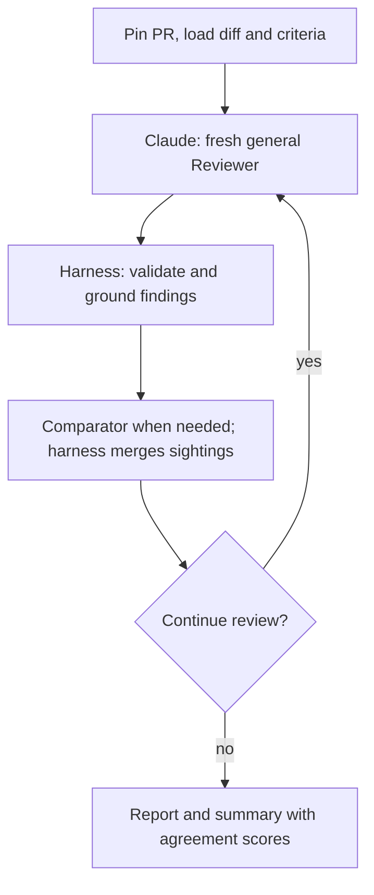
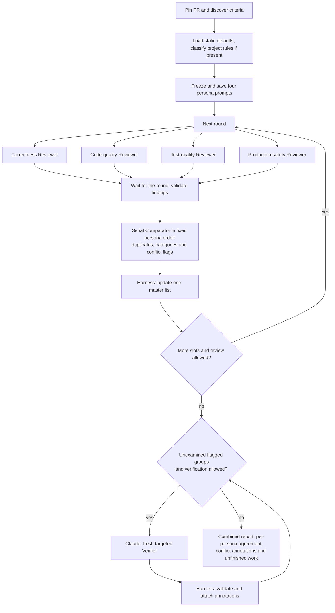

# code-reviewer

A pull request review agent built on Claude Code. It runs independent review passes, merges their findings and reports how often each issue was found. You can review the results locally or explicitly post a summary to GitHub.

**Status:** v0, for a controlled learning environment. Single-agent reviews have been used on real PRs. The optional persona flow is implemented and tested offline; its live behavior and review quality still need validation. Posting has not been exercised live.

[Quick start](#quick-start) · [Review flows](#review-flows) · [Results](#reading-the-results) · [Configuration](#configuration) · [Documentation](#documentation)

## Quick start

You need Python 3.9+, git, GitHub CLI (`gh`) authenticated for the repository, and Claude Code (`claude`) installed and logged in. Reviews use your Claude Code login and incur model usage.

```bash
git clone https://github.com/sskelkar/code-reviewer.git
cd code-reviewer
python3 -m venv .venv
source .venv/bin/activate
python -m pip install --upgrade pip
pip install -e .
reviewer doctor
```

Keep the editable installation and its source checkout: prompts and criteria are loaded from it. Keep the virtual environment active when running `reviewer`. Installation pulls in `tomli` on Python 3.9/3.10; otherwise runtime code uses the standard library.

Before the first real review, run `reviewer doctor --live` to check isolation and the Claude reply format. It makes one small paid call; plain `doctor` makes no model calls. See [environment checks](docs/development.md#verifying-against-the-real-claude-cli) for what this validates.

From a local clone of the project you want reviewed, try a small PR you know well:

```bash
# Preview and save default-only prompts; no model calls or checkout creation.
reviewer review OWNER/REPO#123 --mode single-agent --dry-run

# One pass to check the review end to end.
reviewer review OWNER/REPO#123 --mode single-agent --passes 1

# Normal review: up to six passes with convergence stopping.
reviewer review OWNER/REPO#123 --mode single-agent
```

Dry runs omit project-rule discovery/classification. A review uses the current clone when it matches the PR's repository; otherwise it uses a cached clone. Your working tree is left unchanged.

## Review flows

Both flows pin the PR's commits, load its diff and criteria, and give fresh Claude sessions read access to a separate temporary head checkout. Sessions never see earlier passes' findings. **Models propose; Python validates evidence and replies, merges findings, counts agreement and writes every artifact.**

Each new review fetches the current PR head and target-branch tip into private refs, without updating your branches, remote-tracking refs or tags. Those commits stay fixed only for that run. The diff is merge-base to PR head; the checkout is the PR head, not a simulated merge with the latest target.

Choose with `--mode`, or set `review_mode` in `review.toml`:

| Mode | Pass schedule | Consolidation and verification |
|---|---|---|
| `single-agent` (default) | One general Reviewer; normally 3–6 independent passes, stopping after two quiet passes | Incremental duplicate merging; no separate Verifier |
| `agent-personas` | Four focused Reviewers, three passes each by default, configurable with `--passes N` | Shared master list, per-persona agreement and advisory verification of flagged conflicts |

### Single-agent



The harness updates the master after every pass. By default it requires three successful passes before convergence and stops after two consecutive passes add no new scored finding, or at six scheduled attempts. Budget, cancellation and failure limits can stop it earlier. Use `--passes N` to change the maximum; `--passes 1` produces unrated findings.

### Agent-personas

```bash
reviewer review OWNER/REPO#123 --mode agent-personas --model haiku
# One pass per persona: four total review slots.
reviewer review OWNER/REPO#123 --mode agent-personas --passes 1
```

The personas focus on **correctness**, **code quality**, **test quality** and **production safety**. Their thirteen default rules are assigned ahead of time. Accepted project rules are classified to one or more personas; the harness checks complete coverage and falls back to all personas for unresolved assignments, with warnings.



Set passes per persona with `--passes N` or `persona_passes` in TOML (default 3). All 4 × N slots are scheduled even if earlier passes find nothing new. Normal retries, budgets, cancellation and failure limits can leave slots incomplete. A timeout leaves cost unknown; the pool ledger conservatively charges the reserved allowance ([accounting details](docs/usage.md#persona-budget-pools)). Each round runs up to four Reviewers concurrently on one pinned checkout, then merges results in fixed persona order before the next round. `--parallel N` (1–4, default 4; `persona_parallel` in TOML) controls concurrency.

All passes within a persona receive identical prompts. Any persona may report an evidenced correctness/safety issue outside its focus. Categories never transfer votes: agreement stays with the discovering persona.

The Comparator flags possible conflicts while merging. The Verifier investigates only those groups and explains evidence, uncertainty or tradeoffs. **Annotations never suppress findings or change severity/votes.** No flags means no Verifier calls; blocked or failed verification stays visible as pending/unresolved.

For module-level walkthroughs, see [architecture](docs/architecture.md). The [persona criteria guide](docs/persona-criteria.md) lists the rules, and [proposal §12](docs/proposal.md#12-agreed-persona-design-and-next-steps) records the full contract.

Persona budgets scale with the total cap: 10% criteria builder, 10% Comparator, 13⅓% Verifier, then an equal split of the remainder among personas (about 16⅔% each). At $3 this is $0.30/$0.30/$0.40 plus $0.50 per persona. Calls/retries reserve their allowance atomically; unused pools are not transferred. An exhausted persona or its consecutive-failure limit skips only that persona's remaining slots. Comparator exhaustion stops new review work; Verifier exhaustion leaves conflicts pending. Already-running token usage can exceed the global token threshold. [Budget details](docs/usage.md#persona-budget-pools).

## Reading the results

A review prints its findings, completion/cost line and full-report path. Runs are saved under `~/.code-reviewer/runs/`:

| Artifact | Purpose |
|---|---|
| `summary.md` | Shareable findings; also used for the optional PR comment |
| `report.md` | Detailed criteria, pass accounting, evidence and usage |
| `input/`, `pass-NN/`, `master.json`, `stats.json` | Saved inputs, raw replies, findings, consolidation and accounting |
| `input/personas/`, `verification/` | Persona-mode frozen prompts and conditional verification records |

**Agreement measures repetition, not correctness.** High confidence starts at 75%, Medium at 40%; fewer than two completed passes are unrated. Single-agent uses completed passes as the denominator. Persona mode scores each discovering persona separately—for example, `test-quality: 3/3`—with no combined tier. Failed slots do not contribute votes or completions. Unrated findings remain visible under tier filters.

To inspect and judge findings interactively, start `reviewer` inside the project clone, then run `review OWNER/REPO#123 --mode agent-personas` (or `single-agent`):

```text
show F-001                 inspect a finding
mark F-001 real            record your judgment (real, nit or wrong)
missed "describe an issue"  record a missed issue
drop F-001                 omit it from the shareable summary
summary                    show the summary with your omissions
open                       open the full report
post                       preview, then ask for confirmation
```

The CLI posts only with an explicit `--post` flag; it does not ask for an additional confirmation. Posting creates or updates one summary comment per PR. See the [usage reference](docs/usage.md) for all commands, options and report details.

## Configuration

Copy [review.example.toml](review.example.toml) to the reviewed project's `review.toml` or `~/.code-reviewer/review.toml`. An explicit file goes before the subcommand: `reviewer --config PATH review OWNER/REPO#123`. Command options override file settings for that run.

Common settings are `review_mode`, `persona_passes`, `persona_parallel`, the `model_*` roles, `criteria_mode`, `extra_exclude_patterns` and run/call budgets. `--model sonnet` changes **all roles**. Single-agent pass controls do not change persona scheduling. See the [complete settings reference](docs/usage.md#configuration) for defaults and limits.

Project criteria come from the **base commit**, so a PR cannot change the rules it is judged by. Point to review-rule files from root `AGENTS.md`; applicable nested `AGENTS.md` and `.claude/rules` files are also included by location. Project rules take precedence over conflicting defaults. See [preparing your project](docs/usage.md#preparing-your-project-optional-recommended).

## Scope and safety

Reviewers and the persona Verifier have Read/Grep/Glob in a temporary checkout; they do not execute tests, linters or builds. Other model roles have no code tools. The checkout is outside saved-run storage and is deleted afterward unless you pass `--keep-checkout`.

PR metadata, diff, criteria and files read during review are sent through your Claude Code login. Email redaction covers PR text only; repository files and diffs are not redacted. Saved runs contain code and must be treated accordingly. Use only repositories permitted by your organization's policy.

This remains a controlled-environment tool. Isolation relies on Claude Code restrictions, not an OS sandbox; secret scanning and stronger prompt-injection/posting safeguards are unfinished. The regular frontend supports GitHub PRs, not local branches. Read [privacy and safety](docs/usage.md#privacy-and-safety) and the [hardening backlog](docs/proposal.md#5-safety-v0-baseline) before broader use.

## Development and roadmap

After the editable installation, run the offline suite:

```bash
python3 -m unittest discover -s tests -t .
```

Tests use fake models and temporary repositories, with no network or paid calls. Supported Python is 3.9+; contributors run the full suite on their oldest and newest available Python. Repository rules are in [AGENTS.md](AGENTS.md); code ownership, checks, debugging and replay are in the [development guide](docs/development.md) and [architecture guide](docs/architecture.md).

Next: manually compare single-agent Haiku, single-agent Sonnet and persona Haiku on the same PRs, then build the project context pack. Broader verification, tool-call logging and hardening follow; persona parallel rounds are implemented but not live-validated. The automated eval harness is deliberately parked. See the [proposal checklist](docs/proposal.md#checklist) for the detailed roadmap and [handover](docs/HANDOVER.md) for current work.

## Documentation

| Guide | Contents |
|---|---|
| [Usage reference](docs/usage.md) | CLI/REPL commands, reports, project criteria, all settings, storage and troubleshooting |
| [Architecture](docs/architecture.md) | Code map, flow ownership and detailed single-agent diagrams |
| [Development](docs/development.md) | Setup, tests, common changes, saved-run debugging and Comparator replay |
| [Prompt contracts](prompts/README.md) | Model inputs, outputs, tools and deterministic validation |
| [Persona criteria](docs/persona-criteria.md) | Canonical defaults and assignments |
| [Proposal](docs/proposal.md) | Decisions, experiments and roadmap |
| [Handover](docs/HANDOVER.md) | Latest state and next-session instructions |
| [Python walkthrough](docs/project-explainer.md) | Code explained for Java developers |
