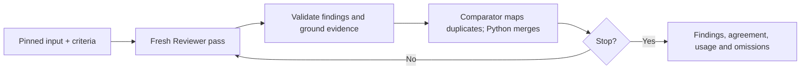
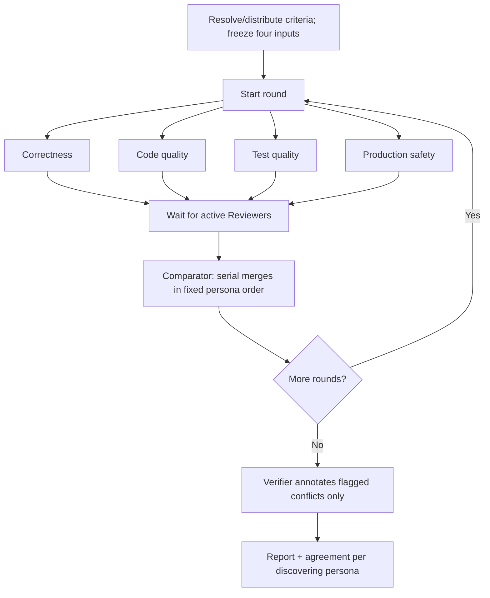

<p align="center">
  
</p>

# code-reviewer

[](pyproject.toml)
[](docs/llm.md)
[](docs/sandbox-architecture.md)
[](docs/tracing.md)

**Review a pull request from multiple perspectives, with evidence you can inspect.**

code-reviewer is a Python CLI that runs independent AI review passes, checks their evidence against the repository and merges duplicate findings into a private report. Choose Claude or OpenAI, use one general reviewer or four specialist personas, and inspect the review timeline in local Langfuse.

[Quick start](#quick-start) · [Review flows](#review-flows) · [Documentation](#documentation) · [Contributing](CONTRIBUTING.md) · [Roadmap](docs/proposal.md#checklist)

## What it does

| Capability | How it works |
|---|---|
| Independent review passes | Each Reviewer starts fresh, without earlier findings. |
| Repository-specific criteria | Discover project rules from the pinned base commit and combine them with built-in defaults. |
| Evidence checks | Validate structured findings, file references and quoted code or changed-line anchors. Semantic correctness still needs human judgment. |
| VM isolation by default | Run the whole review inside one jailed Firecracker VM, with bounded read tools and restricted network access. |
| Private reports | Save findings, agreement, omissions and usage locally. Post a PR summary only with `--post`. |
| Local observability | Trace stages, model calls, available tool activity and token/cache usage without capturing source or prompts. |

## Quick start

### 1. Install

Use **Python 3.11+ for Langfuse export** (3.13 shown). The core reviewer supports Python 3.9+. Host acquisition also requires Git and the GitHub CLI; ChatGPT sign-in requires `/usr/bin/openssl`.

```bash
git clone https://github.com/sskelkar/code-reviewer.git
cd code-reviewer
python3.13 -m venv .venv
source .venv/bin/activate
python -m pip install -e '.[tracing]'
reviewer --help
```

Keep the checkout: prompts and criteria load from it. Installation is from source; the core uses the standard library plus `tomli` below Python 3.11. The tracing extra adds the optional host Langfuse SDK.

### 2. Configure execution and model access

The default VM backend requires a **compatible Apple Silicon Mac**, a dedicated Lima Linux worker with nested virtualization, and pinned Firecracker artifacts. Follow [VM setup](docs/sandbox-check.md#persistent-first-time-setup) and [operator configuration](docs/usage.md#vm-review-configuration) before running a review. VM source acquisition supports public github.com pull requests; private in-VM source authentication is unsupported.

For trusted direct-host execution, append `--no-sandbox`. Host mode uses your Git/GitHub access and a separate exported checkout, without VM isolation. A failed VM review never falls back to the host.

Choose [Claude or OpenAI and its authentication mode](docs/llm.md). API keys use separate API billing. An eligible ChatGPT subscription uses the reviewer's sign-in flow:

```bash
reviewer auth login
reviewer auth models
```

Use the model catalog to choose `MODEL_ID`. For host execution, also add `--no-sandbox` to authentication commands. API/native tokens belong in the invoking environment; ChatGPT sign-in uses a private credential store. Credentials never belong in Git or TOML.

### 3. Review a pull request

These examples use ChatGPT subscription access; [the usage guide](docs/usage.md#reviewing-a-pull-request) covers other providers and authentication modes.

```bash
# Check configuration without fetching the PR or reading credentials.
reviewer review OWNER/REPO#123 --provider openai --auth subscription --model MODEL_ID --preflight

# Run one single-agent pass.
reviewer review OWNER/REPO#123 --provider openai --auth subscription --model MODEL_ID --passes 1

# Run one round across all four personas.
reviewer review OWNER/REPO#123 --provider openai --auth subscription --model MODEL_ID --mode agent-personas --passes 1
```

Preflight checks configuration only; it does not verify runtime files, deployment or authentication. The CLI prints a summary and the full report path when the review completes. Deployment and adapter qualification are listed in [the roadmap](docs/proposal.md#qualification-evidence).

## Review flows

Both flows use a pinned merge-base diff, criteria from the pinned base tip and a separate head snapshot. Reviewers are blind to earlier findings. Models have Read/Grep/Glob only; they never run tests, builds or arbitrary commands. Binary contents are omitted, with metadata and warnings in reports.

### Single-agent



Default: 3–6 attempts. After three successful passes, two consecutive passes without new findings can stop the loop. `--passes N` sets the maximum and lowers the minimum when necessary. Budget, failure and cancellation limits may stop earlier. One successful pass is unrated; repeated agreement is not proof of correctness.

### Agent-personas



Default: three passes per persona; `--passes N` sets rounds, without quiet-pass stopping. `--parallel N` limits concurrent Reviewers to 1–4. Exhaustion of one persona's budget does not stop the others. The Comparator merges duplicates, categorizes and flags conflicts. Verification does not suppress findings or change severity/votes.

Allocation pools scale with the total cap: criteria 10%, Comparator 10%, Verifier 13⅓%, remainder equally among personas; no borrowing. API pools allocate estimated dollars; subscription pools allocate tokens using the same proportions. Limits are harness stop conditions, not hard provider caps.

## Results and configuration

VM reviews show timestamped stage changes and a “still waiting” update every 15 seconds of silence. Interactive terminals also show a small rotating activity indicator; redirected output stays plain. Each returning reviewer gives a glimpse of up to three candidate titles/locations labelled **Verification pending** before grounding or merging. After each consolidated round/pass, up to ten new findings appear as **UNCONFIRMED**. These previews are private, provisional and never posted to GitHub. See [live progress](docs/usage.md#live-progress-and-provisional-findings).

The CLI prints a shareable summary and report path. `summary.md`, `report.md` and `stats.json` contain findings, criteria, agreement, omissions, usage and safe HTTP diagnostics. VM runs export only these three bounded private files; host runs also retain inputs and per-call artifacts. Nothing is posted unless `--post` is supplied.

Use `~/.code-reviewer/review.toml` or `reviewer --config /absolute/path/review.toml …`. Configuration must be outside Git working trees and pass ownership/permission/type/size checks; current-directory `review.toml` is ignored. See [example settings](review.example.toml), [usage](docs/usage.md) and [LLM selection](docs/llm.md).

The VM enforces read-only admitted code, non-root/no-new-privileges, jailer/systemd limits, external egress policy and private transfers. It cannot prove model findings, prevent exposure of a copied runtime token, or enforce provider billing. See the [execution contract](docs/security-contract.md).

## View review traces

Local Langfuse tracing is **enabled by default**. Complete the [first-time setup](docs/tracing.md), including the local services and exported project keys. From the project directory, in each terminal session:

```bash
source .venv/bin/activate
. "$HOME/.code-reviewer/langfuse/local.env"
export LANGFUSE_PUBLIC_KEY LANGFUSE_SECRET_KEY
reviewer review OWNER/REPO#123 --passes 1
```

When the review finishes, open its printed **`Trace:` link**, or browse [local review traces](http://localhost:4000/project/reviewer/traces). Sign in with the local account created during setup; [login details](docs/tracing.md#start-local-langfuse) are in the tracing guide. The same run's `stats.json`, beside `report.md`, stores the link in `tracing.url` and the opaque ID in `tracing.trace_id`.

Traces show stage/model/tool timing, retries and token/cache usage without source, prompts or findings text. VM records arrive after cleanup; they do not stream live. Set `tracing = false` in operator configuration to opt out. Export failures do not fail reviews: metadata stays local, while `tracing.exported` is false. See [missing-trace troubleshooting](docs/tracing.md#missing-traces).

## Documentation

| Guide | Purpose |
|---|---|
| [Usage](docs/usage.md) | Commands, settings, reports, limits and troubleshooting |
| [LLM interface](docs/llm.md) | Contract, adapter/authentication matrix, credentials and qualification |
| [Local tracing](docs/tracing.md) | Langfuse setup, viewing traces, cache usage and troubleshooting |
| [Architecture](docs/architecture.md) | Ownership and review-flow diagrams |
| [VM architecture](docs/sandbox-architecture.md) | Launcher, worker, guest, networking and cleanup |
| [VM deployment](docs/sandbox-check.md) | Persistent setup, no-key checks and recovery |
| [Execution contract](docs/security-contract.md) | Scope and actual guarantees |
| [Plan](docs/proposal.md) | Checklist and optional later work |
| [Development](docs/development.md) | Tests and debugging |
| [Python walkthrough](docs/project-explainer.md) | Method-level call chains and Python implementation walkthrough |
| [Prompt contracts](docs/prompts.md) | Canonical assets and harness validation |

## Contributing

Bug reports, documentation improvements and focused pull requests are welcome. Start with [CONTRIBUTING.md](CONTRIBUTING.md) for development checks, safe reproduction examples and review-contract requirements.

See [the roadmap](docs/proposal.md#checklist) for outstanding qualification and planned work. The supported interface is the one-shot CLI; inactive frontend/replay modules under `parked/` are outside the public command interface.
