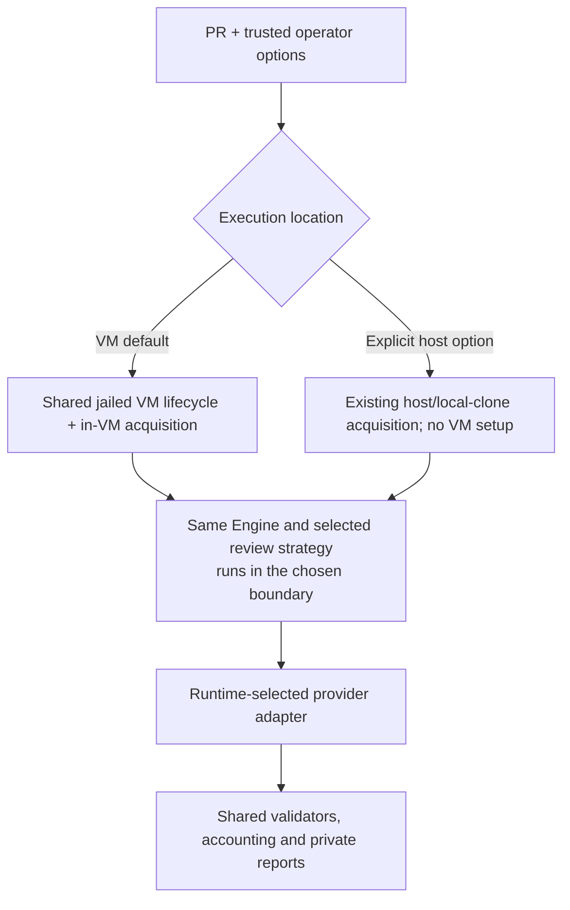
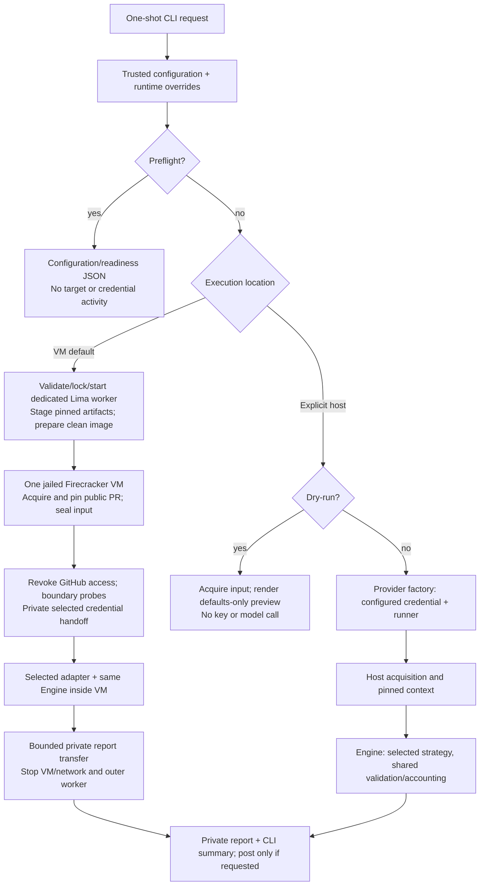
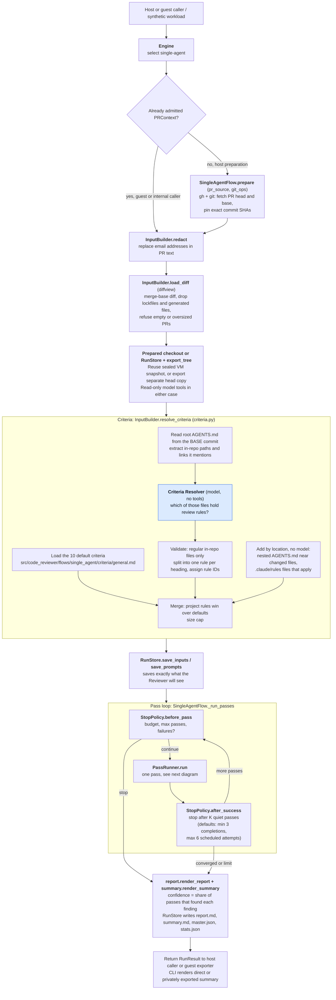
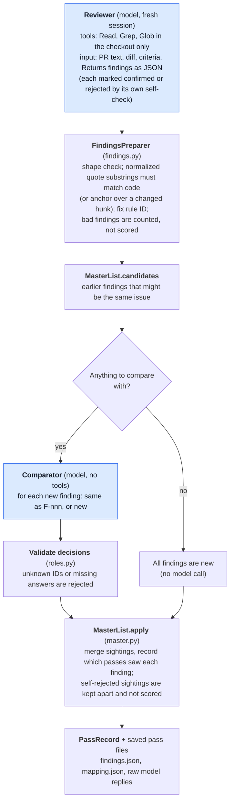

# Architecture

The [README](../README.md#review-flows) explains both flows at a glance. This guide maps them to the implementation and expands the single-agent path.

## Ownership

`Engine` selects one flow before PR preparation and asset loading. Each flow owns orchestration, model contracts, master/result types and presentation. `shared/` owns transport, git/diff handling, criteria discovery, grounding, storage and accounting; it imports neither flow. The CLI dispatches rendering through `presentation.py`. The REPL code/tests are retained but parked; bare `reviewer` shows help.

Only Reviewers and the persona Verifier receive Read/Grep/Glob inside the temporary head checkout. Resolver, Classifier and Comparator calls have no code tools. In the internal Claude flow algorithm, every call is a fresh headless session; the native adapter uses fresh headless sessions. The API adapter uses fresh per-call conversation state. Models propose; Python validates, accounts and writes state.

## Execution choices

Provider, review strategy and execution location are independent operator settings. One core supports either provider and either strategy in the selected boundary. VM is the default; `--no-sandbox` (or trusted `sandbox = false`) explicitly selects host acquisition/review. Repository labels never select behavior. No automatic VM-to-host fallback exists.

Host dispatch and runtime provider selection are implemented. Both dispatch paths are wired; authenticated VM inference remains untested. Current routing is below.

## Public entry-point boundary

`review_flow.run_review` checks effective execution/provider configuration before target activity. Preflight returns settings/readiness without target or credential reads. Explicit host selection uses the provider factory, retained host acquisition and the shared Engine. Host dry-run skips runner/credential creation. VM requests validate deployment settings and use `sandbox/review.py`; every real job must pass artifact/worker/admission/confinement checks. VM failure never switches to the host.

`doctor` reports offline execution/configuration status. The retained `doctor --live`, paid replay and legacy incomplete-settings connected jobs remain blocked. Normal VM reviews use the complete operator job protocol. The parked REPL remains covered by internal tests, with no CLI launch route.

## Sandbox deployment

The [execution contract](security-contract.md) defines shared review behavior and independent execution/provider choices. The following components implement the VM boundary; normal dispatch is wired, with live authentication/inference qualification outstanding.

The [sandbox architecture](sandbox-architecture.md) wraps the whole job in one disposable Firecracker VM. `sandbox/review.py` stages trusted source/artifacts and reuses `check.prepare_worker` for the dedicated Linux worker. `review_worker.py` owns private framed SSH stdio; `connected.py` installs external network policy and launches the shared jailed VM. `guest.py` acquires/pins the public PR, seals input read-only, checks native/file/network restrictions and runs the configured provider/strategy. The credential is read on the workstation only after admission/probes, then transferred over private pipes/vsock. No key/token is stored in argv, TOML, cache images or console logs. `settings.py` transports the complete allowlisted review configuration while excluding host paths/infrastructure settings.

The VM returns three bounded files: report, summary and stats. After VM/network cleanup, remote job deletion and confirmed outer-worker shutdown, the host validates and saves them privately. `ExportedReview` supplies the already filtered summary to CLI/posting; Python objects are never unpickled. Internal prompt/raw-call files remain ephemeral. Native runtime bytes are digest-pinned and part of connected-image cache identity. The native adapter receives an explicit fresh environment, including the selected credential and proxy, in sequential and parallel subprocess paths. The API adapter uses its explicit proxy transport.

Offline fixtures exercise fake subprocesses, simulated API replies and native CLI startup/auth refusal. The raw standalone launcher was extracted outside this project. The supported Mac check now uses `sandbox/vm.py:VirtualMachine` for both its offline and connected workloads: matching upstream jailer, private PID/mount namespaces, chroot, no-new-privileges, default seccomp and a bounded transient systemd service. The connected guest seals its Git input and head snapshot read-only before dropping privileges; `Engine.review(prepared_checkout=...)` reuses that snapshot in either flow. Public acquisition now runs unprivileged inside the guest with source access revoked externally before readiness. Authenticated provider operation remains untested; recovery resets abandoned worker state without resuming reviews. See the [current VM checklist](sandbox-todo.md).

The public `reviewer sandbox check` command in `sandbox/check.py` now owns a complete Mac deployment check: validate/lock/start the dedicated Lima worker, build current trusted source, run both flows with simulated replies in an offline VM, run a second sequential no-key connected probe VM, remove job state, stop the worker and save bounded private results. `sandbox/check_worker.py` generates a harmless fixture or passes an explicit public PR URL into the review VM, and verifies host network cleanup; it accepts no key. This check bypasses target configuration loading, not live-review security controls. See [the command](sandbox-check.md) and [alternative VM designs](sandbox-alternatives.md).

Image preparation is now a separate `sandbox/prepare.py` operation reused by the check: it fingerprints source/builder/copied OS inputs, atomically publishes clean root-owned images and validates every cache hit. It runs before any job VM starts. `sandbox recover` uses the same dedicated-worker lock/profile, restarts the selected worker to discard abandoned kernel state, verifies idle state and removes only recognized owned scratch directories. `--lifecycle` exercises actual supervisor SIGKILL and independent VM termination. The stop policy kills the complete VM cgroup immediately rather than relying on graceful termination. The normal command now reuses image preparation, worker lifecycle and connected supervision.

## Remaining end-to-end wiring

The normal VM/host dispatcher, trusted settings, provider-scoped endpoint policy, private credential handoff and local report presentation are implemented. Offline tests cover both providers/strategies and refusal/cleanup paths. Doctor and preflight share offline configuration status (`runtime_checked: false`); it opens no artifacts and reads no credentials.

Remaining: verify authenticated inference and native tools under the actual endpoint policy using an explicitly supplied credential. Private in-VM URL acquisition, ordinary CLI capsule input, operator-file criteria manifests and VM dry-run remain unsupported. Host API calls currently require one explicit model for all roles and operator token rates. Keep real credentials out of tests; no successful live VM inference has been recorded.

## Code map

Start with [flows/single_agent/flow.py](../src/code_reviewer/flows/single_agent/flow.py): `SingleAgentFlow.review` is the composition root. [engine.py](../src/code_reviewer/engine.py) only delegates to the selected flow.

| Location | Responsibility |
|---|---|
| `security.py`, `review_flow.py` | Shared offline configuration report and explicit execution dispatch; real backends enforce their boundary |
| `engine.py`, `flows/__init__.py` | Stable API and one-time mode selection |
| `flows/single_agent/flow.py` | Complete current review sequence and pass loop |
| `flows/single_agent/passes.py`, `stop_policy.py` | One pass and convergence/failure/budget rules |
| `flows/single_agent/roles.py`, `prompt_contract.py`, `prompts/` | Reviewer/Comparator contracts, role-specific loading, templates and schemas |
| `flows/single_agent/master.py`, `models.py` | Merged sightings, comparator validation, agreement and flow result |
| `flows/single_agent/report.py`, `summary.py`, `dry_run.py` | Detailed report, shareable summary and dry-run presentation |
| `flows/single_agent/criteria/` | Existing ten defaults, unchanged |
| `flows/agent_personas/` | Parallel review rounds, ordered serial consolidation, proportional budget pools, rule distribution, own role contracts/master/result/report, per-call budget guard and conflict-only advisory verification |
| `shared/review_inputs.py`, `criteria.py`, `resolver.py` | PR redaction/diff inputs, criteria parsing/discovery and shared Resolver role |
| `shared/claude_cli.py`, `llm.py`, `templates.py` | Claude subprocesses/retries, accounting/logging and generic template rendering |
| `shared/git_ops.py`, `pr_source.py`, `diffview.py`, `findings.py` | Pinned PR input, diff parsing/exclusions and evidence validation |
| `shared/run_store.py`, `stats.py`, `events.py`, `models.py`, `redact.py` | Storage/checkout lifecycle, usage, events, common data and email redaction |
| `cli.py`, `review_flow.py`, `presentation.py`, `review_options.py` | Active command entry point, execution boundary, output, options and help |
| `repl.py`, `repl_help.py` | Parked interactive frontend; code and tests retained, no CLI launch route |
| `progress.py`, `post.py`, `replay.py` | Progress, explicit posting and parked comparator helpers; doctor/preflight share `security.readiness` |
| `backends/factory.py`, `openai.py`, `read_tools.py` | Runtime runner selection, credential/config checks, stdlib API adapter and bounded read tools |
| `sandbox/review.py`, `review_worker.py`, `settings.py`, `channel.py` | Normal VM dispatch, allowlisted settings, private SSH pipe protocol and local exported result |
| `sandbox/connected.py`, `guest.py`, `wire.py` | Linux supervisor, guest review entry point and bounded private bootstrap/result protocol |
| `sandbox/check.py`, `check_worker.py` | Supported no-key Mac deployment command and connected Linux fixture/cleanup check |
| `sandbox/vm.py`, `snapshot.py` | Shared jailed VMM/systemd lifecycle and read-only admitted guest input with native isolation probes |
| `sandbox/prepare.py`, `recover.py`, `lifecycle.py` | Clean image preparation/reuse, explicit dedicated-worker recovery and opt-in real lifecycle failure checks |
| `sandbox/acquire.py`, `capsule.py`, `git_input.py`, `network.py`, `probes.py` | Unprivileged in-VM public acquisition/pinning or file-only capsule transfer, bounded admission/export, one-way external network phases and harmless probes |
| `sandbox/artifacts.py`, `bundle.py`, `image.py`, `runtime.py`, `*_smoke.py`, `runtime_probe.py` | Trusted image inputs/build stages and separate offline deployment checks |
| Legacy package-root modules | Small compatibility exports; edit canonical flow/shared files instead |

Shared code imports no workflow. Flow-owned result types stay inside the flow; `code_reviewer.models.RunResult` remains a compatibility export of the single-agent result.

## Single-agent implementation

The flow below is the implemented single-agent algorithm called by the normal CLI in either execution location. Host mode prepares context through Git/GitHub CLI; the guest receives already admitted context and a sealed snapshot. Offline tests exercise the same algorithm with synthetic inputs.

### Inside one pass

What is checked, and by whom, today:

| Check | Done by | Where |
|---|---|---|
| The whitespace-normalized quote matches code substrings (or its anchor covers a changed hunk) | Harness, deterministic | `findings.FindingsPreparer` |
| The cited rule is a real one (formatting is repaired; unknown becomes "none") | Harness | `findings.resolve_rule_id` |
| The Reviewer tries to refute its own finding after writing it (**self-check**) | The Reviewer model, in the same session | second phase of `src/code_reviewer/flows/single_agent/prompts/reviewer.system.md` |
| Are two findings the same issue? (finding vs. earlier findings; text only, no code access) | Comparator model, answer validated by the harness | `roles.Comparator` |
| Confidence, severity ordering, what is posted | Harness arithmetic | `master.rate`, `summary.py` |
| A separate **Verifier** that investigates flagged conflicts and annotates them | Available in agent-personas only; single-agent has no separate Verifier | `flows/agent_personas/roles.py` |

Numbered steps, with the module that does each:

1. Receive an admitted `PRContext` from the execution backend, or use retained host `pr_source` preparation to fetch/pin commits. VM acquisition does not call the host preparation path.
2. `InputBuilder.redact` replaces email addresses in the PR text; `InputBuilder.load_diff` parses the merge-base diff, drops excluded files and refuses empty or oversized PRs.
3. Reuse the execution backend's admitted `prepared_checkout`, or export the head into a separate flow-owned temporary directory (symlinks skipped). VM setup seals its mounts read-only; the generic exporter alone does not provide that OS control.
4. `InputBuilder.resolve_criteria` loads default rules, then resolves project criteria from the **base** commit: the harness extracts candidate paths from `AGENTS.md`, the `CriteriaResolver` picks files, the harness validates (in-repo regular files only), adds the nested `AGENTS.md` and `.claude/rules` files that cover the changed paths (`criteria.scoped_files`, no model call), and rule IDs are assigned.
5. `SingleAgentFlow._run_passes` loops. Each pass is `PassRunner.run`: `Reviewer` → `FindingsPreparer` (validate and ground) → `Comparator` → `MasterList.apply`. The Comparator is skipped when there is nothing to compare (for example a single finding in the first pass).
6. `StopPolicy` decides after every pass whether to stop.
7. `report.render_report` renders Markdown; the flow and `RunStore` write the report/artifacts. Criteria appear in the report by name and source, never by their internal IDs.

## Persona implementation

Start at [agent_personas/flow.py](../src/code_reviewer/flows/agent_personas/flow.py). The [flow guide](../src/code_reviewer/flows/agent_personas/README.md) maps its modules and assets; [proposal section 12](proposal.md#12-agreed-persona-design-and-next-steps) records the complete agreed contract.

Project discovery reuses the base-commit Resolver. A persona-only Classifier distributes all accepted project rules, with deterministic coverage checks and visible fallback. Defaults already have static assignments. The flow freezes four Reviewer prompts, then schedules N rounds, running correctness, code quality, test quality and production safety concurrently within each round (`persona_passes`, default 3; overridden by `--passes N`). There is no quiet-pass stop; incomplete slots remain visible.

After the round barrier, usable batches are consolidated serially in fixed persona order. For each batch, the Comparator sees the full master and incoming findings. The harness validates mappings, categories and conflict references, then stages consolidation so interruption cannot retain an incomplete slot's changes. Sightings stay attached to their discovering persona, regardless of category.

After reviewing, one fresh Verifier session per distinct flagged group examines code and accepted criteria while budget/run status permit. Validated annotations may explain support/refutation, conditions or tradeoffs and correct categories. They never rewrite/suppress findings or change severity/votes. No flags means no Verifier calls; failed or skipped verification stays unresolved/pending. Reviewers never receive findings or annotations from earlier calls.

The persona-only `budget.py` owns atomic pool reservations, reconciliation and cancellation; `runner.py` only forwards the cancellation signal to adapters. Shared `ClaudeRunner.run_cancellable` owns native process groups, complete UTF-8 stdin files, timeout polling and cleanup for both strategies. Each persona has its own Caller/request-log state. Workers append call accounting, and presentation/merging reads it only after the round barrier or worker shutdown; budget decisions use the locked ledger. No worker mutates the master. `--parallel 1` serializes reviewers but retains the round barrier. The Verifier runs serially after review rounds. See [pool behavior](usage.md#persona-budget-pools).
