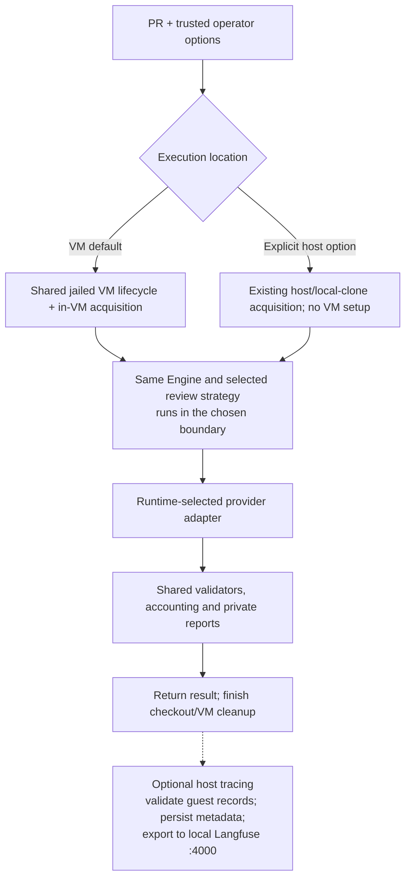
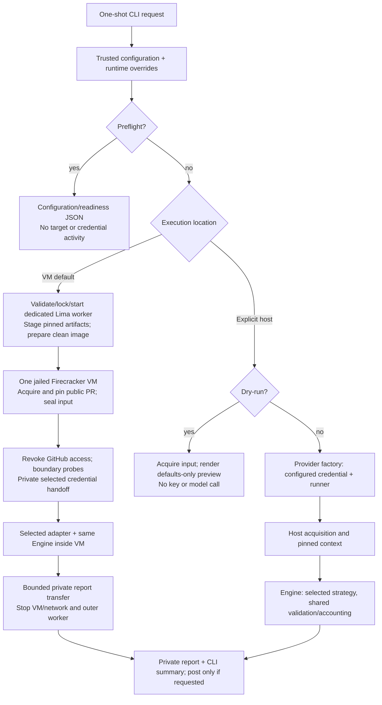
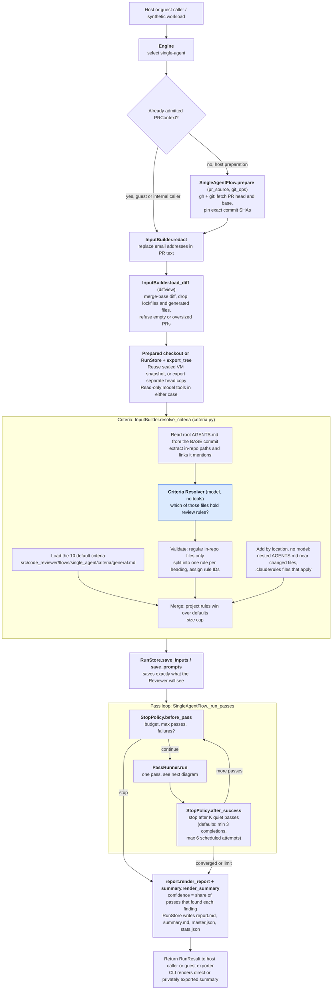
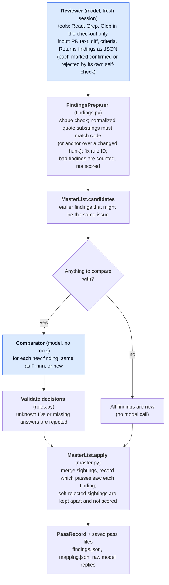

# Architecture

The [README](../README.md#review-flows) explains both flows at a glance. This guide maps them to the implementation and expands the single-agent path.

## Ownership

The Python source uses packages to group one concern behind a small import API. Keep CLI entry points and shared operator configuration at the package root; avoid another folder for every small file.

```text
src/code_reviewer/
  cli.py, config.py, review_flow.py       entry point, settings, execution dispatch
  flows/single_agent/                   single-agent algorithm and canonical assets
  flows/agent_personas/                 persona algorithm and canonical assets
  shared/                              inputs, validation, accounting and storage
  backends/                            adapters and provider authentication
  sandbox/                             Firecracker/Lima execution boundary
  tracing/                             metadata recorder, review lifecycle, optional exporter
  parked/                              inactive REPL and replay helpers
deploy/langfuse/                        local service Compose configuration and setup
sandbox/firecracker/, sandbox/lima/     review VM deployment assets
docs/                                  human guides, including prompts.md
```

`tracing/__init__.py` exposes the standard-library recording API. `tracing/recorder.py` owns recording/validation; `tracing/review.py` owns host persistence and guest merging; `tracing/langfuse.py` owns optional host export. Importing the recording API never imports the SDK. Langfuse deployment files do not belong to the review VM's sandbox package. Flow-owned prompt assets remain next to their algorithms; [the prompt guide](prompts.md) documents both.

`Engine` selects one flow before PR preparation and asset loading. Each flow owns orchestration, model contracts, master/result types and presentation. `backends/` owns the provider-neutral runner contract and provider-specific transport; `shared/` owns git/diff handling, criteria discovery, model-call validation, grounding, storage and accounting; it imports neither flow. The CLI dispatches rendering through `presentation.py`. The REPL code/tests are retained but parked; bare `reviewer` shows help.

Only Reviewers and the persona Verifier receive Read/Grep/Glob inside the temporary head checkout. Resolver, Classifier and Comparator calls have no code tools. Each native call is a fresh headless session. The API adapter uses fresh per-call conversation state. Models propose; Python validates, accounts and writes state.

## Execution choices

Optional observability is independent of these choices. `tracing.review.review_trace` wraps `_execute_review` after configuration/preflight gates, recording real reviews by default with a standard-library recorder; shared role/stage/tool hooks produce bounded metadata. Persona tasks inherit context explicitly. VM settings carry only the enable flag and opaque parent identity; guest records return inside existing stats limits. After cleanup, `tracing.review.finish` validates/merges records and starts the host-only `tracing.langfuse` subprocess, with a fixed loopback destination and deadline. Tracing-off/preflight/dry-run skip credentials and export. See [local tracing](tracing.md) for deployment, privacy and qualification.

Provider, authentication, review strategy and execution location are independent operator settings. See [LLM interface and access](llm.md). One core supports either provider and either strategy in the selected boundary. VM is the default; `--no-sandbox` (or trusted `sandbox = false`) explicitly selects host acquisition/review. Repository labels never select behavior. No automatic VM-to-host fallback exists.



Host/guest dispatch use the same adapter factory and common result/error contract. ChatGPT uses reviewer-owned consent, private refresh storage, streaming and token-only budgets. Current routing is below.

## Public entry-point boundary

`review_flow.run_review` checks effective execution/provider configuration before target activity. Preflight returns settings/readiness without target or credential reads. Explicit host selection uses the provider factory, retained host acquisition and the shared Engine. Host dry-run skips runner/credential creation. VM requests validate deployment settings and use `sandbox/review.py`; every real job must pass artifact/worker/admission/confinement checks. VM failure never switches to the host.



`doctor` reports offline execution/configuration status. There is no supported live-doctor or paid-replay command. Incomplete job settings are refused. Normal VM reviews use the complete operator job protocol. The parked REPL remains covered by internal tests, with no CLI launch route.

## Sandbox deployment

The [VM architecture](sandbox-architecture.md) owns placement, acquisition, admission, transport, networking and cleanup diagrams. The [deployment runbook](sandbox-check.md) owns setup, checks, image reuse and recovery. Qualification evidence and remaining work are tracked in [the roadmap](proposal.md#qualification-evidence).

## Code map

Start with [flows/single_agent/flow.py](../src/code_reviewer/flows/single_agent/flow.py): `SingleAgentFlow.review` is the composition root. [engine.py](../src/code_reviewer/engine.py) only delegates to the selected flow.

| Location | Responsibility |
|---|---|
| `security.py`, `review_flow.py` | Shared offline configuration report and explicit execution dispatch; real backends enforce their boundary |
| `tracing/recorder.py`, `review.py`, `langfuse.py` | Bounded metadata/context, host lifecycle/guest validation and isolated optional SDK export |
| `engine.py`, `flows/__init__.py` | Stable API and one-time mode selection |
| `flows/single_agent/flow.py` | Complete current review sequence and pass loop |
| `flows/single_agent/passes.py`, `stop_policy.py` | One pass and convergence/failure/budget rules |
| `flows/single_agent/roles.py`, `prompt_contract.py`, `prompts/` | Reviewer/Comparator contracts, role-specific loading, templates and schemas |
| `flows/single_agent/master.py`, `models.py` | Merged sightings, comparator validation, agreement and flow result |
| `flows/single_agent/report.py`, `summary.py`, `dry_run.py` | Detailed report, shareable summary and dry-run presentation |
| `flows/single_agent/criteria/` | Existing ten defaults, unchanged |
| `flows/agent_personas/` | Parallel review rounds, ordered serial consolidation, proportional budget pools, rule distribution, own role contracts/master/result/report, per-call budget guard and conflict-only advisory verification |
| `shared/review_inputs.py`, `criteria.py`, `resolver.py` | PR redaction/diff inputs, criteria parsing/discovery and shared Resolver role |
| `backends/contract.py`, `backends/claude.py`, `shared/llm.py`, `shared/templates.py` | Neutral result/runner contract, native subprocess adapter, validated model calls and generic templates |
| `shared/git_ops.py`, `pr_source.py`, `diffview.py`, `findings.py` | Pinned PR input, diff parsing/exclusions and evidence validation |
| `shared/run_store.py`, `stats.py`, `events.py`, `models.py`, `redact.py` | Storage/checkout lifecycle, usage, events, common data and email redaction |
| `cli.py`, `review_flow.py`, `presentation.py`, `review_options.py` | Active command entry point, execution boundary, output, options and help |
| `parked/repl.py`, `parked/repl_help.py` | Parked interactive frontend; code and tests retained, no CLI launch route |
| `progress.py`, `shared/events.py`, `sandbox/progress.py` | CLI status/TTY activity/heartbeats, raw reviewer glimpses, consolidated previews and bounded private progress projection/validation |
| `post.py`, `parked/replay.py` | Explicit final-summary posting and inactive comparator helpers; doctor/preflight share `security.readiness` |
| `backends/factory.py`, `openai.py`, `openai_stream.py`, `chatgpt/`, `read_tools.py` | Runtime adapter selection, protected OAuth consent/refresh, bounded streaming/API transport and read tools |
| `sandbox/review.py`, `review_worker.py`, `settings.py`, `channel.py` | Normal VM dispatch, allowlisted settings, private SSH pipe protocol and local exported result |
| `sandbox/connected.py`, `guest.py`, `wire.py` | Linux supervisor, guest review entry point and bounded private bootstrap/result protocol |
| `sandbox/check.py`, `check_worker.py` | Supported no-key Mac deployment command and connected Linux fixture/cleanup check |
| `sandbox/vm.py`, `snapshot.py` | Shared jailed VMM/systemd lifecycle and read-only admitted guest input with native isolation probes |
| `sandbox/prepare.py`, `recover.py`, `lifecycle.py` | Clean image preparation/reuse, explicit dedicated-worker recovery and opt-in real lifecycle failure checks |
| `sandbox/acquire.py`, `capsule.py`, `git_input.py`, `network.py`, `probes.py` | Unprivileged in-VM public acquisition/pinning or file-only capsule transfer, bounded admission/export, one-way external network phases and harmless probes |
| `sandbox/artifacts.py`, `bundle.py`, `image.py`, `runtime.py`, `*_smoke.py`, `runtime_probe.py` | Trusted image inputs/build stages and separate offline deployment checks |
| `backends/contract.py`, `factory.py` | Shared runner/result/error contract; common provider/auth selection for host and guest |

Shared code imports no workflow. Flow-owned result types stay inside the flow; implementations live in their owning modules. Review code imports the neutral LLM contract, not native provider types.

## Single-agent implementation

The flow below is the implemented single-agent algorithm called by the normal CLI in either execution location. Host mode prepares context through Git/GitHub CLI; the guest receives already admitted context and a sealed snapshot. Offline tests exercise the same algorithm with synthetic inputs.



### Inside one pass



What is checked, and by whom, today:

| Check | Done by | Where |
|---|---|---|
| The whitespace-normalized quote matches code substrings (or its anchor covers a changed hunk) | Harness, deterministic | `findings.FindingsPreparer` |
| The cited rule is a real one (formatting is repaired; unknown becomes "none") | Harness | `findings.resolve_rule_id` |
| The Reviewer tries to refute its own finding after writing it (**self-check**) | The Reviewer model, in the same session | second phase of `src/code_reviewer/flows/single_agent/prompts/reviewer.system.md` |
| Are two findings the same issue? (finding vs. earlier findings; text only, no code access) | Comparator model, answer validated by the harness | `roles.Comparator` |
| Confidence, severity ordering, what is posted | Harness arithmetic | `master.rate`, `summary.py` |
| A separate **Verifier** that investigates flagged conflicts and annotates them | Available in agent-personas only; single-agent has no separate Verifier | `flows/agent_personas/roles.py` |

## Persona implementation

Start at [agent_personas/flow.py](../src/code_reviewer/flows/agent_personas/flow.py). The [flow guide](../src/code_reviewer/flows/agent_personas/README.md) maps its modules and assets.

Project discovery reuses the base-commit Resolver. A persona-only Classifier distributes all accepted project rules, with deterministic coverage checks and visible fallback. Defaults already have static assignments. The flow freezes four Reviewer prompts, then schedules N rounds, running correctness, code quality, test quality and production safety concurrently within each round (`persona_passes`, default 3; overridden by `--passes N`). There is no quiet-pass stop; incomplete slots remain visible.

After the round barrier, usable batches are consolidated serially in fixed persona order. For each batch, the Comparator sees the full master and incoming findings. The harness validates mappings, categories and conflict references, then stages consolidation so interruption cannot retain an incomplete slot's changes. Sightings stay attached to their discovering persona, regardless of category.

After reviewing, one fresh Verifier session per distinct flagged group examines code and accepted criteria while budget/run status permit. Validated annotations may explain support/refutation, conditions or tradeoffs and correct categories. They never rewrite/suppress findings or change severity/votes. No flags means no Verifier calls; failed or skipped verification stays unresolved/pending. Reviewers never receive findings or annotations from earlier calls.

The persona-only `budget.py` owns atomic pool reservations, reconciliation and cancellation; `runner.py` only forwards the cancellation signal to adapters. `backends/claude.py:ClaudeRunner.run_cancellable` owns native process groups, complete UTF-8 stdin files, timeout polling and cleanup for both strategies. Each persona has its own Caller/request-log state. Workers append call accounting, and presentation/merging reads it only after the round barrier or worker shutdown; budget decisions use the locked ledger. No worker mutates the master. `--parallel 1` serializes reviewers but retains the round barrier. The Verifier runs serially after review rounds. See [pool behavior](usage.md#persona-budget-pools).

API transient HTTP retries live in the provider adapter and repeat the current request within the existing call deadline/allowance. Shared `ModelCaller` still owns model-output validation retries, but respects a terminal HTTP result so the retry layers do not multiply. Safe HTTP diagnostic metadata follows the common result into stats and the VM's existing bounded exports. See [retry policy](usage.md#api-errors-and-retries).

## Subscription authentication

ChatGPT consent runs through `reviewer auth login`, outside PR acquisition. A private host store binds verified accounts to stable host/VM identities. Direct calls refresh locally; VM dispatch releases only an access token covering its bounded deadline after admission, source revocation and boundary checks. Refresh/identity tokens stay on the host, so guest egress policy needs no auth endpoint. Subscription responses stream through `response.completed`; partial output cannot execute tools or count as success. Token pools replace dollar pools for subscription calls. See [LLM access](llm.md#chatgpt-sign-in) and the [method-level call chain](project-explainer.md#complete-review-call-chain).
