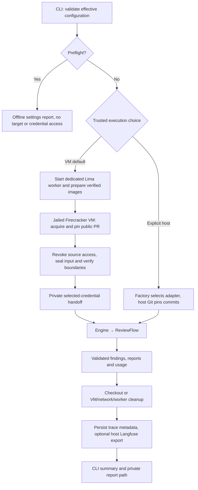

# Architecture

The product has one review pipeline: independent reviewers apply four perspectives, then consolidate candidates, investigate each one and publish only independently supported findings. Provider, authentication and execution location are independent operator choices. The [README](../README.md#review-flow) shows the overall flow; [the walkthrough](project-explainer.md) expands actual method calls.

## Ownership

```text
src/code_reviewer/
  cli.py, config.py, review_flow.py    commands, trusted settings, execution dispatch
  engine.py                           facade over ReviewFlow
  review/                             orchestration, role contracts, criteria and reports
  shared/                             input, grounding, model-call validation and storage
  backends/                           provider-neutral contract, adapters and authentication
  sandbox/                            VM lifecycle, private channels, admission and egress
  tracing/                            bounded metadata and optional host-only export
  parked/                             inactive REPL and its help
sandbox/firecracker/, sandbox/lima/    deployment assets
deploy/langfuse/                       local tracing services
```

`Engine` delegates to `review.flow.ReviewFlow`. It loads no alternate algorithm. `ReviewFlow` composes `InputBuilder`, `RunStore`, `Catalog`, `Budget`, `Roles` and the persona-local callers. Shared code imports no review implementation; adapters depend on the neutral `Runner`/`LLMResult` contract.

## Execution choices



The host dry-run path acquires input and saves defaults-only persona prompts without credentials, model calls or checkout creation. VM dry-run is unsupported. Failed VM requests never switch to host execution. Preflight and doctor check configuration only. See [execution boundaries](security-contract.md).

## Review pipeline

1. Redact email addresses in PR metadata, parse the merge-base diff, omit binary contents, apply exclusions and enforce diff limits. The code snapshot is the pinned head.
2. Load the thirteen canonical default rules. Discover project criteria from the pinned base commit. Deterministic discovery loads explicit review sections, documents and skills; the Classifier distributes accepted project rules. Static defaults need neither classification nor another model call.
3. Validate complete project-rule coverage. Unresolved assignments visibly fall back to all personas. Freeze each reviewer's complete system/user input and assigned criteria.
4. For each configured round, submit active reviewers to a bounded `ThreadPoolExecutor`. Each starts fresh, without previous findings. Wait for all reviewers in that round.
5. In fixed scheduling order—correctness, code quality, test quality, production safety—ground evidence and consolidate each usable batch serially. The Comparator proposes duplicates, categories and conflicts; Python validates and applies a staged master copy. Incomplete slots create no votes.
6. Join/cancel workers before cleanup. A fresh Verifier investigates every eligible unique candidate, joining overlapping conflicts. Python validates complete assessments and evidence before admitting supported findings to publication. Unresolved/failed investigations are withheld and counted; original candidates, severity and votes remain in private artifacts.
7. Save reports and stats. Display order is correctness, production safety, test quality, code quality. Multi-category findings appear once under the first applicable section; rendering does not mutate state.

`--passes N` specifies rounds, default three. `--parallel N` controls reviewer concurrency, default four. There is no convergence stopping. A persona's failures or exhausted pool disable that persona while others continue; global cancellation and shared-role exhaustion stop further work. Comparator exhaustion leaves the slot unconsolidated. Verifier exhaustion leaves pending groups unresolved.

## Module map

| Module | Responsibility |
|---|---|
| `review/flow.py`, `models.py` | Round orchestration and scheduled-slot/result data |
| `review/criteria.py`, `personas.json`, `criteria/` | Default catalog, static assignments and project routing validation |
| `review/roles.py`, `prompt_contract.py`, `prompts/` | Role-specific prompt assembly and contracts |
| `review/budget.py`, `caller.py`, `runner.py` | Locked pools, per-attempt reservations, validation/request logs and cancellation |
| `review/contracts.py`, `master.py` | Validated duplicate/conflict proposals, immutable candidate arguments, sightings and agreement |
| `review/evidence.py`, `verification.py` | Shared bounded schema validation, citation grounding, conflict components, assessments and publication allowlist |
| `review/report.py` | Category-grouped summaries, full reports and dry-run presentation |
| `shared/review_inputs.py`, `criteria.py`, `review_guidance.py` | Diff and criteria preparation |
| `shared/findings.py`, `diffview.py` | Deterministic normalization, evidence and scope checks |
| `shared/llm.py`, `stats.py`, `run_store.py`, `events.py` | Bounded role retries, accounting, artifacts and advisory events |
| `backends/factory.py`, `contract.py`, `claude.py`, `openai.py` | Provider/auth selection and actual native/HTTP invocation |
| `sandbox/review.py`, `review_worker.py`, `connected.py`, `guest.py` | Workstation → worker → guest dispatch and validated return |
| `sandbox/vm.py`, `snapshot.py`, `network.py` | Jailer/systemd confinement, admitted read-only input and external phase-scoped egress |
| `tracing/recorder.py`, `review.py`, `langfuse.py` | Context/metadata, host lifecycle/guest merging and deadline-bounded export |

Only Reviewers and the Verifier receive Read/Grep/Glob. Resolver, Classifier and Comparator have no code tools. Models propose; deterministic code validates and decides. Canonical contracts are described in [prompts](prompts.md).

## Budgets and observability

Criteria receive 10%, Comparator 10%, Verifier 13⅓%, and the remaining budget is divided among personas without borrowing. API-key pools reserve estimated dollars; subscription pools reserve tokens, including cache reads. Missing usage is charged conservatively. These are harness stop conditions, not provider-enforced spending caps. See [pool behavior](usage.md#persona-budget-pools).

Role output-validation retries live in `ModelCaller`; transient HTTP retries live in the adapter and share its deadline. Retries are accounted and cannot create fresh allowances. Token overruns are measured after native process completion; current rejection behavior is tracked in [the roadmap](proposal.md#checklist).

Tracing wraps real reviews after preflight/configuration gates. Context propagates to persona threads and the guest. Closed metadata returns through the existing stats artifact; after cleanup the host validates/merges it, persists stats and optionally exports to local Langfuse. Stage updates and candidate counts use a separate bounded advisory channel. See [tracing](tracing.md) and [VM controls](sandbox-architecture.md).
