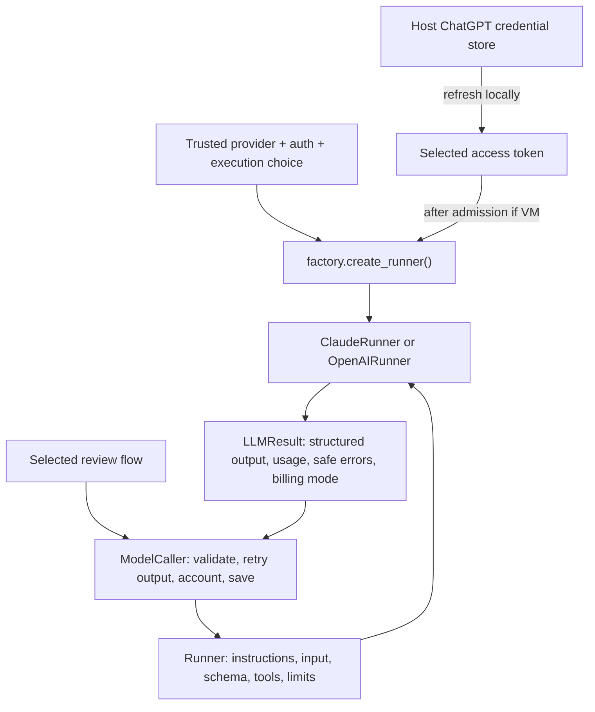

# LLM interface and access

Provider, authentication and execution location are independent operator choices. Both review algorithms use the same `Runner` contract, validation, criteria, accounting and reports. Subscription access does not change the VM boundary or select a different review algorithm.

## Support and qualification

| Provider | Authentication | Implementation |
|---|---|---|
| Claude | API key | Claude Code adapter, `ANTHROPIC_API_KEY` |
| Claude | Subscription / enterprise | Claude Code adapter, explicit `CLAUDE_CODE_OAUTH_TOKEN` |
| OpenAI | API key | Responses adapter, `OPENAI_API_KEY` |
| OpenAI | ChatGPT subscription | Reviewer-owned OAuth consent, private storage/refresh, streaming Responses |

[Qualification evidence and outstanding checks](proposal.md#qualification-evidence) are tracked centrally; implemented access paths do not establish account entitlement or live tool behavior.

An enterprise seat must include Claude Code and permit its use. ChatGPT Plus/Pro plan access is separate from API credit. Eligibility and model availability come from the selected account; passing preflight does not verify them. No path reads browser/Codex credentials or silently changes billing mode.

## Contract and ownership



- `backends/contract.py`: `Runner`, `LLMResult`, `RunnerError` and token keys.
- `shared/llm.py`: `CallSpec`, per-role output validation, accounting and output retry policy.
- `backends/factory.py`: validates settings and selects one credential/adapter for host or guest.
- `backends/claude.py`: native process execution, structured envelope parsing, cancellation and process-group cleanup.
- `backends/openai.py`, `openai_stream.py`, `http_errors.py`, `read_tools.py`: fixed HTTPS endpoint, bounded stream/JSON parsing, tool continuations and safe errors.
- `backends/chatgpt/`: loopback OAuth/PKCE, signed identity validation, protected account records, serialized rotating refresh and model catalog.
- `sandbox/`: worker/image policy, private credential transfer, external egress and cleanup.

Only Reviewers and the persona Verifier receive Read/Grep/Glob. Resolver, Classifier and Comparator receive no code tools. The adapters do not choose criteria, merge findings or post comments.

## Selecting access

Set `provider = "claude" | "openai"` and `auth_mode = "api-key" | "subscription"`, or use `--provider` and `--auth`. API-key access is the default. OpenAI requires one explicit model ID for all roles; Claude aliases are not mapped to OpenAI models.

| Selection | Credential source |
|---|---|
| Claude API key | `ANTHROPIC_API_KEY` |
| Claude subscription | Dedicated `CLAUDE_CODE_OAUTH_TOKEN` |
| OpenAI API key | `OPENAI_API_KEY` |
| OpenAI subscription | Selected account in `~/.code-reviewer/auth/chatgpt.json` |

For Claude subscription access, run `claude setup-token` while signed into the intended organization. Its [authentication](https://code.claude.com/docs/en/authentication) and [headless](https://code.claude.com/docs/en/headless) documentation define native entitlement/setup. Only the selected native credential is forwarded; API keys cannot override subscription selection. Do not put credentials in TOML, argv, a checkout, cached VM image or chat.

## ChatGPT sign-in

VM is the default execution location. Sign in for the location you intend to use:

```bash
reviewer auth login
reviewer auth status
reviewer auth models
reviewer review OWNER/REPO#123 --provider openai --auth subscription --model MODEL_ID --passes 1
reviewer auth logout
```

For direct-host execution, append `--no-sandbox` to **each** authentication and review command. Host and VM identities are separate. A VM identity is stable for the configured Lima home/instance; changing that deployment identity requires its own sign-in. The host conducts consent for the selected runtime, stores its registration and retains refresh credentials locally. This bounded-job design transfers only an access token, rather than installing a renewable session inside the guest.

Use `--account LABEL` on auth/review commands, or set `chatgpt_account = "LABEL"`. Labels distinguish local saved accounts; verified issuer/subject/client identity binds a registration. Switching accounts requires selecting another label rather than replacing the verified identity behind an existing label. `auth status` is offline and reports labels/expiry, not tokens. `auth models` explicitly contacts the account's catalog and prints visible model IDs; it does not invoke a model. `auth login --no-browser` prints the one-time authorization URL for manual opening.

Sign-in uses an ephemeral `127.0.0.1` listener, fresh state/nonce and PKCE S256. The callback client ID, identity signature, issuer, audience, expiry, subject and required plan scopes are validated before saving tokens. RS256 verification uses `/usr/bin/openssl`; there is no Python crypto dependency. Authentication storage requires POSIX file controls, an owned 0700 directory, 0600 regular single-link files, exclusive refresh locking and atomic replacement. Store it outside Git. `CODE_REVIEWER_DATA` relocates the reviewer's private data root, including this store.

Refresh rotates tokens under the store lock. Terminal refresh errors clear unusable tokens while preserving registration identity for reauthorization. Temporary errors retain credentials. Logout clears local tokens and attempts remote revocation; an unconfirmed revocation tells you to disconnect the app in ChatGPT settings. Local logout does not prove that an already copied access token is unusable.

Host calls refresh before a bounded request when necessary. The VM launcher refreshes only after source admission/revocation and boundary checks, then hands off an access token with enough remaining lifetime for the configured VM deadline plus a margin. Refresh/identity tokens and host login files never enter the VM. Authentication endpoints are contacted by the host; guest inference egress remains `api.openai.com:443` only. VM jobs cannot renew access tokens.

The subscription Responses payload uses `store: false`, `stream: true`, full stateless history and namespaced read tools. It omits unsupported `max_output_tokens`. An absent Content-Type header still requires valid bounded SSE framing; it cannot bypass completion validation. Tools/final output are accepted only after a valid `response.completed`; truncation, failed/incomplete events and interrupted streams fail without automatic replay. Temporary HTTP failures before streaming may use the bounded request retry policy. Subscription usage-limit errors require operator action; no API-key fallback occurs.

Official protocol references: [registration/sign-in](https://developers.openai.com/siwc/token-sharing-open-source/sign-in), [accounts/refresh](https://developers.openai.com/siwc/token-sharing-open-source/profiles-and-sessions), [models/streaming](https://developers.openai.com/siwc/token-sharing-open-source/models-and-inference), [preview limitations](https://developers.openai.com/siwc/token-sharing-open-source/preview-limitations), [VM identities](https://developers.openai.com/siwc/token-sharing-open-source/self-hosted-vms).

## Responses protocol

| Concern | Adapter behavior |
|---|---|
| Subscription request | Fixed public Responses endpoint, bearer access token, `store: false`, `stream: true`, array input and `instructions`; unsupported preview fields are omitted |
| Tools | Namespaced Read/Grep/Glob functions, strict argument schemas, no command tools |
| Stream output | Retain finalized `response.output_item.done` items by index; terminal output is authoritative when populated, otherwise finalized items supply the output. Partial deltas cannot authorize execution |
| Completion | Require `response.completed`; failed, incomplete, truncated, duplicated or malformed item streams fail |
| Tool continuation | Decode argument strings as JSON objects, validate the selected tool, execute bounded reads, then append all output/reasoning items and `function_call_output` with its `call_id` to stateless history |
| Final answer | Read message `output_text` and decode JSON; refusals, missing content and unsupported shapes have explicit safe errors |
| Output schema | Close objects and require all declared fields. Omit unsupported array `uniqueItems` from the OpenAI request only; Python role validators still check distinct assignments, categories and conflict references |
| Investigation limits | At most 32 read-tool calls and 33 response turns, allowing one tool call per turn plus a final structured answer; token/cost allowances, request sizes and deadlines may stop work earlier |
| Retry | Completed invalid JSON can use the existing bounded output retry. Stream/protocol failures do not restart the conversation. Temporary HTTP retries remain separately bounded |
| Diagnostics | Retain closed processing phases, counts and error types; omit raw text, arguments, reasoning and response bodies |

Protocol references: [subscription requirements](https://developers.openai.com/siwc/token-sharing-open-source/preview-limitations), [streamed function calls and continuation](https://developers.openai.com/api/docs/guides/function-calling), [structured outputs](https://developers.openai.com/api/docs/guides/structured-outputs). The fixtures in `tests/test_chatgpt.py` exercise actual stdlib HTTP/SSE parsing, fragmented finalized output, tool continuation with reasoning, and final schema output without network/model access.

## Accounting and limits

API-key calls use operator-supplied token prices and estimated dollar allowances. Subscription calls use `call_budget_tokens` (default 200,000) and `run_budget_tokens` (default 2,000,000), count cache reads and display API cost as N/A. Persona token pools use the same criteria/Comparator/Verifier/persona ratios as API dollar pools, without borrowing. Incomplete or missing usage conservatively consumes at least the reserved token allowance; validated usage is reconciled even when the answer is invalid. Known usage is reconciled after each call.

Token admission estimates, pass counts, timeouts and cancellation bound work but cannot enforce a hard provider spending/token cap: subscription requests cannot set `max_output_tokens`, and native usage is observed after process completion. One response can exceed its allowance before the harness stops. Claude subscription calls omit the native API-dollar flag and use the shared token/pass/time controls. Never treat native API-equivalent costs as a subscription balance or invoice.

See [HTTP errors](usage.md#api-errors-and-retries). Safe codes/validated headers reach stats; raw provider error bodies and credentials do not. Optional [local Langfuse tracing](tracing.md) records model/tool timing, safe error codes and usage. The native Claude adapter exposes aggregate invocation usage rather than intermediate tool events.

## Native runtime artifact

The supported verified startup fixture uses Claude Code 2.1.301, Linux ARM64, SHA-256 `1e119036a802d359ba5f9886428e031586e8796f7a858d5a8ee179ac7b8604f0` (267,247,608 bytes). Provenance uses Anthropic's documented signing fingerprint `31DD DE24 DDFA B679 F42D 7BD2 BAA9 29FF 1A7E CACE`. Startup compatibility does not establish authenticated tool behavior or entitlement.

Set `vm_claude_binary` and `vm_claude_sha256` to a verified Linux ARM64 executable. The Mac executable cannot run in the guest. The runtime uses a 4 GiB job VM / 6 GiB worker; binaries, disks and credentials stay outside Git. Qualify runtime changes with the [VM deployment checks](sandbox-check.md).
