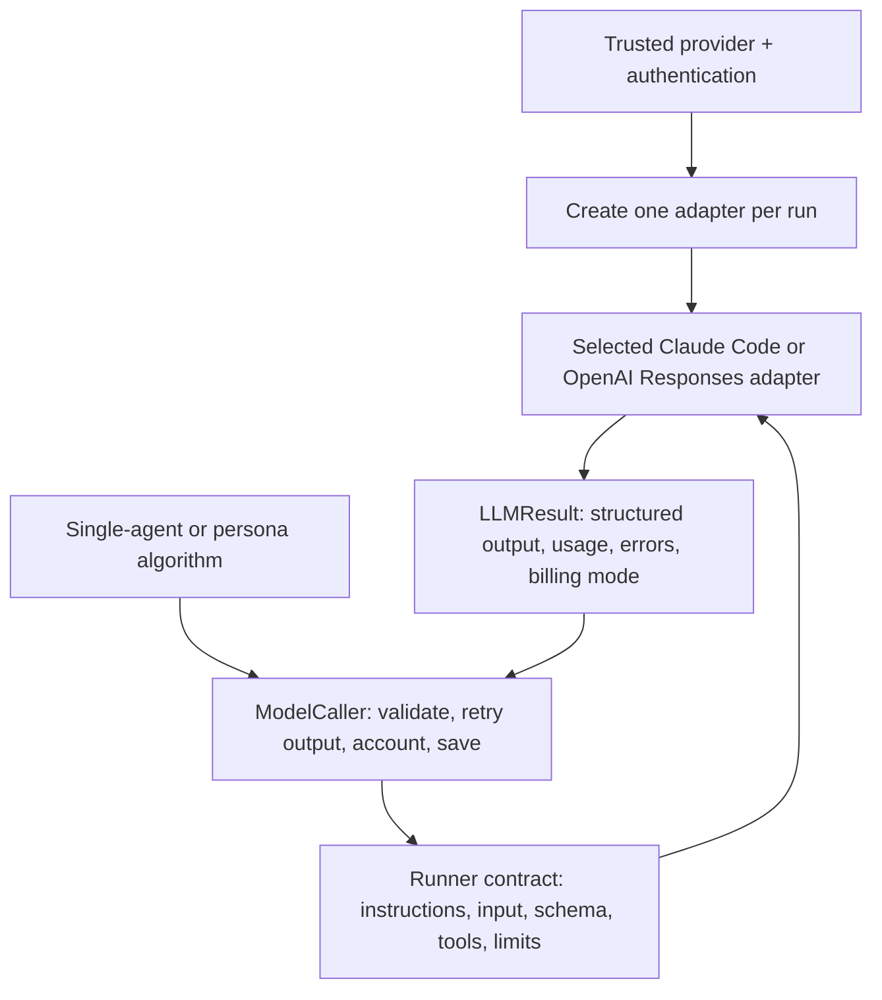

# LLM interface and access

The review algorithms depend on a provider-neutral runner. Provider, authentication and execution location are independent operator choices. A subscription is an authentication/access option; it does not select a different review algorithm or weaken the VM boundary.

## Current support

| Provider | Authentication | Implementation | Live qualification |
|---|---|---|---|
| Claude | API key | Claude Code adapter | Successful VM inference unverified |
| Claude | Subscription / enterprise | Claude Code adapter, explicit OAuth token | Organization entitlement and successful VM inference unverified |
| OpenAI | API key | Responses adapter with bounded read tools and HTTP retries | Real VM requests reached the API; account/authentication errors observed, no successful inference |
| OpenAI | ChatGPT subscription | Planned Sign in with ChatGPT flow | Not implemented; preflight refuses before target or credential activity |

An enterprise seat must include Claude Code and permit its use. ChatGPT Plus is not API credit. Sign in with ChatGPT is a separate documented subscription route for eligible applications; it is not implemented by placing a browser/Codex token into `OPENAI_API_KEY`.

## Contract and ownership

- `backends/contract.py`: shared `Runner`, `LLMResult`, `RunnerError` and token keys. A call has a fresh conversation, allowlisted read tools, a timeout and an estimated allowance.
- `shared/llm.py`: `CallSpec` and `ModelCaller` own review-role context, output validation, retry policy and per-call logs. They import no provider implementation.
- `backends/factory.py`: validates the selected combination, selects credentials and creates the adapter for both host and guest callers. There is no fallback provider or billing mode.
- `backends/claude.py`: process invocation, native JSON envelope parsing, cancellation and process-group cleanup.
- `backends/openai.py`, `http_errors.py`, `read_tools.py`: fixed-endpoint HTTPS, Responses tool conversations, strict schema translation, bounded filesystem reads, safe error diagnostics and deadline-aware retries.
- `sandbox/`: owns deployment, private credential transfer, external egress and VM cleanup. Adapters do not select the execution location.

Only Reviewers and the persona Verifier get Read/Grep/Glob. Other roles receive no code tools. Prompts, findings schemas, grounding, duplicate merging and agreement remain flow-owned and unchanged by the provider switch.

## Selecting access

Use `provider = "claude" | "openai"` and `auth_mode = "api-key" | "subscription"`, or `--provider` and `--auth`. API key is the default authentication mode. Subscription selection never silently uses an ambient API key. The old `vm_claude_auth` configuration key is accepted only as a migration input (`oauth` becomes `subscription`); do not specify it together with `auth_mode`.

| Selection | Credential source |
|---|---|
| Claude API key | `ANTHROPIC_API_KEY` |
| Claude subscription, explicit host execution | Dedicated `CLAUDE_CODE_OAUTH_TOKEN` |
| Claude subscription, VM execution | Dedicated `CLAUDE_CODE_OAUTH_TOKEN`, handed off only after admission/probes |
| OpenAI API key | `OPENAI_API_KEY` |
| OpenAI subscription | Future reviewer-owned OAuth consent/storage/refresh; currently unavailable |

For a Claude subscription token, run `claude setup-token` yourself while signed into the intended enterprise organization. Token creation/entitlement is an operator step, not performed by tests or preflight. Never paste a token into chat or put it in TOML, argv, a source checkout or a cached VM image. A VM receives only the selected credential through private pipes; it does not mount the operator's home or keychain. A long-lived token remains sensitive after VM destruction. The configured endpoint policy may still reject an endpoint needed by a real login/inference flow; live qualification is required before expanding the allowlist.

[Claude authentication](https://code.claude.com/docs/en/authentication) and [programmatic use](https://code.claude.com/docs/en/headless) describe its supported native login/headless paths. Use the existing explicit isolation/tool flags; do not add bare mode to a subscription invocation without checking compatibility with the qualified release.

## Accounting

`billing_mode` distinguishes API, subscription and unknown results. Costs remain estimates or allocation units, never a provider-enforced cap or a subscription balance. Native subscription output can report an API-equivalent cost; it is not an additional API invoice. Token, pass, timeout and concurrency limits still apply. Unknown usage/cost remains unknown and persona reservations stay conservative; pools never borrow.

See [HTTP failures and retry limits](usage.md#api-errors-and-retries). Safe codes/validated headers are exported in stats; raw provider error bodies and credentials are not logged. Agentic tracing is deferred.

## Next: ChatGPT subscription access

Implement the application's own supported Sign in with ChatGPT consent, account selection, protected storage, validation and renewal, then extend the Responses transport for the subscription protocol. The preview requires streaming with `store: false`, an account-supported model, and omission of unsupported parameters such as `max_output_tokens`. Stream failure is not completion; do not retry after partial output as if nothing happened.

This is a separate implementation milestone, not a configuration switch that works today. Keep host and VM admission credential-free, select the account explicitly, and qualify refresh/expiry, cancellation, tools and model output through the real boundary. Do not copy Codex/browser credentials or send subscription tokens through the API-key path. The existing reviewer/core does not need a new agent framework.

Official references: [Sign in with ChatGPT](https://developers.openai.com/siwc/token-sharing-open-source), [models and streaming](https://developers.openai.com/siwc/token-sharing-open-source/models-and-inference), [preview limits](https://developers.openai.com/siwc/token-sharing-open-source/preview-limitations), [self-hosted VM credentials](https://developers.openai.com/siwc/token-sharing-open-source/self-hosted-vms).

## Qualified native artifact

The no-key Linux ARM64 startup probe used Claude Code 2.1.301 with SHA-256 `1e119036a802d359ba5f9886428e031586e8796f7a858d5a8ee179ac7b8604f0` (267,247,608 bytes). The upstream release manifest signature was checked against Anthropic's documented fingerprint `31DD DE24 DDFA B679 F42D 7BD2 BAA9 29FF 1A7E CACE`. That establishes provenance/startup compatibility, not authenticated tool containment or entitlement.

Provide a verified Linux ARM64 native executable through `vm_claude_binary` and `vm_claude_sha256`; the Mac executable cannot run in the Linux guest. This runtime needs the existing 4 GiB job VM / 6 GiB dedicated worker. Artifact bytes, credentials and disks remain outside Git. Recheck [upstream setup](https://code.claude.com/docs/en/setup) and repeat qualification when changing releases. See [VM deployment](sandbox-check.md).
