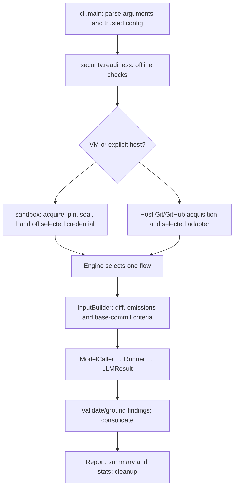

# Reading the reviewer code

A walkthrough for a Java developer learning this Python project. The runnable product is a one-shot CLI; the parked REPL is not the entry point. Start with the [architecture](architecture.md) for boundaries and [LLM guide](llm.md) for provider/authentication support.

## The program's path

## Where to start reading

| Module | Question it answers |
|---|---|
| `cli.py`, `review_options.py` | Which commands/options exist and how are overrides applied? |
| `config.py`, `security.py`, `review_flow.py` | What is trusted configuration and when can target/credential activity begin? |
| `engine.py`, `flows/__init__.py` | Which review algorithm runs? |
| `flows/single_agent/flow.py` | What is the whole single-agent review sequence? |
| `flows/agent_personas/flow.py` | How do concurrent rounds, fixed-order merges and advisory verification work? |
| `shared/review_inputs.py`, `criteria.py`, `resolver.py` | How are PR input and project rules assembled? |
| `shared/diffview.py`, `findings.py` | How is a diff represented and evidence checked? |
| `backends/contract.py`, `factory.py` | What does any LLM adapter promise and how is it selected? |
| `backends/claude.py`, `openai.py` | How do native CLI and HTTPS calls satisfy that contract? |
| `shared/llm.py`, `stats.py`, `run_store.py` | Who validates replies, accounts attempts and writes artifacts? |
| `sandbox/review.py`, `review_worker.py`, `guest.py` | How does a normal review cross the VM boundary? |
| `sandbox/vm.py`, `network.py`, `snapshot.py` | Which OS/network controls contain the job? |
| `parked/` | Retained inactive frontend/replay helpers; no normal CLI dependency |

There are no package-root forwarding modules. Tests and callers import the module that owns the implementation. `Engine` remains a small facade over one selected flow; it does not contain a second copy of either algorithm.

## Python concepts used here

### Dataclasses are ordinary data objects

`PRContext`, `CallSpec` and `LLMResult` use `@dataclass`. Like a Java record or a small POJO, their fields describe data. Python generates the constructor and useful representations. `field(default_factory=list)` gives each instance its own list; a shared mutable default would leak state between runs.

`dataclasses.replace(cfg, ...)` creates an option-adjusted copy. It prevents one review's CLI overrides from mutating configuration reused elsewhere. Paths use `pathlib.Path` rather than scattered string concatenation.

### A protocol describes the dependency

`Runner` is a `typing.Protocol`: code uses the runner's supported methods without depending on a concrete provider class. It is a static structural contract, not runtime validation. Claude and OpenAI adapters return `LLMResult`; FakeRunners in tests use the same result type. Runtime reply/schema/evidence checks remain mandatory.

The interface carries system/user text, schema, model, allowed tools, cwd, estimated allowance and timeout. It returns structured output or failure, token/cost metadata, duration, retryability and billing mode. The adapter does not decide review criteria, merges, votes or posting.

### Functions and callbacks connect the pieces

The harness passes event sinks, validators, transport functions and fixture runners as ordinary function values. This resembles injecting Java functional interfaces. `emit(Event(...))` is progress output, not the review state. The master list, pass records and validators determine the result.

Dependency injection keeps tests offline: a fixture can supply scripted provider responses without reading credentials, networking or starting a VM. Boundary tests exercise the real dispatcher with controlled infrastructure fakes rather than bypassing the boundary through a presentation seam.

### Exceptions describe failure boundaries

- `ConfigError`: invalid trusted operator settings or unsupported access selection.
- `RunnerError`: adapter startup/use failure; callers never choose a fallback provider.
- `PassFailed`: a call could not produce validated output after permitted retries.
- `ReviewRefused`: no acceptable review input or unsupported execution request.
- Persona `RunStopped`: a particular pool/global limit prevents more work.

`try/finally` ensures cleanup even when these exceptions or cancellation interrupt execution. Context managers (`with`) close files/sockets/temporary state at the boundary they own. Never assume a temporary directory itself provides OS isolation.

### Concurrency is bounded work, not extra agents created dynamically

Persona mode uses a `ThreadPoolExecutor`: each round dispatches at most `persona_parallel` calls. Each active reviewer has separate caller/log state and an independent budget pool. Shared accounting/reservations are protected by locks. The harness waits for the round, merges in fixed order and only then starts another round. Cancellation reaches native process groups or API retry waits; join work before removing its checkout.

## Input and criteria

Each run pins exact base/head/merge-base commits. Criteria come from the base tip so a PR cannot edit its own rules. The merge-base-to-head diff defines changed scope. Lockfiles/generated/configured exclusions are named but not scored. Binary detection uses an 8000-byte NUL/invalid-UTF-8 prefix heuristic; omitted contents are not certified safe. Reports/stats include omission metadata.

The VM fetches and parses public input unprivileged, applies text/count/object limits, exports text blobs, revokes source networking and seals code read-only before model work. Host acquisition reuses Git/GitHub access and exports a separate checkout. No target build/test/install command is run by either review flow.

## One model call and one pass

`ModelCaller` supplies a role's `CallSpec` to the selected `Runner`, records attempts and validates the result. An invalid structured answer can receive one feedback retry. OpenAI temporary HTTP retries repeat the same request with a deadline and server/backoff delay; they do not restart the whole tool conversation or multiply through the output retry. Safe codes/headers survive; raw error bodies do not.

The Reviewer proposes findings. `FindingsPreparer` validates shape/rule references and grounds quotes/anchors in admitted code/diff. A Comparator proposes duplicate mappings; deterministic code updates the master. Single-agent stopping uses successful completions and new findings. Persona stopping uses configured rounds and independent pools; flagged conflicts may receive advisory verification. Agreement measures repeated sightings, not truth.

## Storage and billing

`RunStore` owns private files and a separate temporary checkout. Host runs retain prompts, replies and mappings; normal VM runs export only bounded report/summary/stats after confirmed cleanup. Internal artifact paths in a VM report refer to destroyed guest files. `--post` explicitly publishes the selected summary through the operator's GitHub CLI.

API keys and subscription credentials are separate access modes. The common factory selects exactly one and strips unselected native credentials. Dollar values are adapter estimates/allocation units, not a transferable subscription balance or hard provider cap. Unknown cost remains unknown; token/pass/time limits remain useful regardless of billing mode.

## What is unfinished

The shared runner/factory, Claude access modes and OpenAI API-key adapter are implemented. The ChatGPT subscription consent/storage/refresh and streaming path is planned and explicitly refused today. Successful live inference and actual native read-tool behavior inside the VM still require qualification. REPL/replay restoration, LSP, context packs and agentic traces are later work.

## Development checks

Use Python 3.9+ with the standard library and `tomli` on older Python. Every module starts with `from __future__ import annotations`; avoid `match` and runtime `X | Y` types. Run the full suite on the oldest and newest available supported Python. Unit tests use temporary synthetic repositories, fake processes and simulated responses; they never read real keys or boot VMs. See [development](development.md), [the VM checklist](sandbox-todo.md) and [the current plan](proposal.md#checklist).
