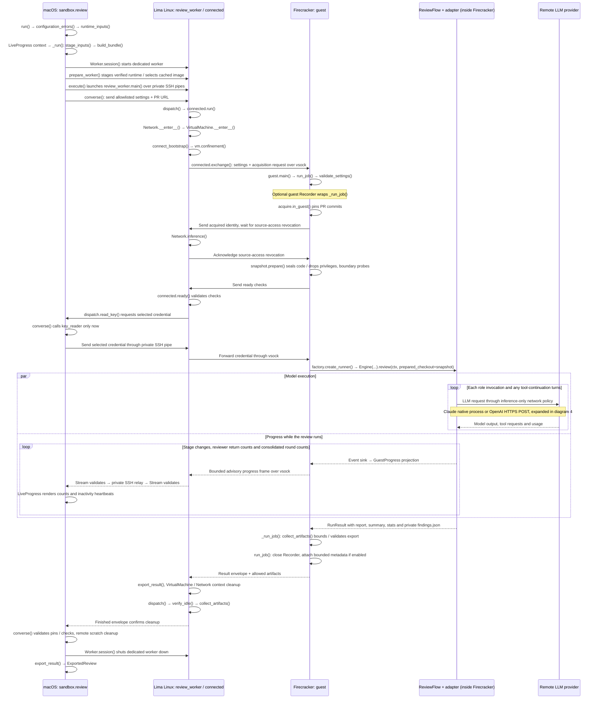
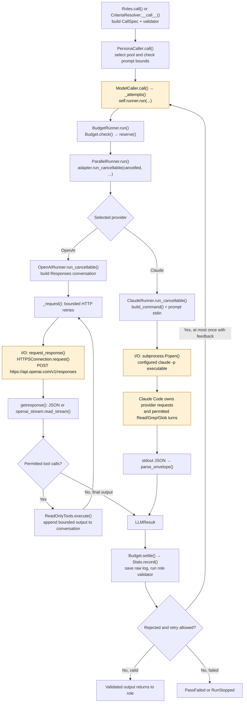
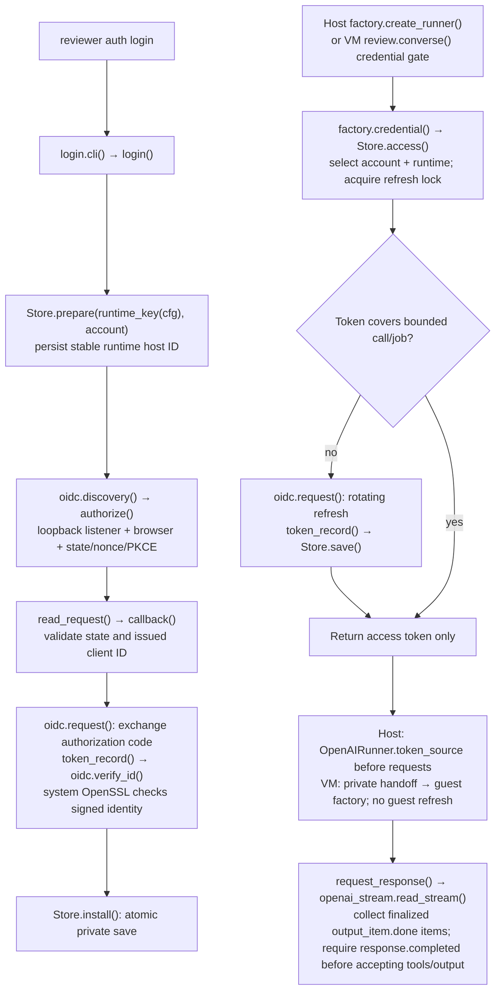
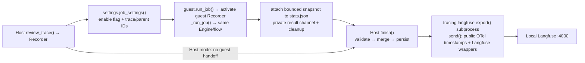

# Reading the reviewer code

A source-code walkthrough for contributors. It follows a pull request from the one-shot CLI through execution, model calls, validation and reporting. Start with the [architecture](architecture.md) for boundaries and [LLM guide](llm.md) for provider/authentication support.

## Complete review call chain

From an installed reviewer checkout, start with `source .venv/bin/activate && reviewer review <PR URL>`. Activation makes the CLI available in the current terminal; the diagrams begin at the `reviewer` process. The installed `reviewer` entry point in [pyproject.toml](../pyproject.toml) calls `code_reviewer.cli.main()`. The diagrams below expand that path in layers: dispatch, the VM boundary, the four-perspective pipeline and each model invocation. Labels name actual functions or methods; arrows show execution order, including returns where marked. They omit standard-library internals and small parsing/formatting helpers.

Orange **LLM call** nodes mark role invocations; orange **I/O** nodes mark the subprocess or network operation that performs them. Other nodes run locally without asking a model. The same call chain runs on the host or inside Firecracker, according to the selected execution location.

### 1. CLI, execution selection and final output

```mermaid
flowchart TD
    START["reviewer review PR"] --> CLI["cli.main() → build_parser()"]
    CLI --> CONFIG["config.load_config()"]
    CONFIG --> OPTIONS["git_ops.parse_pr_ref()<br/>review_options.apply_run_options()"]
    OPTIONS --> DISPATCH["review_flow.run_review()"]
    DISPATCH --> READY["security.readiness()"]
    READY --> PREFLIGHT{"--preflight?"}
    PREFLIGHT -->|yes| OFFLINE["Return configuration report<br/>cli.main() prints JSON; exit"]
    PREFLIGHT -->|no| GATE["Validate effective execution/provider settings"]
    GATE --> EXECUTE["tracing.review.review_trace() wrapper<br/>review_flow._execute_review()"]
    EXECUTE --> LOCATION{"cfg.sandbox?"}
    LOCATION -->|yes: default| VM["sandbox.review.run()<br/>Expand in diagram 2"]
    LOCATION -->|no: explicit host| DRY{"--dry-run?"}
    DRY -->|no| ADAPTER["backends.factory.create_runner()"]
    DRY -->|yes: no credential| ENGINE["Engine.__init__() → ReviewFlow.__init__()"]
    ADAPTER --> NATIVE{"Claude host subscription<br/>without an exported token?"}
    NATIVE -->|yes| STATUS["claude.require_subscription_login()<br/>native auth status, configured isolation,<br/>no reviewed checkout or credential copying"]
    STATUS --> ENGINE
    NATIVE -->|no| ENGINE
    ENGINE --> PREPARE["Engine.prepare() → ReviewFlow.prepare()<br/>pr_source.load_pr_context()"]
    PREPARE --> HOSTINPUT["gh_pr_view() → _object_store()<br/>fetch_pr_refs() → merge_base()<br/>commit_messages() → PRContext"]
    HOSTINPUT --> KIND{"--dry-run?"}
    KIND -->|yes| PREVIEW["Engine.dry_run() → ReviewFlow.dry_run()<br/>presentation.render_dry_run(); exit"]
    KIND -->|no| REVIEW["Engine.review() → ReviewFlow.review()<br/>LLM role calls in diagram 3<br/>Actual provider I/O in diagram 4"]
    REVIEW --> OUTCOME["Return ReviewOutcome.result"]
    VM --> OUTCOME
    OUTCOME --> TRACE["If tracing: tracing.review.finish()<br/>validate guest metadata, save stats,<br/>bounded host export to localhost:4000"]
    TRACE --> DISPLAY["cli.main()<br/>presentation.render_summary() + run_line()<br/>print report_path"]
    DISPLAY --> POST{"--post?"}
    POST -->|yes| GITHUB["post.format_comment() → post.post_comment()"]
    POST -->|no| EXIT["Return CLI exit status"]
    GITHUB --> EXIT
```

`_object_store()` selects a matching local clone or calls `git_ops.ensure_cache_clone()` for a cached bare clone. Fetches pin base/head into private refs; they do not switch the operator's working branch. A VM result is an `ExportedReview`: presentation uses its exported summary rather than reconstructing the guest's master list. Configuration errors stop before acquisition or credential access; VM failures have no edge to host execution.

### 2. VM execution and process boundaries

`sandbox.progress.Stream.receive()` consumes progress frames while waiting for the next acquisition/readiness/result envelope. `review.converse()` keeps credential requests separate and still requires the exact finished/cleanup envelope. `LiveProgress` owns a joined host heartbeat thread around VM execution; it never reads credentials or reviewed files. `shared.events.reviewer_preview()` projects proposed/self-rejected counts as each reviewer returns, before grounding and the round barrier. `shared.events.round_preview()` reports new and cumulative grounded candidate counts after consolidation. Neither exposes candidate titles or locations. The TTY-only activity line clears before output and on exit; non-interactive output stays plain. These counts are advisory and do not enter prompts or authorize publication.

The guest receives an already pinned `PRContext` from acquisition and calls `Engine.review()` directly: it does **not** call host `Engine.prepare()` again. Code acquisition uses temporary source-network access; model work uses the inference-only policy. The guest adapter shares the same review implementation as the host adapter. See [sandbox architecture](sandbox-architecture.md) for enforcement details and failure/cleanup boundaries.

### 3. Four-perspective review orchestration

`Engine.review()` delegates to `ReviewFlow.review()` in `review/flow.py`. `InputBuilder.redact()` handles PR metadata, `load_diff()` enforces diff/exclusion/binary limits, and `RunStore` owns artifacts. Host runs use `prepare_checkout()` and `git_ops.export_tree()`; VM runs reuse the admitted sealed snapshot.

Orange nodes invoke an LLM when their condition applies. Every invocation expands into diagram 4.

```mermaid
flowchart TD
    START["ReviewFlow.review()"] --> INPUT["InputBuilder + RunStore<br/>Budget + ParallelRunner + PersonaCaller + Roles"]
    INPUT --> RES["LLM when needed: resolve_criteria()<br/>CriteriaResolver.__call__() → ModelCaller.call()"]
    RES --> CLASS["LLM for project rules: Roles.classify()<br/>Roles.call('classifier')"]
    CLASS --> FREEZE["Catalog.allocate() → _freeze()<br/>freeze() + save_frozen() per persona"]
    FREEZE --> ROUND["_passes(): ThreadPoolExecutor.submit()<br/>LLM: Roles.review() for each active persona"]
    ROUND --> WAIT["as_completed(): collect returned outputs<br/>round barrier"]
    WAIT --> MERGE["_consolidate() in scheduling order<br/>FindingsPreparer.prepare()<br/>LLM when findings exist: Roles.compare()"]
    MERGE --> APPLY["MasterList.apply() on staged copy<br/>count completed slot only after consolidation"]
    APPLY --> NEXT{"More configured rounds?"}
    NEXT -->|Yes| ROUND
    NEXT -->|No| JOIN["finally: cancel + executor.shutdown(wait=True)"]
    JOIN --> JOBS["_verify() → verification.groups()<br/>connected conflicts + singleton candidates"]
    JOBS --> VERIFY["candidate_inputs(): immutable claim data<br/>LLM: Roles.verify() → Roles.call('verifier')"]
    VERIFY --> GATE["validate_assessments() → accepted assessment<br/>publishable() selects supported findings"]
    GATE --> REPORT["RunStore.save_inputs() + save_outputs()<br/>report.render_report() + render_summary()<br/>artifact() → findings.json"]
    REPORT --> CLEAN["finally: cleanup_checkout()<br/>unless explicitly kept on host"]
    classDef llm fill:#fff1d6,stroke:#b76b00,color:#171717
    class RES,CLASS,ROUND,MERGE,VERIFY llm
```

Each persona has frozen instructions, caller/log state and an independent pool. Pool exhaustion or repeated failures disable that persona; the others continue. Shared-role exhaustion, global cancellation or terminal failure prevents further calls. Workers are joined before checkout cleanup. Validated Verifier assessments gate publication. Refuted, unresolved and unfinished candidates remain private; severity and votes are unchanged. `review/verification.py` owns conflict components, assessment validation and the publication predicate shared by reporting and structured output.

`report._groups()` places each finding once under correctness, production safety, test quality or code quality. Display order is independent of scheduling order and never mutates the master.

### 4. Every LLM invocation, actual I/O, tools and validation

The actual shared adapter invocation is `self.runner.run(...)` in [ModelCaller._attempts()](../src/code_reviewer/shared/llm.py). The object is a budget wrapper around a cancellation wrapper around the selected provider adapter. Runner construction and authentication status checks do not request an LLM review.

Claude's provider implementation lives outside this repository: `subprocess.Popen()` hands the request to Claude Code. Python gets its aggregate JSON result. OpenAI transport is implemented here; both authentication methods use `request_response()`. VM HTTP requests use the fixed external egress proxy. An injected `_transport` substitutes synthetic HTTP replies only in tests.

One role invocation can involve several provider requests: OpenAI tool continuations, bounded transient HTTP retries and the shared output-validation retry are distinct. They do not add review rounds or grant fresh budgets. Only Reviewers and Verifier have code tools; Resolver, Classifier and Comparator do not.

### Following the diagrams in code

| Layer | Source entry points |
|---|---|
| Command and boundary selection | [cli.py](../src/code_reviewer/cli.py), [review_flow.py](../src/code_reviewer/review_flow.py), [security.py](../src/code_reviewer/security.py) |
| VM launcher → Linux supervisor → guest | [review.py](../src/code_reviewer/sandbox/review.py), [review_worker.py](../src/code_reviewer/sandbox/review_worker.py), [connected.py](../src/code_reviewer/sandbox/connected.py), [guest.py](../src/code_reviewer/sandbox/guest.py) |
| Persona orchestration and call guards | [review/flow.py](../src/code_reviewer/review/flow.py), [roles.py](../src/code_reviewer/review/roles.py), [caller.py](../src/code_reviewer/review/caller.py), [runner.py](../src/code_reviewer/review/runner.py) |
| Shared input, calls, evidence and storage | [review_inputs.py](../src/code_reviewer/shared/review_inputs.py), [llm.py](../src/code_reviewer/shared/llm.py), [findings.py](../src/code_reviewer/shared/findings.py), [run_store.py](../src/code_reviewer/shared/run_store.py) |
| Adapter creation and implementations | [factory.py](../src/code_reviewer/backends/factory.py), [claude.py](../src/code_reviewer/backends/claude.py), [openai.py](../src/code_reviewer/backends/openai.py), [read_tools.py](../src/code_reviewer/backends/read_tools.py) |

### Using this map to check for unused code

Trace reachability from `cli.main()` and the separately launched worker/guest `main()` functions. Search both direct calls and references passed as callbacks, then check tests and supported deployment commands before removing a symbol. A method absent from a literal `name()` search can still execute through `CriteriaResolver.__call__()`, `PersonaCaller` inheritance, `Engine.__getattr__()`, a context manager's `__enter__()`/`__exit__()`, an executor task or a subprocess module entry point.

The diagrams cover the review command. `sandbox check/recover` have separate supported entry paths; the retained `parked/` frontend/REPL helpers are deliberately outside this path. Neither omission alone establishes dead code. Authentication is expanded below; offline preflight does not enter that path.

### 5. ChatGPT authentication within the call chain

`cli.main()` routes explicit `auth` commands to `backends.chatgpt.login.cli()`. These commands do not acquire a PR. Normal review dispatch enters credential handling only after validated configuration (host) or confirmed VM admission (guest workload).

`auth status` uses `Store.records()` without network/refresh. `auth models` calls `Store.access()` then `models.catalog()`. `auth logout` calls `Store.logout()` to attempt revocation and clear local tokens. Identity/refresh credentials stay on the host; host and VM registrations use separate runtime identities. See [LLM access](llm.md#chatgpt-sign-in) for exact limits and the outstanding live qualification.

### 6. Optional tracing across the VM boundary

`run_review()` validates configuration and handles preflight before calling the decorated `_execute_review()`. `tracing.review.review_trace()` creates a `tracing.Recorder` for real reviews by default; `tracing = false` opts out. `tracing.observation()` and `traced()` record closed metadata, not method arguments. `ModelCaller.call()` creates role agents; OpenAI records individual turns/tools, while Claude records aggregate native generations. Persona executor submissions use `copy_context().run` to preserve parentage.

The exporter is optional, host-only and deadline-bounded. It has no provider credentials or guest network route. `finish()` also runs on failure, preserving available host metadata; an unavailable exporter cannot replace a review exception or result. Preflight/dry-run bypass the recorder/export lifecycle. See [trace configuration and limits](tracing.md).

## Further reference

The diagrams above map executable paths. For behavior and limits, use [architecture](architecture.md), [configuration/reports](usage.md), [authentication](llm.md), [tracing](tracing.md) and [VM controls](sandbox-architecture.md). [Development](development.md) owns test/setup instructions; [the roadmap](proposal.md#checklist) owns remaining work.
