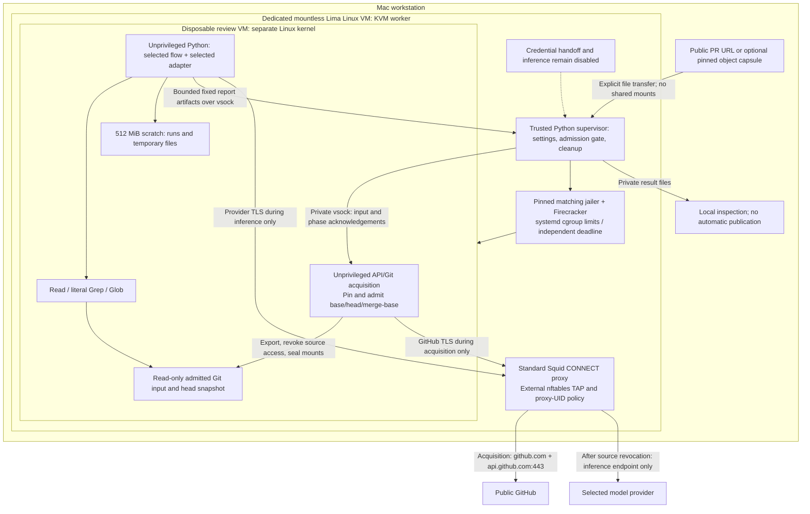

# VM execution architecture

The reviewer chooses provider, review strategy and execution location independently. VM execution is the intended default; an explicit direct-host option is also planned. Neither path is selected from repository ownership or purpose. See the [shared execution contract](security-contract.md).

## Boundaries and process placement

One disposable Firecracker VM contains acquisition, Python orchestration, every persona and model/tool session. On macOS, dedicated mountless Lima supplies the Linux/KVM environment; on native Linux that outer compatibility layer is unnecessary. The diagram shows the VM components, not completed authenticated dispatch.

The trusted launcher is ordinary operator-controlled Python in the dedicated Linux worker, outside the inner review VM. It manages the jailer/VM, external network policy, private bootstrap/results and cleanup; it does not review code. The shared review core runs inside the selected execution boundary with either provider adapter. No per-persona VM, container controller or always-running orchestration service is involved.

## Implemented VM controls

- Pinned Firecracker, matching upstream jailer and kernel; hashes cover the actual staged bytes. Runtime/configuration are root-owned outside the VMM-writable socket directory.
- The shared `vm.py` starts a transient systemd service with CPU/RAM/swap/task/deadline limits, chroot, private PID/mount namespaces, reduced UID/GID, no-new-privileges and default VMM seccomp. Host observations check these controls independently of guest reports.
- Guest setup seals admitted Git/head input read-only and drops privileges. Both flows reuse the prepared head snapshot. Native write/chmod/runtime-write denials are tested.
- External TAP/nftables and standard Squid CONNECT policy deny direct guest networking. Public acquisition allows GitHub endpoints only; the supervisor kills existing source tunnels before starting inference-only policy. Endpoint/authentication plumbing must support the runtime-selected adapter. The currently deployed no-key route tests one API endpoint; it is not a completed multi-provider runtime.
- Private bounded vsock frames carry settings, input and results. Reports use fixed names/byte limits and private local files. No target-controlled archive is blindly extracted on the workstation.
- Clean root-owned images are keyed by source/builder/copied OS identity, hash-checked on reuse and contain no target inputs or keys. Shutdown joins/kills owned work before scratch removal. Independent deadlines bound supervisor loss; explicit dedicated-worker recovery clears abandoned state without resuming the review.

A guest compromise can falsify results/accounting and expose a credential available inside it. VM destruction does not revoke that credential. Custom guest-wide syscall filtering and a custom credential broker are deferred. Read-only model tools and guest probe reports are not substitutes for host-enforced containment.

## Acquisition and input

`sandbox/acquire.py` runs API/Git parsing, pinned fetch, tree admission and export unprivileged inside the review VM. Public GitHub URLs are supported in no-key checks; private source authentication is not implemented. Limits include bounded metadata, shallow history, retained Git bytes/file count, admitted trees, scratch and deadlines. Missing commits or merge-base fail instead of silently widening history or changing pins. See [exact limits](sandbox-check.md#public-pr-acquisition-check).

The optional capsule path transfers bounded file-only Git objects from a chosen existing clone; it invokes no target Git on the workstation and copies no target configuration/hooks. It can include other history from that object store. Guest admission reconstructs clean Git state, admits the pinned trees and exports the head. This remains separate from the intended direct-host acquisition feature, which reuses the existing host acquisition implementation.

## Lifecycle

1. Read trusted operator settings and choose provider, strategy and execution location.
2. For VM execution, prepare clean artifacts/images and start the jailed disposable guest with external policy already installed.
3. Acquire/admit/pin input inside the guest, export the snapshot, revoke source access and seal read-only mounts before model work.
4. Supply selected-adapter authentication privately at runtime; never bake credentials into images, target files, arguments or logs.
5. Run the shared review algorithm with bounded Read/Grep/Glob and deterministic validators/accounting.
6. Transfer validated bounded artifacts for local inspection. Publishing requires separate explicit operator action.
7. Stop/join the VM and proxy, remove network/scratch state and confirm worker shutdown. Failures do not select host execution automatically.

Steps requiring authenticated provider calls and normal CLI report dispatch remain unwired. Explicit direct-host execution is also planned, not currently enabled. No-key checks exercise the listed components without claiming review-quality evidence.

## Development and current work

Use [the supported deployment command](sandbox-check.md), [VM checklist](sandbox-todo.md) and [development guide](development.md). Checks run an offline simulated-provider workload and a sequential connected probe workload; these are tests, not additional VM layers or per-persona isolation.

The standalone raw-Firecracker experiment was moved outside the project. Its old console-based launcher is not an alternative reviewer entry point. `sandbox/runtime.py` now contains only the bounded subprocess, boot configuration and result-validation utilities used by the supported components. See [the code map](architecture.md#code-map).
