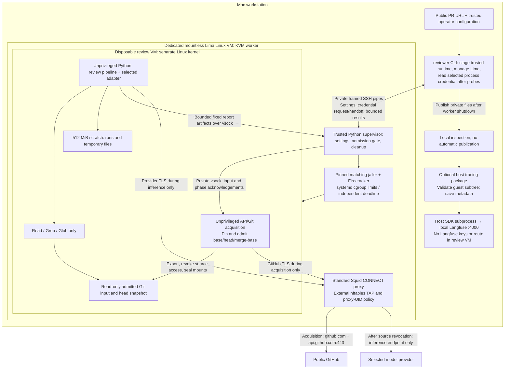
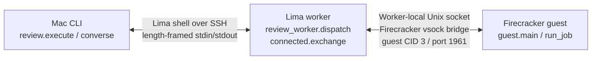
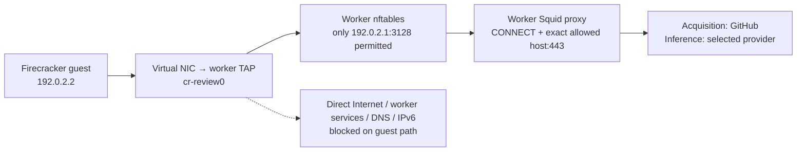

# VM execution architecture

The reviewer chooses provider, authentication and execution location independently. VM execution is the default; `--no-sandbox` explicitly selects the implemented direct-host path. Neither path is selected from repository ownership or purpose. See the [shared execution contract](security-contract.md).

## Boundaries and process placement

One disposable Firecracker VM contains acquisition, Python orchestration, every persona and model/tool session. On macOS, dedicated mountless Lima supplies the Linux/KVM environment; on native Linux that outer compatibility layer is unnecessary. Normal Mac dispatch uses the components below; both providers use the same review engine and runtime-selected adapters. The normal launcher currently supports the Mac/Lima deployment, not a standalone native-Linux CLI path.

The trusted launcher is ordinary operator-controlled Python in the dedicated Linux worker, outside the inner review VM. It manages the jailer/VM, external network policy, private bootstrap/results and cleanup; it does not review code. The shared review core runs inside the selected execution boundary with either provider adapter. No per-persona VM, container controller or always-running orchestration service is involved.

## Private control and result channel

The channel is two connected transports, separate from the guest's Internet connection. Here, **guest** means the inner Firecracker Linux VM; **worker** means the outer Lima Linux VM on the Mac.

1. On the Mac, [`review.execute`](../src/code_reviewer/sandbox/review.py) starts `limactl --tty=false shell ...` with private subprocess stdin/stdout pipes. Lima carries this session over SSH to the worker. [`Channel`](../src/code_reviewer/sandbox/channel.py) adapts the pipes to deadline-bounded reads/writes; stdout carries protocol frames rather than human-readable logs.
2. In the worker, [`review_worker.dispatch`](../src/code_reviewer/sandbox/review_worker.py) receives the request and calls [`connected.run` / `exchange`](../src/code_reviewer/sandbox/connected.py). [`VirtualMachine.__enter__`](../src/code_reviewer/sandbox/vm.py) configures Firecracker's vsock device with guest CID 3 and a jailed Unix-domain socket, `/bootstrap.sock`. `connected.connect_bootstrap` opens the worker-side socket and requests `CONNECT 1961`.
3. Inside Firecracker, [`guest.main`](../src/code_reviewer/sandbox/guest.py) listens using `AF_VSOCK` on port 1961 and accepts one connection. Vsock is a host/guest transport provided by the virtual machine monitor, not TCP/IP: it needs no public IP address, DNS lookup, proxy allowance or Internet-facing listener.
4. [`wire.py`](../src/code_reviewer/sandbox/wire.py) frames each message with an eight-byte length, then bounded bytes or JSON. The same framing is used on both hops. Settings and acquisition acknowledgements travel toward the guest; a credential travels only after the admission gate; bounded advisory progress and fixed report artifacts return in the other direction. This is not a shared host folder or a general-purpose network tunnel.

“Private” describes the controlled endpoints, process pipes/socket placement and SSH transport. Vsock itself does **not** add encryption or make returned data trustworthy. The worker supervisor and workstation remain trusted, and a compromised guest can send malicious result bytes. `connected.export_result` and the workstation validate envelopes, fixed filenames, encoding, completion checks and byte limits rather than unpickling objects or extracting a target-controlled archive. Current limits are 4 MiB per artifact, 8 MiB combined decoded artifacts and 12 MiB for a result frame. Local reports are published only after VM/network cleanup and confirmed worker shutdown.

Advisory progress frames show stage changes, reviewer return counts and consolidated round counts. Candidate titles and locations are withheld until verification supports final publication. Both hops retain closed schemas, per-frame/stream limits, terminal safety and credential checks. Progress cannot request credentials, select execution policy, replace admission/results or attest cleanup. A workstation heartbeat reports the last stage after 15 seconds without updates. See [CLI semantics](usage.md#live-progress-and-candidate-counts).

This channel returns `report.md`, `summary.md`, `stats.json` and private `findings.json`. Optional [local tracing](tracing.md) adds bounded metadata inside the existing stats/export allowances. The workstation validates and exports it after cleanup. The guest does not connect to Langfuse or receive its keys; no extra guest egress rule is installed.

## Guest Internet egress: where policy is enforced

Firecracker provides the virtual network device. The **Lima worker's Linux kernel and proxy**, outside that guest, enforce the destination policy. Guest proxy environment variables direct normal clients to the proxy, but are not the security boundary.

[`network.py`](../src/code_reviewer/sandbox/network.py) owns both layers:

- **`Network.__enter__`:** installs the per-job `inet cr_reviewer` nftables table, creates TAP `cr-review0`, assigns worker gateway `192.0.2.1/30` and starts an unprivileged Squid process. `connected.run` enters this context before starting Firecracker. `VirtualMachine.__enter__` attaches the guest NIC to that TAP; the guest address is `192.0.2.2`.
- **`firewall`:** permits guest-originated traffic to the worker's proxy at `192.0.2.1:3128` and drops other TAP input and forwarded traffic. Return traffic from the proxy is permitted. Additional output rules restrict the proxy UID to selected worker DNS resolvers and public IPv4 TCP port 443, rejecting private/reserved ranges, IPv6 and other traffic. These rules scope guest/proxy traffic; they are not a blanket deny policy for every process in the worker.
- **`squid_config`:** accepts only the guest source address, HTTP `CONNECT`, port 443 and an exact allowed hostname authority. Literal-IP destinations, other domains/ports and forbidden resolved destinations are denied. The acquisition list is `github.com` and `api.github.com`. Inference names come from [`settings.ENDPOINTS`](../src/code_reviewer/sandbox/settings.py): `api.openai.com`, or `api.anthropic.com` and `platform.claude.com`. Repository/model text cannot add destinations.
- **`Network.inference`:** after acquisition, `connected.exchange` kills the old proxy process group, closing existing GitHub tunnels, and starts a new proxy with inference-only destinations. The guest receives a source-revocation acknowledgement, runs boundary probes, and only then can receive the selected credential. Editing guest proxy variables cannot reopen a direct route.
- **`Network.__exit__`:** stops the proxy, removes the TAP first, then removes the firewall table. The worker dispatcher checks idle state before returning the result. Failed cleanup does not permit automatic host execution.

The proxy tunnels provider TLS; it does not decrypt or inspect prompts. Destination restrictions limit where the guest can connect, not which data it can send to an approved provider. A guest compromise can still abuse an available credential or send data to an allowed endpoint. Boundary probes exercise denied destinations and the approved TLS route, but guest-reported probe results are diagnostics, not independent attestation. See [implemented controls and limitations](#implemented-vm-controls).

## Implemented VM controls

- Pinned Firecracker, matching upstream jailer and kernel; hashes cover the actual staged bytes. Runtime/configuration are root-owned outside the VMM-writable socket directory.
- The shared `vm.py` starts a transient systemd service with CPU/RAM/swap/task/deadline limits, chroot, private PID/mount namespaces, reduced UID/GID, no-new-privileges and default VMM seccomp. Host observations check these controls independently of guest reports.
- Guest setup seals admitted Git/head input read-only and drops privileges. Both flows reuse the prepared head snapshot. Native write/chmod/runtime-write denials are tested.
- External TAP/nftables and standard Squid CONNECT policy deny direct guest networking. Public acquisition allows GitHub endpoints only; the supervisor kills existing source tunnels before starting inference-only policy. Inference policy selects only `api.openai.com`, or `api.anthropic.com` and `platform.claude.com`. The no-key deployment check tests the first route; native live authentication/tool behavior remains unqualified.
- Private bounded SSH pipes and vsock frames carry settings, runtime credentials, input and results. Only the selected credential is read after admission/probes; the host home/keychain is never copied. Reports use fixed names/byte limits and private local files. No target-controlled archive is blindly extracted on the workstation.
- Clean root-owned images are keyed by source/builder/copied OS identity and the optional native binary digest, hash-checked on reuse and contain no target inputs or keys. Shutdown joins/kills owned work before scratch removal. Independent deadlines bound supervisor loss; explicit dedicated-worker recovery clears abandoned state without resuming the review.

A guest compromise can falsify results/accounting and expose a credential available inside it. VM destruction does not revoke that credential. Custom guest-wide syscall filtering and a custom credential broker are deferred. Read-only model tools and guest probe reports are not substitutes for host-enforced containment.

## Acquisition and input

`sandbox/acquire.py` runs API/Git parsing, pinned fetch, tree admission and export unprivileged inside the review VM. Public GitHub URLs are supported by normal review dispatch and no-key checks; private source authentication is not implemented. Limits include bounded metadata, shallow history, retained Git bytes/file count, admitted text trees, scratch and deadlines. Binary contents are detected from a bounded prefix and omitted before snapshot export; text-file/text-tree limits and the all-entry count remain enforced. No full target archive is generated in the guest. Reports and stats record omissions rather than claiming binary content coverage. Missing commits or merge-base fail instead of silently widening history or changing pins. See [exact limits](sandbox-check.md#public-pr-acquisition-check).

The optional capsule path transfers bounded file-only Git objects from a chosen existing clone; it invokes no target Git on the workstation and copies no target configuration/hooks. It can include other history from that object store. Guest admission reconstructs clean Git state, admits the pinned trees and exports the head. Direct-host execution uses the operator's Git/GitHub access instead.

## Lifecycle

1. Read trusted operator settings and choose provider, authentication and execution location.
2. For VM execution, prepare clean artifacts/images and start the jailed disposable guest with external policy already installed.
3. Acquire/admit/pin input inside the guest, export the snapshot, revoke source access and seal read-only mounts before model work.
4. Supply selected-adapter authentication privately at runtime; never bake credentials into images, target files, arguments or logs.
5. Run the shared review algorithm with bounded Read/Grep/Glob and deterministic validators/accounting.
6. Transfer bounded report/summary/stats frames privately and validate them, without publishing a local success yet.
7. Stop/join the VM and proxy, remove network/scratch state and confirm worker shutdown. Failures do not select host execution automatically.
8. Save the private local files and print the summary. GitHub posting requires explicit `--post`.

## Development and current work

Use [the supported deployment command](sandbox-check.md), [qualification evidence](proposal.md#qualification-evidence) and [development guide](development.md). Checks run an offline simulated-provider workload and a sequential connected probe workload; these are tests, not additional VM layers or per-persona isolation.

`sandbox/runtime.py` contains bounded subprocess, boot configuration and result-validation utilities for the shared jailed lifecycle. See [the code map](architecture.md#module-map).

The guest and explicit host path use the same provider/authentication factory and `LLMResult` contract. The VM still determines confinement, endpoint policy and delayed credential release; adapters do not change these. ChatGPT consent/refresh run on the host, with only an access token transferred after admission. See [LLM access](llm.md).
