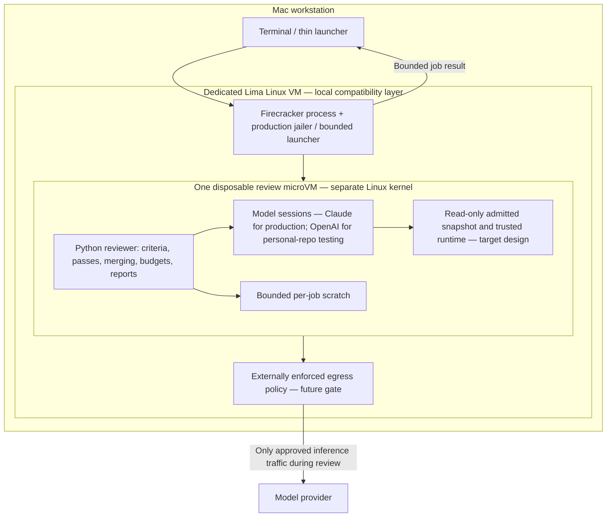

# Sandbox architecture: one VM per review

Current decision: **one disposable VM contains the entire review job**, including Python orchestration and every fresh Claude process. Agreed 2026-10-25; the simpler connected-pilot scope below was confirmed 2026-10-26. This replaces the earlier proposal for a controller container, a supervisor service and a microVM per model invocation. [Security roadmap](security-roadmap.md) tracks the remaining controls; [architecture](architecture.md) describes the existing reviewer internals.

## Implementation status

| Part | Status |
|---|---|
| Local M4/macOS -> Lima Linux -> nested Firecracker boot | Verified with a tiny synthetic Linux guest |
| Both existing Python flows with a fake headless Claude executable | Implemented as an offline smoke workload |
| Bounded offline Firecracker launcher and trusted-source bundle | Implemented prototype; Linux/KVM only |
| Whole-harness smoke inside a Firecracker guest | Passed: 2 single-agent passes / 4 persona slots; 3 / 8 fake calls |
| Real Claude binary: offline startup / unauthenticated headless refusal | Passed for pinned native ARM64 2.1.301; [runtime/auth record](sandbox-runtime-auth.md) |
| OpenAI backend for controlled sandbox testing | Implemented and offline guest-tested; [provider/tool boundaries](sandbox-openai.md) |
| Authentication, permitted inference egress and real model calls | Not implemented or qualified |
| Real PR admission/fetch, read-only guest runtime/snapshot, non-root enforcement and production jailer | Not implemented or qualified |
| Publishing or exporting real report artifacts | Not exposed by the prototype |

The normal `reviewer` CLI/REPL still runs as before. It does not silently use this prototype and must not be described as sandboxed. The implemented prototype has three offline workloads: fake-Claude review, real-Claude unauthenticated startup, and simulated-OpenAI review. All currently use synthetic inputs; the planned connected pilot will use a user-selected non-sensitive personal repository. No paid calls, host credential mounts or target repositories are part of it.

## Boundaries and process placement

The diagram is the intended real-review layout. All three offline workloads have **no network interface or attached disks** and use an in-memory filesystem assembled from trusted artifacts. The review workloads use fake Claude or simulated OpenAI responses; the runtime-probe guest adds the verified native Claude binary but no credentials. It does not yet implement the read-only/non-root target shown above.

On a native Linux/KVM worker, the outer Lima VM disappears. Python and Claude remain together inside the review microVM. The Mac setup needs nested virtualization because Firecracker uses Linux KVM; the outer VM is a compatibility layer, not another agent or orchestrator. No host directories or credential sockets should be shared into it for review jobs.

## Why Python is inside the job

Dockerizing an application and separating privileges are compatible choices. A container for Python is optional packaging, not another required security service. For this version, put the trusted reviewer code and its runtime into the guest image and run it there directly.

The host launcher has a small responsibility: select operator-approved artifacts/policy, start the VM, enforce an external deadline/output budget, collect a bounded result and stop/reap the VM. It does not run the target's tests, builds, hooks or scripts, nor receive arbitrary host commands from the guest. It must not become a general remote-execution API. No privileged controller container or host Docker socket is required.

The guest's Python harness retains normal deterministic validation and role separation during honest execution. A compromised guest could still corrupt its own report, other persona state or accounting; sharing a VM deliberately gives up strong isolation between invocations. Treat the whole guest output as untrusted. This design protects the host boundary, not the semantic truth or tamper resistance of a report produced by a compromised guest.

## Job lifecycle for real reviews (planned)

1. **Select trusted policy.** Read operator configuration outside the reviewed repository. Target `review.toml`, rules and PR text cannot choose executables, loosen isolation or authorize publication. Reject unsupported runtime/policy combinations; no host fallback.
2. **Start an empty disposable guest.** Use pinned images, explicit vCPU/RAM/disk/output/time limits, a private job directory and a production jailer. Keep long-lived host credentials, previous runs and other jobs outside it.
3. **Admit/fetch the requested PR.** Use approved hosts/protocols and bounded Git operations inside the isolated job. Pin base/head; export the review tree with path/type/size checks. Public fetches need no credential; private fetching requires a separately scoped supported auth design. If a fetch credential is provided, externally revoke/expire its authority before model execution rather than assuming deleting an environment variable erases it.
4. **Freeze inputs and make the snapshot read-only.** Preserve current criteria discovery from base and the same head snapshot for all passes. The guest runtime/policy stays separate from repository-controlled files. Allow only the required process/helper execution; Read/Grep/Glob remain the only code tools.
5. **Run the existing review flow.** Python starts independent headless sessions; persona calls overlap within rounds and consolidate serially as today. Model calls use only explicitly approved inference/auth routes. Network restrictions are enforced outside the guest, so a guest cannot broaden them.
6. **Export a bounded result.** Initially return a local report for inspection; publishing stays disabled inside the VM. Export only allow-listed regular result files or a framed result stream, with path/type/count/size validation. Never blindly extract a guest-provided archive onto the host. A result digest identifies bytes, not the truth of their contents.
7. **Destroy the guest on every outcome.** Reap owned processes and clear scratch on success, error, timeout or Ctrl-C. Mark interrupted/unknown usage honestly. A later external lease/watchdog must cover launcher crashes; a Python `finally` block alone cannot guarantee cleanup after its own SIGKILL or host failure.

No persistent warm snapshot may contain private code, credentials, prior prompts or writable state from a completed job. Caching clean runtime artifacts is separate from reusing a live review guest.

## Offline prototype contract

The new modules live under `src/code_reviewer/sandbox/`, separate from both review flows:

| File | Responsibility |
|---|---|
| `bundle.py` | Archive only trusted reviewer Python/Markdown/JSON assets; reject links/oversize inputs; stable tar metadata and a per-file SHA-256 manifest |
| `smoke.py` | Manufacture a tiny Git change inside the guest; run both real flows; check pass counts, consolidated finding count, fake calls and report creation |
| `openai_smoke.py` | Run both flows through the actual OpenAI adapter with simulated Responses replies and local Read dispatch, without a real key |
| `runtime_probe.py` | Start pinned real Claude in a fresh home with no credentials; check required flags, auth status and unauthenticated headless refusal |
| `fake_claude.py` | Synthetic executable honoring the existing headless JSON interface for Reviewer/Comparator; never contacts a provider |
| `launch.py` | Linux/KVM preflight, operator-supplied artifact digest checks, fixed no-network boot configuration, deadline, bounded output and process-group cleanup |
| `sandbox/firecracker/build-offline-guest.sh` | Build the test-only ARM64 initramfs inside the disposable Ubuntu build VM, using its installed Python/Git/runtime libraries and a validated source bundle |

The launcher has no PR, credential, publishing or generic command option. Its boot config is fixed at 2 vCPUs, with no drives or network interfaces. The default smoke workload uses 1024 MiB RAM; `--workload runtime` selects a 4096 MiB guest and the distinct runtime-result validator. `--workload openai-offline` selects the 1024 MiB simulated-OpenAI flow test and its own offline result validator. The builder optionally accepts a verified operator-supplied Claude binary/digest to produce that runtime-probe image; this is never selected by target repository configuration. It requires explicit SHA-256 values for the Firecracker binary, kernel and initrd. Output is capped at 1 MiB across stdout/stderr, and the default deadline is 180 seconds (configurable only within 1–600 seconds). There is no API socket and no unsandboxed fallback.

`REVIEWER_SMOKE_RESULT=` frames a single JSON result. Host validation requires both flow results and expected completion, finding and fake-call counts. This proves the test workload completed, not that malicious guest output is trustworthy. The workload exercises the actual subprocess transport, Git export, finding grounding, duplicate consolidation, per-mode reports and parallel persona calls. It does not use the parked eval harness.

The first image is **repeatable scaffolding, not a reproducible production image**: runtime libraries come from the installed Ubuntu build VM, versions are recorded, and artifacts are content-hashed. The builder takes only the trusted source tar made by `bundle.py`; extraction rejects traversal, links, duplicate names and oversized entries and checks manifest coverage/digests. It must never be used as a target-repository importer.

The prototype guest runs its synthetic workload as guest root, with a writable in-memory runtime. Firecracker currently runs unprivileged with a VM-local KVM ACL and default seccomp; a production jailer is still pending. These limitations are acceptable only for the explicit offline smoke test, not untrusted real reviews.

## Running the offline check

See [the runbook](../sandbox/README.md) for bundle/build/launch commands. The host offline unit suite does not need Lima, KVM, Firecracker or a model login. Running the real boot check is an explicit infrastructure operation outside the normal test suite.

The ordinary `reviewer` installation is unchanged; do not add `--sandbox` examples until that user interface and real-review path exist. Keep generated images, archives, logs and VM disks outside the repository. Never mount the user's home directory just to supply packages or authentication.

## Agreed connected pilot (2026-10-26; not implemented)

The next live review uses the operator's **non-sensitive personal repository and an OpenAI test key**. There is no requirement to write a new example project. The existing synthetic fixtures remain offline regressions and containment probes; they are not the required live review input. The operator will select the repository, a pinned base/head change, model, token rates and run budget before a live run. No production repository, saved production run or identifiers belong in this project. Production reviews remain Claude-only.

Keep this pilot small:

- One disposable Firecracker review VM contains the whole Python flow and model/tool loop. The dedicated mountless outer Lima VM remains the Mac compatibility layer.
- A network interface is enabled only after **external default-deny rules** are installed and checked. During review, allow only the required OpenAI HTTPS destination; block other destinations and any direct/proxy, IPv6, DNS, private-network or metadata bypass. The guest cannot edit the enforcing policy. An API hostname hard-coded in Python is not this boundary.
- Supply a dedicated disposable test key privately **at runtime into the guest**. The key is not baked into an image/archive, put in command arguments or logs, or obtained through a shared home/keychain mount. Use a bounded per-job bootstrap channel to deliver it to worker memory/environment outside the reviewed tree; its exact transport is an implementation detail, not an inference service. Close that channel after startup.
- On completion, error or cancellation, terminate the guest and remove per-job network rules, channels and scratch. Revoke the test key after the test; VM destruction and deleting an environment variable do not revoke it.
- **Defer the custom API relay, host-held credential broker, per-persona VMs and extra orchestration services.** They are not prerequisites for this controlled pilot. If a standard network proxy is needed for destination enforcement, it is network plumbing, not a custom inference/credential relay.

Accepted tradeoff: **a compromised guest could steal and reuse the test key**, consume its authority outside the Python dollar ledger, and alter its report. This is a controlled feasibility test with a disposable credential, not the eventual production security target. Do not describe provider spending alerts or our estimated budget as a hard externally enforced dollar cap.

### Connected implementation sequence

1. **Correct the recorded prototype defects.** Resolve the builder failure-status and scan-accounting findings below with regression tests. Keep the ordinary Claude command and both review flows stable.
2. **Wire a bounded personal-repository input and report path.** Admit only the selected base/head material and metadata without executing target code or inheriting target Git/config authority. Use bounded, validated input transfer; no host checkout mount or target scripts/builds/hooks. For the first pilot, admit prepared inputs before review so inference-stage egress need not include GitHub or a GitHub credential. Export only bounded expected regular report files. Never use the trusted-runtime bundle builder to import the target repository.
3. **Add external network policy and private runtime key delivery.** Install and verify policy before releasing the key or starting model calls; refuse missing/unsupported enforcement. A hostname policy must account for DNS changes/shared addresses rather than relying on a one-time IP lookup. Reuse existing network tooling; if a mandatory proxy is chosen, add explicit trusted proxy support because the current OpenAI transport ignores proxy environment variables. Keep verified HTTPS and reject redirects; never solve connectivity by opening general egress.
4. **Verify the boundary with harmless probes.** Test denied model-tool reads outside the checkout, absence of write/execute tools, attempts to access the host outside admitted inputs, network bypasses, unsafe input/output paths, key absence from images/logs/reports, timeouts and cleanup. Native guest process/privilege/syscall probes belong to the stronger enforcement gate below. Keep generated canaries/fixtures for these probes; no new review sample project or review-quality eval harness is needed. Identify which controls the pilot actually enforces; do not claim deferred jailer/syscall restrictions have passed.
5. **Run one small controlled personal-repository review.** After inputs, model/rates and limits are supplied, start with limited passes/concurrency, inspect the report and accounting, and clean up/revoke the test key. A valid review can contain zero findings. The offline fixture's fixed finding/call counts are not live result requirements.
6. **Return to production hardening and Claude qualification.** Complete jailer, non-root/read-only, execution/syscall and resource enforcement plus adversarial tests. Qualify Claude authentication/native tool restrictions separately before any authorized Claude-only production pilot. An OpenAI run does not qualify Claude's integrations or credentials.

This turn updates plans and records a review; it authorizes no connected implementation, VM boot, target-repository access or paid call. No new `--sandbox` or live-key command is implemented yet.

## Review before connected implementation (2026-10-26)

The direction is appropriate for a controlled personal-project pilot. Existing code is offline scaffolding, not ready for a live personal-repository/key run. Two confirmed defects should be corrected as the first implementation work; they are **recorded, not fixed** in this documentation-only pass.

| Finding | Evidence and consequence | Required follow-up |
|---|---|---|
| P2: image creation can report success after archive failure | [Builder pipeline](../sandbox/firecracker/build-offline-guest.sh#L107) uses `find → cpio → gzip` under POSIX `sh`; `set -e` sees the final command status. A fake `cpio` exiting 23 produced an empty compressed archive with overall exit 0. Stderr is discarded and the builder can hash/announce a partial image. | Check every stage, retain bounded diagnostics, and publish an artifact only after successful archive construction; add a failure regression. The guest success marker still prevents this from becoming a successful review. |
| P2: Grep scan accounting excludes bytes read from skipped files | [Scan loop](../src/code_reviewer/backends/read_tools.py#L119) counts bytes only after `_read` succeeds; binary/non-UTF-8 files are already read before being skipped. With a one-byte allowance, a 32-byte binary was read and returned empty results without a limit failure. The 16 MiB decoded-text cap does not bound total read IO across such files. | Charge actual bytes read, including skipped inputs, before allowing more reads; return a visible limit result and add binary/non-UTF-8 regressions. Per-file and entry limits still bound the current workload more loosely. |

Other implementation gaps are expected, not newly claimed regressions: the launcher has no NIC/key/target-input/export path; shared Git export checks paths/types but has no per-file or aggregate byte cap, so it is not yet the bounded personal-input admission path; the OpenAI client bypasses ambient proxies; guest root/runtime remain writable; jailer and guest execution/syscall controls are absent; HTTP timeout/cancellation is not instantaneous; cleanup cannot survive a launcher SIGKILL by `finally` alone. Artifact hash checks identify trusted operator-selected bytes, not malicious-content safety or immutable files. The pilot must not be confused with production qualification.

## Next implementation gates

| Gate | Required evidence |
|---|---|
| 1. Offline whole-job smoke — passed | Both modes complete inside the guest with fake Claude, no network/credentials and bounded host collection |
| 2. Controlled personal-repo OpenAI pilot — pending | Runtime startup passed offline. Bounded input/export, external destination policy, disposable runtime key, denial/cleanup probes and an authorized small live review remain pending |
| 3. Enforcement | Production jailer, read-only runtime/snapshot, unprivileged processes, externally enforced egress and resource/deadline controls pass synthetic attack probes |
| 4. Real PR pilot | Trusted configuration, bounded isolated fetching and safe artifact export work; host publishing remains manual and separate; staged private-data use is authorized |

Do not add per-persona VMs, an orchestration service, a credential gateway we do not need, a controller container, signed publication tokens or multi-tenant audit infrastructure as prerequisites. A custom gateway remains deferred unless a later production requirement justifies it; the pilot accepts a disposable key inside its guest. Multi-tenant hosting, cross-invocation integrity and automatic publication require new decisions and tests.
